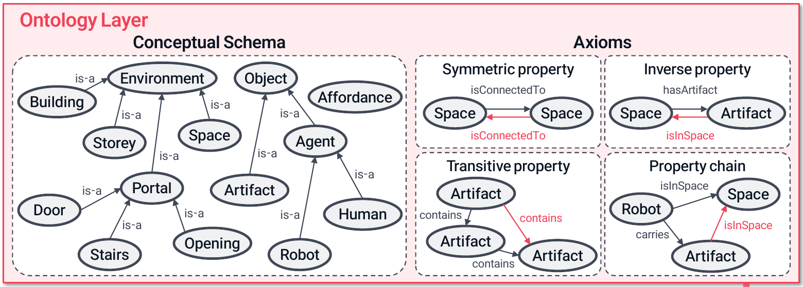

<!-- slide 1 · Semantic ontologies -->

<!-- _class: title -->
<!-- _paginate: false -->

SCE Working Group 1 &middot; Project A &middot; October 2026

# Semantic ontologies

## Primer for SCE WG1

<u> Matt McKay & Akshay Shanker</u>

---

<!-- slide 2 · Communicating with AI -->
<!-- _class: airy2 -->

## Communicating with AI

AI. AI can now write code, solve hard mathematical problems and translate papers into code.

Humans. We need a shared structure for what an AI "understands", in order to:
1. **agree on the meaning** of a paper, a model or a model description;
2. **inspect and verify** what the AI produces;
3. **extend** the set of problems the AI can solve.

---

<!-- slide 3 · Semantics ≠ text -->
<!-- _class: airy -->

## Meaning as a relation to a domain

Semantics. Meaning is a relation between a piece of text and something outside language, its domain.
 
Missing meaning. A system trained only on form, such as text, has no way to learn the relation between the text and its meaning (Bender and Koller 2020).

A large language model fills in the meaning statistically, from regularities in its training text, with no explicit structure that a reader can inspect.

Bender and Koller (2020), <a href="https://aclanthology.org/2020.acl-main.463/">“Climbing towards NLU”</a>, ACL.

---

<!-- slide 4 · Semantic ontology -->
<!-- _class: airy2 -->

## Semantic ontology

Knowing what each symbol refers to is not enough.

Ontology. To understand a statement, we also need the relations between objects of different kinds.

Semantic ontology. **A semantic ontology is a machine-readable account of objects, the kinds they belong to and the valid relations between them.**

Signatures state the types of a relation's arguments and the input and output types of an operation.

---

<!-- slide 5 · Three parts to a semantic ontology -->
<!-- _class: roomy -->

## Three parts to a semantic ontology

$$
\text{written form}\ \xrightarrow{\quad\Upsilon\quad}\ \text{domain of meaning}
$$

1. The written form. The written form consists of machine-readable symbols, each with a type and a signature, such as $v : X \to \mathbb{R}$. In this deck a type labels a symbol in the written form, whereas a kind sorts the objects in the domain.

2. The domain of meaning. The objects we model, such as state spaces, probability laws, value functions and operators, are sorted into kinds with relations between them.

3. The map Υ (upsilon). Υ maps each typed symbol to an object of the matching kind. A program, called the checker in this deck, checks that the assigned object has the required kind. For a stage file the checker is the elaborator (slide 24), for an OWL ontology a reasoner (slide 6).

<strong>Example from AI training.</strong> Under NVIDIA’s TensorFloat-32 (TF32) mode, a matrix of 32-bit floating-point numbers (<code>float32</code>) can change when multiplied by the identity, because the inputs are rounded before the multiplication. An ontology of the arithmetic would state the <strong>written form</strong> (the declared type and the arithmetic setting), the <strong>domain of meaning</strong> (the machine values and the rounded operations) and <strong>Υ</strong> (which setting the symbols are read under), so that humans and AI tools compute under the same arithmetic assumptions.

Harel and Rumpe (2004), "Meaningful modeling: what's the semantics of 'semantics'?", <em>Computer</em> 37(10), 64–72, for the three parts &middot; Bellman calculus, Introduction §1 (bellman-ddsl/docs) &middot; in this deck a type belongs to the written form and a kind to the domain; Guizzardi and Guarino (2024) write "type" for what the deck calls a kind, and keep "kind" for a narrower notion. &middot; <a href="https://docs.pytorch.org/docs/2.14/notes/numerical_accuracy.html">PyTorch, “Numerical accuracy”, TF32 section</a> &middot; Stosic and Micikevicius (NVIDIA, 2021), <a href="https://developer.nvidia.com/blog/accelerating-ai-training-with-tf32-tensor-cores/">“Accelerating AI Training with NVIDIA TF32 Tensor Cores”</a>.

---

<!-- slide 6 · Ways to represent and use an ontology -->

## Ways to represent and use an ontology

Formal mathematics is one way to write an ontology down, though the mathematics as usually written leaves its conventions implicit (slides 19–21). The table lists the forms in use.

| Form or use | What it makes explicit | Examples in this deck |
|:---|:---|:---|
| **Typed mathematical theory** | Types, the signatures of operations and the laws they satisfy. | Math-in-the-Middle (slide 9); the Bellman calculus, which Bellman-SYM writes down (slide 23); mathlib, the library of the proof assistant Lean. |
| **Ontology axioms, in OWL** | A checkable statement about classes (OWL’s word for kinds) or named individuals. In OWL, the ontology language of the W3C, the web standards body, `SubClassOf(:Bond :TradableDebtInstrument)` states that every bond is a tradable debt instrument. | FIBO, the finance ontology (slide 43); OntoPlan (slide 13). |
| **Graph** | Object identifiers, their types and the relations between them, each statement a triple of subject, predicate and object, as in RDF, the W3C’s graph model. | OntoPlan’s world model, the facts about a simulated environment stored as RDF triples (slide 13). |
| **Annotations on models or data** | Links from variables or objects to the terms of an ontology. | SemGen’s biological models (slide 9); NVIDIA’s scene objects (slide 8). |

<strong>What an axiom does.</strong> Given the axiom above and <code>ClassAssertion(:Bond :b)</code>, that b is a bond, a reasoner, the program that draws consequences from axioms, infers <code>ClassAssertion(:TradableDebtInstrument :b)</code>.

The forms combine, since OWL axioms and annotations can both be stored as RDF graphs. In every form, Υ interprets the written symbols in the domain of meaning.

<a href="https://kwarc.info/people/frabe/Research/ODK_interop_17.pdf">Kohlhase et al. (2017), §§2–3</a> &middot; <a href="https://leanprover-community.github.io/mathlib-overview.html">Lean/mathlib overview</a> &middot; W3C: <a href="https://www.w3.org/TR/owl2-overview/#Ontologies">OWL 2 overview</a> and <a href="https://www.w3.org/TR/rdf11-concepts/#data-model">RDF graph model</a>; <a href="https://www.w3.org/TR/owl2-primer/">OWL 2 Primer, §§3, 4.1–4.2</a> (syntax and inference) &middot; <a href="https://arxiv.org/html/2610.07649v1">Nam et al. (2026), §3.1</a> &middot; <a href="https://pmc.ncbi.nlm.nih.gov/articles/PMC6499248/">Neal et al. (2019), §2</a> &middot; <a href="https://nvidia-omniverse.github.io/usd-validation-nvidia/specs/capabilities/semantic_labels/capability-semantic_labels.html">NVIDIA, semantic labels</a>. RDF represents statements as subject–predicate–object triples, the predicate naming a relation. The OWL snippets use Functional-Style Syntax, with “:” abbreviating FIBO’s namespace.

---

<!-- slide 7 · The scope depends on the field and the task -->

## The scope depends on the field and the task

**Domains of meaning vary by field.** Examples include genes and biological processes, objects and actions in robotics, and different economic models, methods, data and problems.

**One domain can support several ontologies.** In computational economics, separate ontologies may describe Bellman problems, specify the data inputs to estimation, state numerical assumptions in solvers, or define relations among countries, goods and trade flows.

**For an economics project.** An ontology can specify value functions and valid compositions of operators; specify the parameter space, data requirements and identifying assumptions of an estimation problem; or link a dataset column to a shared definition of annual consumption per household and its units.

<strong>WG1’s task.</strong> Define the scope for computational economics by deciding which objects, relations and operations our ontologies should describe and which tasks they should support.

On choosing an ontology’s domain, purpose and scope: Noy and McGuinness (2001), <a href="https://protege.stanford.edu/publications/ontology_development/ontology101-noy-mcguinness.html"><em>Ontology Development 101</em></a>, §3, Step 1. The computational-economics uses above are illustrative.

---

<!-- slide 8 · Semantic ontologies and formal methods in AI -->

## Semantic ontologies and formal methods in AI

| Use | Published finding | Source |
|:---|:---|:---|
| AI training data (NVIDIA) | NVIDIA’s Omniverse simulation platform labels scene objects with identifiers from Wikidata, a public knowledge base, through the semantic-label schema of the OpenUSD scene format. The labels give AI training data its object categories. | <a href="https://nvidia-omniverse.github.io/usd-validation-nvidia/specs/capabilities/semantic_labels/capability-semantic_labels.html">NVIDIA specification</a> <a href="https://openusd.org/dev/api/usd_semantics_overview.html">OpenUSD schema</a> |
| Robot planning (OntoPlan) | OntoPlan achieved **89% task success**, against **27%** for SayPlan, a comparison system given the same scene facts. | <a href="https://arxiv.org/html/2610.07649v1">Nam et al. (2026)</a> NeurIPS (accepted) |
| Robot experience (KnowRob) | The KnowRob knowledge system used an ontology to retrieve grasp poses and forces from recorded robot actions. | <a href="https://www.open-ease.org/papers/beetz18knowrob.pdf">Beetz et al. (2018)</a> ICRA |
| AI program translation | Training a code model to emit symbolic expressions for numeric constants, which a rule-based interpreter converts to IEEE-754 values, raised the share of C functions whose generated assembly passed input–output tests from **3.8% to 92.6% on 21,104 functions**. | <a href="https://aclanthology.org/2024.findings-emnlp.55/">Zhang et al. (2024)</a> EMNLP Findings |
| AI theorem proving (LeanDojo) | Retrieving existing Lean library results raised proof success from **23.2% to 26.3% on 2,000 theorems** requiring results not used in training. | <a href="https://proceedings.neurips.cc/paper_files/paper/2023/hash/4441469427094f8873d0fecb0c4e1cee-Abstract-Datasets_and_Benchmarks.html">Yang et al. (2023)</a> NeurIPS |
| Numerical checking (SMT-LIB) | SMT-LIB, a standard input language for automated reasoners, defines floating-point types, operations and rounding modes, so that a reasoner can check a floating-point computation. | <a href="https://smt-lib.org/papers/BTRW15.pdf">Brain et al. (2015)</a> IEEE ARITH |

Reported AI gains concern the combined systems described in each paper.

---

<!-- slide 9 · Evidence – shared models and operational uses -->

## Evidence: shared models and operational uses

| Use | Published finding | Source |
|:---|:---|:---|
| Factory planning | Software converted an existing factory ontology and machine-operation descriptions into **267 planning actions in about 15 seconds**. | <a href="https://doi.org/10.1016/j.engappai.2023.106727">Malburg et al. (2023)</a> Eng. Appl. AI |
| Assembly planning (Ford) | Ford’s deployed assembly-planning AI used an ontology to interpret vehicle-build instructions and to share that knowledge with other applications. | <a href="https://ojs.aaai.org/index.php/AAAI/article/view/19071">Rychtyckyj et al. (2016)</a> IAAI |
| Materials data (MDS-Onto) | MDS-Onto defines terms for X-ray and solar-energy measurements, which software uses to generate data templates and machine-readable datasets. | <a href="https://doi.org/10.1038/s41597-025-04938-5">Rajamohan et al. (2025)</a> Scientific Data |
| Model composition (SemGen) | SemGen used ontology terms to match variables by biological meaning and combine models in different formats. | <a href="https://pmc.ncbi.nlm.nih.gov/articles/PMC6499248/">Neal et al. (2019)</a> Bioinformatics |
| Arterial-model assembly | SemGen merged semantically annotated bond-graph modules, whose junction laws conserve mass and energy, into an **86-vessel arterial model from three templates**. | <a href="https://doi.org/10.1371/journal.pcbi.1008859">Shahidi et al. (2021)</a> PLOS Comput. Biol. |
| Biological inference (GO-CAM) | Gene Ontology uses logical rules to infer additional labels for gene functions and distributes them in standard releases. | <a href="https://doi.org/10.1038/s41588-019-0500-1">Thomas et al. (2019)</a> Nature Genetics |
| Mathematical software | A shared mathematical ontology, Math-in-the-Middle, let three computer-algebra systems, SageMath, GAP and Singular, each perform a step of one polynomial calculation. | <a href="https://doi.org/10.1007/978-3-319-72453-9_14">Kohlhase et al. (2017)</a> MACIS |

Factory conversion reuses an existing ontology. Arterial-model assembly combines semantic annotations with physical constraints.

---

<!-- slide 10 · Case studies (divider) -->

<!-- _class: divider -->

# Case studies

---

<!-- slide 11 · OntoPlan – robot task planning (divider) -->

<!-- _class: divider sub -->

Case study 1 of 3

# OntoPlan: robot task planning

---

<!-- slide 12 · Motivating example from robotics -->

## Motivating example from robotics

Nam et al. (2026), accepted at NeurIPS 2026.

OntoPlan combines a language model with planning software for indoor robot tasks in symbolic simulation. Its ontology defines object types, relations and inference rules, while a matching action model specifies what each action changes.

Illustrative task. Move a toothbrush from a cabinet to another room.

| Model component | Toothbrush example |
|:---|:---|
| Objects and types | The toothbrush and the cabinet have type **Artifact** (physical object), while the room has type **Space**. |
| Relation | The toothbrush is inside the cabinet. |
| Action effect | After pickup, the toothbrush is held by the robot’s hand and is no longer inside the cabinet. |
| Inference rule | A carried object is in the same room as the robot. |

The language model and the planning software work from the same objects, types and updated relations.

Nam et al. (2026), <a href="https://arxiv.org/html/2610.07649v1">OntoPlan</a>, §3.1 and Appendix A, Table 7. The task illustrates the paper’s state updates.

---

<!-- slide 13 · OntoPlan’s ontology defines object types and rules -->

## OntoPlan’s ontology defines object types and rules

<figure class="ontology-figure">

<figcaption><strong>Written form.</strong> The diagram shows type names and logical rules. <strong>Domain of meaning.</strong> The names and rules describe the simulated rooms, robots, objects and relations. <strong>Υ.</strong> It interprets <code>Space</code> as the set of spaces and <code>carries</code> as the relation between a robot and the objects it carries.</figcaption>
</figure>

Nam et al. (2026), <a href="https://arxiv.org/html/2610.07649v1">OntoPlan</a>, Figure 2, ontology layer (cropped). The <a href="https://github.com/namhyeongwoo/OntoPlan/blob/main/figures/world_model.png">full figure</a> also shows rooms, objects and their states. Υ is this deck’s notation for interpretation.

---

<!-- slide 14 · Ontology-based planning achieved 89% task success -->
<!-- _class: airy -->

## Ontology-based planning achieved 89% task success

The same study compared three AI planning systems on 150 simulated robot tasks. All used GPT-4o, the same scene facts and the same 16 primitive actions, and their plans were checked against the same preconditions and effects.

| System | Success rate |
|:---|:---|
| OntoPlan | **88.7% (133/150)** |
| SayPlan | 27% |
| DELTA | 13% |

OntoPlan retrieves the relevant facts, constructs the plan and records the consequences of each action. DELTA also had formal action rules and plan-constructing software, which means that formal rules alone do not account for OntoPlan's gain.

Nam et al. (2026), <a href="https://arxiv.org/html/2610.07649v1">OntoPlan</a>, §§4–5 and Appendix E. Results evaluate the ontology together with fact retrieval and planning software.

---

<!-- slide 15 · OntoPlan kept AI inputs small as scenes grew -->
<!-- _class: airy2 -->

## OntoPlan kept AI inputs small as scenes grew

Within OntoPlan, the authors compared selecting relevant facts with supplying all scene facts as text.

| Facts supplied to AI | Growth in the largest input |
|:---|:---|
| Relevant facts selected from the ontology | **1.06×** |
| All scene facts supplied as text | **8.13×** |

Task success was 89% with selected facts and 87% with all facts, a difference that was not statistically significant.

Nam et al. (2026), <a href="https://arxiv.org/html/2610.07649v1">OntoPlan</a>, Table 6. Ratios compare large with small scenes. Input size counts tokens (text units) in the largest single call per task.

---

<!-- slide 16 · Buffer-stock saving (divider) -->

<!-- _class: divider sub -->

Case study 2 of 3

# Buffer-stock saving

---

<!-- slide 17 · A mathematical description of a model -->
<!-- _class: roomy -->

## A mathematical description of a model

This case shows that a machine reading a mathematical description of a model misses part of its meaning. Consider an excerpt from a written statement of the buffer-stock saving model:

> Each period the household arrives with assets $k_t$, receives income $y_t$ and earns the gross return $R\,k_t$ on those assets, where $R$ is the gross interest factor. Market resources are then $m_t=R\,k_t+y_t$. Income is i.i.d. with $\log y_t\sim N(\mu_y,\sigma_y^2)$. The household chooses consumption $c_t\in(0,m_t]$, leaving $k_{t+1}=m_t-c_t$, to solve the Bellman equation
> $$v_t(m_t)=\max_{0<c_t\le m_t}\;\Big\{u(c_t)+\beta\,\mathbb{E}_t\,v_{t+1}\big(R\,(m_t-c_t)+y_{t+1}\big)\Big\}.$$
> The right-hand side defines an operator $\mathbb{T}$ with $v_t=\mathbb{T}\,v_{t+1}$, which sends the function $v_{t+1}$ to the function $v_t$, backward from a given terminal value over a finite horizon.

---

<!-- slide 18 · Context -->
<!-- _class: roomy -->

## Context

Implicit context. Economists write code that implements $\mathbb{T}$ from their own understanding of dynamic programming, which the statement leaves implicit.

By itself, machine reading the statement does not give enough information to build $\mathbb{T}$.
- The difficulty is not one of parsing. A machine parses the statement, that is, splits it by grammar rules alone into a parse tree of its symbols, whereas the tree, with no structure added to its symbols, records nothing of the model's meaning. <a href="#the-parse-tree-of-a-written-statement" class="c-red">See the appendix on parse trees.</a>

- A semantic ontology makes that implicit understanding explicit.

---

<!-- slide 19 · The missing-meaning problem -->
<!-- _class: roomy -->

## The missing-meaning problem

The tables on this slide and the next two list some of the meaning that a parse of the buffer-stock statement misses.

| Missing meaning | In the buffer-stock statement |
|---|---|
| Variable bindings | The maximisation binds $c_t$, while the expectation binds $y_{t+1}$. The left-hand side binds $m_t$ by defining $v_t$ as a function of $m_t$, which leaves $m_t$ free inside the right-hand side. |
| Parameters | The paper defines $u$, $R$, $\beta$ and the law of $y_{t+1}$ elsewhere, in no fixed place. Of these, only $\beta$ and $R$ are numbers, while $u$ is a function and the law is a probability measure, a difference the statement does not show. |
| Symbol types | The value function $v_t$ maps $\mathbb{R}_{++}$ to $\mathbb{R}$, with $m_t$ a point of its domain. The tree records both symbols but not that $v_{t}(m_{t})$ evaluates a function at a point of a particular type. |
| An equation between functions | For each $m_t$ the Bellman equation equates two numbers. Over all $m_t$ it is one equation between functions, $v_t=\mathbb{T}\,v_{t+1}$, in which $\mathbb{T}$ maps $v_{t+1}$ to $v_t$. |

---

<!-- slide 20 · The missing-meaning problem -->
<!-- _class: airy2 -->

## The missing-meaning problem

| Missing meaning | In the buffer-stock statement |
|---|---|
| Whether a symbol is a variable, a function, or a random variable | The symbol $m_t$, defined by $m_t=R\,k_t+y_t$, is i) the path of one household's resources, ii) the function $(k,y)\mapsto Rk+y$ composed inside the operator, and iii) the random variable whose law is the cross-sectional distribution. A paper writes one symbol for all three meanings, whereas code must represent them as three objects of different types with different uses. |
| Shock law | The statement fixes $\log y_t\sim N(\mu_y,\sigma_y^2)$. In the shorter form $y\sim\mathrm{LogNormal}(\mu_y,\sigma_y)$, $\mu_y$ denotes the mean of $\log y$ under one convention and the mean of $y$ under another. |

The LogNormal convention: Project Bellman (the authors' project, slide 23), reference page "Shock distributions".

---

<!-- slide 21 · The missing-meaning problem -->
<!-- _class: airy2 -->

## The missing-meaning problem

| Missing meaning |In the buffer-stock statement  |
|---|---|
| Implications of timing stated in words | In a model with entry, beyond the excerpt of slide 17, the sentence "A policy shock raises entrants at date $t$" is satisfied by two different models, because the shock may reach the cross-sectional distribution at $t$ or at $t+1$, while nothing in the paper records which one the code computes. |
| What the household knows when it decides | If the return $R_t$ is random, persistent and drawn before the decision, the household's expectation of $R_{t+1}$ depends on whether it observes $R_t$ or only $m_t=R_t\,k_t+y_t$ when it decides. |

The timing example: Project A proposal, footnote 1.

---

<!-- slide 22 · Multiple possible parsed meanings -->
<!-- _class: airy -->

## Multiple possible parsed meanings

Several readings. One well-formed statement admits two or more readings of its parse tree. <a href="#what-the-expectation-integrates" class="c-red">The appendix</a> gives examples of false agreement, in which two readers accept the same statement and compute different models.

Human readers. False agreement rarely arises when an economist reads the model. An economist has been taught that $m_t$ in $v(m_t)$ is the point at which $v$ is evaluated, not a path of assets across a population.

Timing and information. Even so, the timing of events and what the household knows at each decision confuse economists themselves.

AI readers. When we rely on an AI's statistical reading of the text, we cannot be sure that it has read the model correctly, even when its reading appears correct most of the time.

---

<!-- slide 23 · The ontology – one stage of the buffer-stock model -->

## The ontology: one stage of the buffer-stock model

The stage file, which writes one stage (the decision problem of one period) in Bellman-SYM, the model language of Project Bellman (the authors’ project), is the <strong>written form</strong>. Its <strong>domain of meaning</strong> contains state spaces, probability laws, value functions and operators. <strong>Υ</strong> maps each declaration and block to the mathematical object it denotes.

Perches. A perch is one of the three information sets of the stage: arrival `!arvl`, decision `!dcsn` and continuation `!cntn`.

Fields. A field is a state or a value declared at a perch together with its set, as in `m : ℝ₊₊ @ !dcsn`. The role tags `!ctrl` and `!vlu` mark a chosen variable and a value.

Blocks. A block holds the equations between two perches: the transition with the shock, whose law line `y ~ LogNormal(μ_y, σ_y)` declares its distribution, the choice in the `[id=policy]` block, and the expectation.

Bellman-SYM, Stages §§1–4: the documentation example, whose b and w are written here as the calculus’s k and m (Bellman calculus, Stages and perches §1, bellman-ddsl/docs) &middot; the law line fixes the convention that slide 20 left to a subfield.

---

<!-- slide 24 · What the ontology checks and makes explicit -->

## What the ontology checks and makes explicit

Under Υ (upsilon), each field and block of the file denotes a typed object. The role tag `!vlu` marks a value. The marks `[>]` and `[<]` give the continuation and arrival values, written $v_\succ$ and $v_\prec$ below. $\mathsf{V}$, $\mathsf{V}_\succ$ and $\mathsf{V}_\prec$ denote the spaces of value functions at the decision, continuation and arrival perches. The elaborator, the program that constructs those objects, refuses a line that the types do not admit and names the rule.

| Line in the file | Under Υ it denotes |
|---|---|
| `V[>] : ℝ @ !vlu` at the continuation perch | $v_\succ:\mathbb{R}_+\to\mathbb{R}$, a function of savings, never a number |
| the choice block `[id=cntn_to_dcsn]` with its `[id=policy]` block | $\mathbb{T}_\succ:\mathsf{V}_\succ\to\mathsf{V}$, the choice operator |
| the expectation block `[id=dcsn_to_arvl]` | $\mathbb{T}_\prec:\mathsf{V}\to\mathsf{V}_\prec$, the expectation operator |

| A line that | The elaborator |
|---|---|
| adds the shock outside its own expectation, `V[<] = E_{y}(V) + y` | refuses it under `shock-reintroduced`, since $y$ is not known at arrival |
| lists a continuation value at the decision perch | refuses it under `field-perch`, since the value is a function of savings |
| puts the mean of the shock in the transition, `m = R*k + exp(μ_y + σ_y^2/2)` | accepts it, leaving the different model visible on that line |
| writes a second `β` in the expectation block | accepts it, leaving the second `β` visible on its own line |
| would impose a stationary closure $v_{t+1}=v_t$ | has no line for it, since `V[>]` comes from the next period or the terminal value |

The reference on refusals, rules shock-reintroduced and field-perch; Bellman-SYM, Field equations §5, Perch tagging rules §3, Periods §§2–3, Trellises §2; the runs of <code>elaborate_text</code> of 13 October 2026.

---

<!-- slide 25 · Pig goes to the library (divider) -->

<!-- _class: divider sub -->

Case study 3 of 3

# Pig goes to the library

---

<!-- slide 26 · What the pig learned in the library -->

## What the pig learned in the library

&copy; Tom Gauld, reproduced in Guizzardi and Guarino (2024), "Explanation, semantics, and ontology", <em>Data &amp; Knowledge Engineering</em> 153, 102325, Figure 1; shown here for discussion within the working group.

---

<!-- slide 27 · The set-theoretic semantics is not enough -->

## The set-theoretic semantics is not enough

What must a reader know to understand the joke?

Set-theoretic semantics. A function from each word to a subset of a set $D$ of individuals gives the denotations $\llbracket\mathit{ham}\rrbracket,\ \llbracket\mathit{bacon}\rrbracket,\ \llbracket\mathit{sausages}\rrbracket\subseteq D$, the sets of things each word applies to. Such a mapping, Guizzardi and Guarino (2024) say, "would not do Maurice here any good".

Ontology. The kinds and relations the words are about form a separate system, which the paper states as three facts. Ham, bacon and sausage are food products constituted by pork. Pork comes from a pig. Maurice is a pig.
- In the deck's notation: $\mathit{Maurice}:\mathsf{Pig}$, $\ \mathsf{Ham}\sqsubseteq\exists\mathit{constitutedBy}.\mathsf{Pork}$ (every ham is constituted by some pork), $\ \mathsf{Pork}\sqsubseteq\exists\mathit{dependsOn}.\mathsf{Pig}$ (every quantity of pork comes from some pig).
- The library holds these three facts, which a dictionary does not.

The joke here arises from the system of kinds and relations, not from the set-theoretic semantics.

Guizzardi and Guarino (2024), "Explanation, semantics, and ontology", <em>Data &amp; Knowledge Engineering</em> 153, 102325, &sect;2.1: the quotation, and the three facts (1)–(3) that understanding the cartoon needs, stated there in words; the symbols are the deck's.

---

<!-- slide 28 · When Maurice learns the ontology -->

## When Maurice learns the ontology

Above the line stand the words, the <strong>written form</strong>. Below it stand the kinds, individuals and relations, the <strong>domain of meaning</strong>. The dashed arrows are <strong>Υ</strong>, which assigns each word its meaning. The solid arrows state relations between kinds and do not identify Maurice as the source of any particular ham.

Guizzardi and Guarino (2024), &sect;2.1: "Mapping the words 'ham', 'bacon' and 'sausages' to subsets of a semantic domain would not do Maurice here any good"; the three facts (1)&ndash;(3); real-world semantics "maps symbols to the entities (types, relations, objects, events, aspects) that are part of this ontology".

---

<!-- slide 29 · Semantics and Ontology -->

## Semantics and ontology

Semantics. A set-theoretic semantics maps each word to a subset of a set $D$ of individuals, $\llbracket\mathit{ham}\rrbracket\subseteq D$, and nothing more.

Ontology. The ontology is a separate system of kinds, individuals and relations, written as typed symbols.
- Kinds: $\mathsf{Pig},\ \mathsf{Pork},\ \mathsf{Ham},\ \mathsf{Bacon},\ \mathsf{Sausage}$. The word $\mathit{ham}$ names the kind $\mathsf{Ham}$, whose instances are the individual hams.
- Individual: $\mathit{Maurice}:\mathsf{Pig}$. A typed symbol pairs a symbol with the kind of what it names. Here the colon is the instantiation relation, which holds between the individual Maurice and the kind $\mathsf{Pig}$.
- Relations: $\mathit{constitutedBy}$, a relation from $\mathsf{Ham}$ to $\mathsf{Pork}$, and $\mathit{dependsOn}$, a relation from $\mathsf{Pork}$ to $\mathsf{Pig}$. Each holds between individuals of its two kinds and is not a function from one kind to the other. The kind-level facts $\mathsf{Ham}\sqsubseteq\exists\mathit{constitutedBy}.\mathsf{Pork}$ and $\mathsf{Pork}\sqsubseteq\exists\mathit{dependsOn}.\mathsf{Pig}$ say that every ham is constituted by some pork and that every quantity of pork comes from some pig.

| | The pigs | The buffer-stock model |
|---|---|---|
| Written form | $\mathit{ham},\ \mathit{bacon},\ \mathit{sausages}$ | $m,\ y,\ \mathbb{E},\ v,\ \mathbb{T}$ in the Bellman equation |
| Semantics, $\llbracket\cdot\rrbracket$ into a set | $\llbracket\mathit{ham}\rrbracket,\ \llbracket\mathit{bacon}\rrbracket,\ \llbracket\mathit{sausages}\rrbracket\subseteq D$ | $\llbracket\text{Bellman equation}\rrbracket=\mathbb{T}$, some operator |
| Left open | foods for pigs, or foods from pigs | which variable $\max$ chooses and which $\mathbb{E}$ averages over, the space of $v$, the law and timing of $y$ |
| Ontology, typed statements | $\mathit{Maurice}:\mathsf{Pig}$, $\mathsf{Ham}\sqsubseteq\exists\mathit{constitutedBy}.\mathsf{Pork}$, $\mathsf{Pork}\sqsubseteq\exists\mathit{dependsOn}.\mathsf{Pig}$ | $v:\mathbb{R}_{++}\to\mathbb{R}$, $\ y:\mathbb{R}_{++}$ with law $\nu_y$, $\ \mathbb{T}:(\mathbb{R}_{++}\to\mathbb{R})\to(\mathbb{R}_{++}\to\mathbb{R})$ |
| False agreement | two pigs agree that the words name foods, one meaning foods for pigs and the other foods from pigs | two readers accept the Bellman equation and disagree on the timing of the response to a shock (slide 21) |

Guizzardi and Guarino (2024), "Explanation, semantics, and ontology", <em>Data &amp; Knowledge Engineering</em> 153, 102325, &sect;2.1 (semantics as a function; an ontology as "a specific theory about the kinds of entity and their ties"; types, individuals and instantiation, where &sect;2.1 writes "the type Pig" for what the deck calls a kind and &sect;3 keeps "kind" for a type whose instances keep their identity; the facts (1) and (2) are stated there in words and written above in the deck's notation), &sect;3.4 (false agreement).

---

<!-- slide 30 · Current modelling tools and AI (divider) -->

<!-- _class: divider -->

# Current modelling tools and AI

Dynare and other tools already turn model descriptions into computed results.

---

<!-- slide 31 · What Dynare and other modelling tools do -->
<!-- _class: roomy -->

## What Dynare and other modelling tools do

Dynare and Dolo read a model description and apply a numerical method to it, as a program in R or Stata calls a numerical routine. In the figure, the lower route is this computation, carried out in the tool’s own language and modelling rules.

With a shared economic interpretation. The upper route states the interpretation separately. Υ maps the written model to a typed model object, ⟦file⟧, to which Ρ (rho) then attaches a numerical method.

Conceptual routes in this deck’s notation: Υ denotes a separately stated, shared economic interpretation. Compilers can already perform semantic checks. Dynare represents equations separately from solution commands. <a href="https://clang.llvm.org/docs/CommandGuide/clang.html#description">Clang documentation</a> &middot; <a href="https://www.dynare.org/manual/the-model-file.html#model-declaration">Dynare manual</a> &middot; <a href="https://www.econforge.org/dolo.py/">Dolo documentation</a> &middot; Bellman calculus, Introduction §1.

---

<!-- slide 32 · What AI needs beyond code compilation -->
<!-- _class: airy -->

## What AI needs beyond code compilation

Successful compilation or execution does not establish agreement with the intended economic model.

Shared definitions. Give the AI an ontology that specifies the economic objects, their units, timing and relations.

Links to code. Identify the variables and functions that implement each shared economic definition.

Checks on model agreement. Check declarations against the ontology, review the links to code, and test the numerical results.

<strong>Example.</strong> Shared definitions distinguish assets chosen today from resources after tomorrow’s income shock, even though both are stored as floating-point numbers.

Υ interprets the declared symbols as economic objects. Reviewing their implementation is a separate task. Proposed requirements for AI model generation and translation. Precedent for shared definitions and mappings: <a href="https://kwarc.info/people/frabe/Research/ODK_interop_17.pdf">Kohlhase et al. (2017), MACIS, §§2–5</a>.

---

<!-- slide 33 · The community library (divider) -->

<!-- _class: divider -->

# The community library

---

<!-- slide 34 · One model, several numerical implementations -->
<!-- _class: roomy -->

## One model, several numerical implementations

QuantEcon’s community library asks each toolkit to implement a shared model and calibration with its own solution method, in a runnable tutorial.

| Part of a contribution | Buffer-stock example |
|:---|:---|
| Common economics | Equations, timing, shock laws, normalisation and calibration. |
| Implementation choices | Solution method, shock approximation, grids, interpolation and software version. |
| Comparison quantities | Consumption, target resources, marginal propensities to consume and the seven model conditions listed in the submission guide. |

The starting point is the buffer-stock description and the tutorial in the HARK toolkit, submitted as <a href="https://github.com/QuantEcon/community-library/pull/5">pull request #5</a> (a proposed addition to the library’s repository), open with changes requested.

<a href="https://quantecon.github.io/community-library/">Community Library</a> &middot; <a href="https://github.com/akshayshanker/community-library/blob/e0452585392965c41f90a98a77a94b185f3501e7/models/buffer-stock/README.md">Buffer-stock submission guide</a>. The result tables, metadata format and tolerances are optional draft conventions. Reporting requirements remain under discussion. Status checked 15 October 2026.

---

<!-- slide 35 · Link toolkit variables to shared model definitions -->
<!-- _class: airy2 -->

## Link toolkit variables to shared model definitions

| Published precedent | What was done |
|:---|:---|
| SemGen | Ontology annotations matched biological quantities across different model formats. |
| Math-in-the-Middle | Symbols from SageMath, GAP and Singular were mapped to shared mathematical definitions. |
| BioModels, a curated database of biological models | Curators annotated model entities and reproduced published simulations. |

**Proposed for the library.** Link each implementation’s variables and operations to agreed economic definitions. The links align the written terms. Interpreting those terms as economic objects is what **Υ** does.

<a href="https://pmc.ncbi.nlm.nih.gov/articles/PMC6499248/">Neal et al. (2019), <em>Bioinformatics</em>, §§2–5</a> &middot; <a href="https://kwarc.info/people/frabe/Research/ODK_interop_17.pdf">Kohlhase et al. (2017), MACIS, §§2–5</a> &middot; <a href="https://pubmed.ncbi.nlm.nih.gov/31701150/">Malik-Sheriff et al. (2020), <em>Nucleic Acids Research</em></a>. The library extension is proposed; the papers establish the precedents.

---

<!-- slide 36 · Define the quantity before comparing the numbers -->
<!-- _class: roomy -->

## Two estimates of one defined quantity

In the buffer-stock description, **target resources** are the level of resources, measured relative to permanent income, at which expected next-period resources equal current resources.

| Points in the income-shock approximation, besides the zero-income point | Saved HARK estimate of target resources |
|:---|:---|
| 7 | **1.3910** |
| 21 | **1.3994** |

The same model and calibration give different numerical estimates when the shock approximation changes.

<strong>Proposed extension.</strong> Each result would declare its model version, quantity definition, normalisation and numerical settings. Reviewers would check these declarations against the code and numerical results.

<a href="https://github.com/akshayshanker/community-library/blob/e0452585392965c41f90a98a77a94b185f3501e7/projects/HARK/BST/checks/sensitivity.md">Saved HARK sensitivity study, §3</a> &middot; <a href="https://github.com/akshayshanker/community-library/blob/e0452585392965c41f90a98a77a94b185f3501e7/models/buffer-stock/model-description.md">Quantity definition, §1</a>. Both calculations retain the same additional zero-income outcome and asset grid. These are saved estimates, not a new computation.

---

<!-- slide 37 · Use the library to test WG1’s common definitions -->
<!-- _class: airy2 -->

## Use the library to test WG1’s common definitions

**Proposed pilot.** Start with the full buffer-stock description and the HARK contribution before adding a second toolkit.

**Task.** Ask an AI to identify comparable results and report differences in numerical settings.

**Comparison.** Compare the AI’s answers with and without semantic annotations, using the same complete model statement, equations, calibration and run information. Record correct matches, incorrect matches and cases requiring review.

The library supplies the worked examples from which WG1 can decide which definitions and checks to share.

Proposed pilot, not an existing library feature. The annotations restate supplied facts. The full buffer-stock model includes permanent and transitory shocks. The earlier Bellman stage illustration is simplified.

---

<!-- slide 38 · Appendix (divider) -->

<!-- _class: divider -->

# Appendix

---

<!-- slide 39 · Further examples (divider) -->

<!-- _class: divider sub -->

Appendix

# Further examples

---

<!-- slide 40 · Biology – the Gene Ontology -->

## Biology: the Gene Ontology

Written formMap ΥDomain of meaning

Excludes. The ontology excludes three misreadings. A missing annotation may not be read as the absence of a function, under the open-world assumption, which treats an absent statement as unknown rather than false. A NOT qualifier, which records that a gene lacks a function, may not be read as an inconclusive result. A term may not be read by its name rather than by its definition and relations, since a label must be unique and a definition must always denote the same referents (principles 12 and 19 of the OBO Foundry, the body that sets the rules for biomedical ontologies).

For economics. A model's object is named by a term with a definition and relations, not by a variable name. The role tags `!ctrl` and `!vlu` and the law line of a stage file play that part, as the `sboTerm` of the Systems Biology Ontology does for a rate law in SBML, the exchange format for biochemical models.

Ashburner et al. (2000), "Gene Ontology: tool for the unification of biology", <em>Nature Genetics</em> 25(1), 25–29 &middot; The Gene Ontology Consortium (2026), "The Gene Ontology knowledgebase in 2026", <em>Nucleic Acids Research</em> 54(D1), D1779–D1792, Table 3 (the release of 22 July 2025) &middot; GAF 2.2 documentation and the human annotation file of 21 May 2026 (geneontology.org); the go-ontology build file, which runs the ELK reasoner &middot; SBO: Courtot et al. (2011), <em>Molecular Systems Biology</em> 7, 543.

---

<!-- slide 41 · Engineering – OntoCAPE, the ontology for chemical process engineering -->

## Engineering: OntoCAPE, the ontology for chemical process engineering

Written formMap ΥDomain of meaning

Excludes. The ontology excludes a model confused with the system it models and a model variable confused with the physical quantity it stands for. The relation `models` joins a model to its system, while `correspondsToQuantity` pairs a variable with a quantity, as a declared domain excludes the deck's function on the wrong space (slide 50).

For economics. OntoCAPE is the nearest case to Project A because it is an ontology of models themselves. Model variables, equation systems and solution strategies are kinds in its modules (its sub-ontologies), so that a process model and its solver are distinct typed objects, as Υ and Ρ keep a model apart from its numerical method.

Morbach, Yang and Marquardt (2007), "OntoCAPE—A large-scale ontology for chemical process engineering", <em>Engineering Applications of Artificial Intelligence</em> 20(2), 147–161 &middot; Morbach, Wiesner and Marquardt (2009), <em>Computers &amp; Chemical Engineering</em> 33(10), 1546–1556 &middot; Marquardt, Morbach, Wiesner and Yang (2010), <em>OntoCAPE: A Re-Usable Ontology for Chemical Process Engineering</em>, Springer &middot; the OntoCAPE 2.0 distribution (AVT, RWTH Aachen, GPL): system.owl and mathematical_model.owl; technical reports LPT-2008-25 and LPT-2008-28; Morbach (2009), dissertation, RWTH Aachen, on the RacerPro checks.

---

<!-- slide 42 · Earth science – the SWEET ontologies -->

## Earth science: the SWEET ontologies

Written formMap ΥDomain of meaning

Excludes. The ontology excludes a quantity name read as any of several kinds, since a SWEET class fixes the kind by its definition and by its place among realms (SWEET's divisions of the Earth system), quantities and phenomena. The Climate and Forecast (CF) standard names, published with their canonical units as SKOS concepts (the W3C's format for agreed lists of terms) on the NERC vocabulary server, settle the same question for a variable such as `temp` in a netCDF data file (a format for climate data). In the deck's terms this is the question of the shock law (slide 20) and of timing stated in words (slide 21).

For economics. The comparison paper of the special issue that Project A proposes needs a vocabulary of this kind: which object each team reports, a value or a marginal value function, on which state and under which timing, as in the comparison projects that den Haan, Judd and Juillard (2010, 2011) introduced.

Raskin and Pan (2005), "Knowledge representation in the semantic web for Earth and environmental terminology (SWEET)", <em>Computers &amp; Geosciences</em> 31(9), 1119–1125 &middot; ESIPFed/sweet, release 3.5.0 (14 July 2022), the header of sweetAll.ttl; the class count from the 3.5.0 source &middot; CF standard names: NERC Vocabulary Server, collection P07, version 95 (16 September 2026), publisher Natural Environment Research Council, owner the CF Standard Names Committee &middot; den Haan, Judd and Juillard (2010, 2011), <em>Journal of Economic Dynamics and Control</em> 34(1), 1–3 and 35(2), 175–177.

---

<!-- slide 43 · Finance – FIBO, the Financial Industry Business Ontology -->

## Finance: FIBO, the Financial Industry Business Ontology

Written formMap ΥDomain of meaning

Excludes. The ontology excludes an issuer read as the obligor (the party that owes the payments) of a bond and a notional amount read as a principal, since each is a defined class or property (OWL's word for a relation). The 2023 revision of the Swaps ontology separated the nominal from the notional amount, which its change note says "were confused". In the deck's terms these are a function on the wrong space (slide 50) and the shock law (slide 20).

For economics. FIBO is finance's own ontology, with the Bureau of Economic Analysis, the Bureau of Labor Statistics, the CFTC and the Office of Financial Research among its contributors. The 2026 rule under the Financial Data Transparency Act records it among the standards that commenters proposed. Project A's ontology names the objects of a model as FIBO names the parties and terms of a contract.

EDM Council, FIBO (spec.edmcouncil.org/fibo), release Q2 2026 (14 July 2026), MIT licence; the development-process page on consistency; onto-viewer's consistency checker (Openllet and HermiT) &middot; OMG specifications EDMC-FIBO/FND 1.2, BE 1.1, FBC 1.0 and IND 1.0 (2017–2018) &middot; Bennett (2013), "The financial industry business ontology: best practice for big data", <em>Journal of Banking Regulation</em> 14(3–4), 255–268 &middot; Allemang, Garbacz, Grądzki, Kendall and Trypuz (2021), <em>FOIS 2021</em>, 112–126 &middot; Financial Data Transparency Act Joint Data Standards, 91 FR 38246 (25 June 2026) &middot; GoodRelations, the ontology schema.org absorbed in 2012: Hepp (2008), <em>EKAW 2008</em>, LNCS 5268, 329–346.

---

<!-- slide 44 · Knowledge representation – OWL 2, the language ontologies are written in -->

## Knowledge representation: OWL 2, the language ontologies are written in

Written formMap ΥDomain of meaning

Excludes. The language excludes any reading of the axioms other than the one fixed by the Direct Semantics, OWL's official rule for what its statements mean, under which "the correct answer to any such question is predetermined by the formal semantics", whatever reasoner computes it (Primer §2). It also forbids reading a missing statement as false and reading two names as two individuals.

For economics. This is the three-part definition in full: classes, properties and individuals as typed symbols, an interpretation as the domain, and a map whose consistency (that the axioms do not contradict one another) and entailments (what follows from them) a reasoner decides. A stage file's Υ plays the part of the Direct Semantics, and the elaborator the part of the reasoner.

W3C (2012), <em>OWL 2 Web Ontology Language</em>, Recommendations of 11 December 2012: Document Overview §2.3; Direct Semantics §§2.2–2.5; Profiles §§1 and 5; Primer §§2, 4 and 9 &middot; Baader, Calvanese, McGuinness, Nardi and Patel-Schneider (eds.) (2007), <em>The Description Logic Handbook</em>, 2nd ed., Cambridge University Press &middot; HermiT: Glimm, Horrocks, Motik, Stoilos and Wang (2014), <em>Journal of Automated Reasoning</em> 53(3), 245–269; ELK: Kazakov, Krötzsch and Simančík (2014), <em>Journal of Automated Reasoning</em> 53(1), 1–61.

---

<!-- slide 45 · The five reference ontologies against the three parts of a semantic ontology -->

## The five reference ontologies against the three parts of a semantic ontology

Each row places one ontology against the three parts of slide 5, the typed symbols of the written form, the domain of meaning and the map between them, and names in the last column the program that checks the map.

| Ontology | Written form | Domain of meaning | Map Υ | Checker |
|---|---|---|---|---|
| Gene Ontology | the GO terms, each by ID | kinds of molecular function, biological process and cellular component | the term in a GAF annotation | the ELK reasoner on the ontology at every commit |
| OntoCAPE | OWL classes and relations in 62 modules | models, systems, materials and quantities | the axioms, `models` and `hasModelVariable` | the RacerPro reasoner |
| SWEET and the CF names | OWL classes, and SKOS concepts for the CF names | Earth-science quantities, realms and phenomena | the class, or the standard name on a variable | any OWL tool; the CF checker against the NVS table |
| FIBO | OWL classes and properties | contracts, instruments and parties | the class asserted of a record | two OWL 2 reasoners on every release |
| OWL 2 | classes, properties and individuals | an interpretation: a set with relations on it | the Direct Semantics | a reasoner: consistency and entailment |

Harel and Rumpe (2004), <em>Computer</em> 37(10), 64–72, for the three parts &middot; the sources of each ontology are on its slide: Ashburner et al. (2000) and the Gene Ontology Consortium (2026); Morbach, Yang and Marquardt (2007); Raskin and Pan (2005) and the NERC Vocabulary Server; the EDM Council and Bennett (2013); W3C (2012).

---

<!-- slide 46 · The stage file against the same three parts -->

## The stage file against the same three parts

The stage file of slide 23, the deck's own written form, is read here against the columns of the table on slide 45.

| Part | In the Bellman-SYM stage file |
|---|---|
| Written form | the fields and the blocks, each with a type and a perch, and the declared law of the shock (slide 23) |
| Domain of meaning | state spaces, laws, value functions and the operators between them (slide 5) |
| Map Υ | the perch tags `@ !arvl`, `@ !dcsn` and `@ !cntn`, the role tags `!ctrl` and `!vlu` and the law line (slide 23), interpreted by Υ (upsilon), the checked interpretation of slide 48, as the objects of slide 5 |
| Checker | the elaborator (slide 24), which constructs the typed object or refuses the file, naming the rule the file breaks and the line; and the comparator, a program that compares two elaborated files up to renaming and reports, for each kind of item, agreement, difference or an undecided residue, the items it can neither match nor reject |
| Run on the file of slide 23 | The elaborator constructed the object from the file and refused the line `E_{y}(V) + y`, with `y` listed among the block's inputs, under `shock-reintroduced`. The comparator read the file and the documentation example, with b and w for k and m, as one object under that renaming. |

Bellman-SYM, Stages §5 (checked interpretation) &middot; bellman-ddsl wiki, Υ §1 (the elaborator) and judge §4 (the comparator) &middot; the runs: <code>elaborate_text</code> of <code>bellman.factory.elaboration</code> and <code>compare</code> of <code>meaning_map_training.compare</code>, 13 October 2026, on the stage file of slide 23 and on Bellman-SYM's documentation example (Stages §4).

---

<!-- slide 47 · The parse tree of a written statement -->
<!-- _class: airy2 -->

<!-- _header: 'Appendix &middot; [return to slide 18](#context)' -->

## The parse tree of a written statement

Parsing a written statement into a tree, as every compiler first does, shows what the statement leaves to context.

What the parser does. It splits `v = u(c) + beta * w` into a tree by grammar rules alone.

What the tree records. The tree records only which symbol is applied to which, node by node.

What the tree omits. The tree records nothing about what `v`, `c` or `w` are, which variable is bound where, or whether `v` is a function.

The tree is Python's abstract syntax tree, <code>ast.parse("v = u(c) + beta * w")</code>.

---

<!-- slide 48 · From the syntax tree to the semantic graph -->

<!-- _header: 'Appendix &middot; [return to slide 18](#context)' -->

## From the parse tree to the semantic graph

In the model, $v$ is not a number obtained by adding $\beta w$ to $u(c)$. That $v_t=\mathbb{T}\,v_{t+1}$ sends a function to a function appears only once the binders, types and declarations on the right are attached to the tree by the dotted lines in the figure, which turn the tree into the semantic graph.

$$\begin{aligned}
&\textsf{binders:}&& \max_{c_t}\ \text{binds } c_t,\quad \mathbb{E}_t\ \text{binds } y_{t+1},\\
&&& v_t(m_t)=\cdots\ \ \forall m_t\in\mathbb{R}_{++}\ \text{ binds } m_t\\[4pt]
&\textsf{fixed from outside:}&& u:\mathbb{R}_{++}\to\mathbb{R},\quad \beta,\,R\in\mathbb{R},\\
&&& \nu_y\ \text{the law of } y_{t+1},\ \text{on } \mathbb{R}_{++}\\[4pt]
&\textsf{obtained:}&& v_{t+1}\big(R(m_t-c_t)+y_{t+1}\big):\mathbb{R},\\
&&& \mathbb{T}:(\mathbb{R}_{++}\to\mathbb{R})\to(\mathbb{R}_{++}\to\mathbb{R})
\end{aligned}$$

The law <em>ν</em><em>y</em> is the probability distribution of the income shock. A semantic ontology states the quantifier over <em>m</em><em>t</em> on the left-hand side, the binder conventions, the types and the declarations of <em>u</em> and <em>ν</em><em>y</em>, none of which the tree records.

Bellman-SYM, Project Bellman's model language, parses a file into such a tree, builds the semantic graph from it by a checked interpretation, which the calculus calls Υ (upsilon), and discards the tree (Bellman calculus, Introduction §§1–2; Bellman-SYM, Stages §5).

---

<!-- slide 49 · What the expectation integrates -->

<!-- _header: 'Appendix &middot; [return to slide 22](#multiple-possible-parsed-meanings)' -->

## What the expectation integrates

The paper's Bellman equation gives $\mathbb{E}$ the date $t$ as its subscript rather than the variable it integrates. Because the tree specifies neither that variable nor the type of $\mathbb{E}_t$, each box below puts the paper's expression to the left of "read as" and a reading that the tree does not exclude to the right.

The shock leaves the expectation.
$$\mathbb{E}_t\,v\big(R(m-c)+y'\big)\qquad\text{read as}\qquad v\big(R(m-c)+\mathbb{E}_t\,y'\big)\quad\text{or}\quad \mathbb{E}_t\big[v\big(R(m-c)\big)\big]+y'.$$
Since Jensen's inequality gives $\mathbb{E}_t\,v(R(m-c)+y')\le v(R(m-c)+\mathbb{E}_t\,y')$ for concave $v$, the first reading overstates the continuation value. Because it replaces the income risk by its mean, it also removes the precautionary motive, the saving held against that risk (Kimball 1990). The second reading treats $y'$ as known before it is drawn.

The expectation moved through the maximisation.
$$\max_c\big\{u(c)+\beta\,\mathbb{E}_t\,v_{t+1}(\cdot)\big\}\qquad\text{read as}\qquad \mathbb{E}_t\max_c\big\{u(c)+\beta\,v_{t+1}(\cdot)\big\}.$$
Since $\mathbb{E}\max\ge\max\mathbb{E}$, the reading on the right overstates the value and lets consumption respond to income that has not yet been drawn.

The precautionary motive: Kimball (1990), "Precautionary saving in the small and in the large", <em>Econometrica</em> 58(1), 53–73. Jensen's inequality is a standard result.

---

<!-- slide 50 · A number for a function, and a function on the wrong space -->
<!-- _class: airy -->

<!-- _header: 'Appendix &middot; [return to slide 22](#multiple-possible-parsed-meanings)' -->

## A number for a function, and a function on the wrong space

A number where a function belongs.
$$v_t=\mathbb{T}\,v_{t+1},\quad v_t:\mathbb{R}_{++}\to\mathbb{R}\qquad\text{read as}\qquad v_t(\hat m_t)\ \text{ alone, at }\ \hat m_t=R\,\hat k_t+\hat y_t,\ \text{ one simulated household's resources.}$$
The backward step then returns one number and one consumption $c_t(\hat m_t)$, although $\mathbb{T}$ needs $v_{t+1}$ at every $R(\hat m_t-c)+y'$. Under this reading the reader has simulated a path where the model asked for a function.

A function on the wrong space.
$$\mathbb{E}_t\,v_{t+1}(Ra+y')\ \text{ on savings } a=m-c,\ \text{the paper's } k_{t+1},\ a\in[0,\infty)\qquad\text{read as}\qquad v_{t+1}\ \text{ itself, on resources } m\in(0,\infty).$$
The borrowing limit acts at $a=0$, a point at which a function of resources is not defined, so that the two functions have different domains. A reading that confuses them puts the boundary at a point where the constraint does not act.

---

<!-- slide 51 · The discount and the expectation applied twice, and the recursion as a fixed point -->

<!-- _header: 'Appendix &middot; [return to slide 22](#multiple-possible-parsed-meanings)' -->

## The discount and the expectation applied twice, and the recursion as a fixed point

The discount and the expectation applied by both steps once $\mathbb{T}$ is split.
$$v_t=\max_c\big\{u(c)+\beta\,\mathbb{E}_t\,v_{t+1}(\cdot)\big\}\qquad\text{read as}\qquad v_t=\max_c\big\{u(c)+\beta^2\,\mathbb{E}_{y'}\mathbb{E}_{y''}\,v_{t+1}(\cdot)\big\}.$$
Since the Bellman equation writes $\beta$ and $\mathbb{E}_t$ once each, an implementation that splits $\mathbb{T}$ into the choice and the expectation must decide which step applies $\beta$ and which applies $\mathbb{E}_t$. An implementation that applies $\beta$ and $\mathbb{E}_t$ in each of the two steps makes the household discount at $\beta^2$ and draw income twice.

Dated value functions read as one stationary function.
$$v_t=\mathbb{T}\,v_{t+1},\ \ v_{t+1}\ \text{an input}\qquad\text{read as}\qquad v=\mathbb{T}\,v,\ \ \text{a fixed point.}$$
A stationarity condition that the statement never makes replaces the backward recursion from a terminal value. Once the terminal value has disappeared from the problem, the last period's consumption is chosen as if another period followed.

---

<!-- slide 52 · How an AI works with a semantic ontology (divider) -->

<!-- _class: divider sub -->

Appendix

# How an AI works with a semantic ontology

---

<!-- slide 53 · The AI writes against the ontology -->

<!-- _header: 'Appendix &middot; [return to slide 4](#semantic-ontology)' -->

## The AI writes against the ontology

Autoformalization. The AI translates the paper into the written form, which the checker accepts or refuses (Wu et al. 2022, where the checker decided syntactic correctness and people judged faithfulness; AlphaProof, Hubert et al. 2026, which learned by reinforcement with Lean's kernel, the core program that checks each proof step, as the verifier).

Refuse and repair. The checker's refusal, with its rule named, is the AI's next prompt, as the error message of a proof assistant (a program that checks proofs) is in Baldur, a proof-repair system (First et al. 2023). The elaborator's rules `shock-reintroduced` and `field-perch` are messages of this kind.

Constrained generation. The AI's output is restricted, as the AI produces each word of its output, to the grammar of the written form, so that only its meaning remains to be checked (Poesia et al. 2022; Geng et al. 2023).

Compute, then answer. From the accepted file the ontology's programs compute Υ's object and Ρ's numbers (or, for a proof, the kernel checks it), so that the AI's answer to the user is built from that output rather than from its own guess.

Round trip. A second program writes the accepted object back into prose for a judge, a program or a second AI, to compare with the paper (Li et al. 2024), or regenerates the object for comparison with the original (Allamanis et al. 2024). Matsya, the project's assistant service, runs the first loop with the elaborator and two judges and the second with its comparator.

Wu, Jiang, Li, Rabe, Staats, Jamnik and Szegedy (2022), "Autoformalization with large language models", <em>NeurIPS 2022</em>, 32353–32368 &middot; Hubert, Mehta, Sartran et al. (2026), <em>Nature</em> 651, 607–613, published online 12 November 2025 &middot; First, Rabe, Ringer and Brun (2023), "Baldur: whole-proof generation and repair with large language models", <em>ESEC/FSE 2023</em>, 1229–1241 &middot; Poesia et al. (2022), "Synchromesh", <em>ICLR 2022</em>; Geng, Josifoski, Peyrard and West (2023), "Grammar-constrained decoding for structured NLP tasks without finetuning", <em>EMNLP 2023</em>, 10932–10952 &middot; Li, Wu, Li, Wei, Yang, Zhang and Ma (2024), "Autoformalize mathematical statements by symbolic equivalence and semantic consistency", <em>NeurIPS 2024</em>, 53598–53625; Allamanis, Panthaplackel and Yin (2024), "Unsupervised evaluation of code LLMs with round-trip correctness", <em>ICML 2024</em>, PMLR 235, 1050–1066 &middot; Matsya's architect mode: bellman-ddsl, terminology, 9 October 2026.

---

<!-- slide 54 · The AI reads from the ontology -->
<!-- _class: airy -->

<!-- _header: 'Appendix &middot; [return to slide 4](#semantic-ontology)' -->

## The AI reads from the ontology

Retrieval over a knowledge graph. The AI answers from a graph of entities and relations rather than from passages alone (surveyed in Pan et al. 2024; GraphRAG, Edge et al. 2024, which answers from summaries of entity clusters). Matsya retrieves passages of the project's documents with their sections, links and tags, and reads the typed object itself when a question names a stage file.

Training on generated pairs. The ontology's programs generate pairs of a file and its prose, or the comparator labels two files as one object or as two, so that a model can be trained on the pairs. AlphaProof's roughly one million natural-language problems, auto-formalised into about 80 million formal statements, are the largest instance. The project's comparator module, <code>meaning_map_training.compare</code>, labels such pairs, while the package's own training revises Matsya's instruction texts and settings against the round trip, with the language models' weights fixed.

What separates the two groups. In the five uses of the previous slide the checker, not the AI, decides what the file means, which makes the AI's reading inspectable. In these two the AI's reading improves but stays statistical, which is why they do not replace the checker.

Pan, Luo, Wang, Chen, Wang and Wu (2024), "Unifying large language models and knowledge graphs: a roadmap", <em>IEEE Transactions on Knowledge and Data Engineering</em> 36(7), 3580–3599 &middot; Edge et al. (2024), "From local to global: a graph RAG approach to query-focused summarization", arXiv:2404.16130 &middot; Hubert, Mehta, Sartran et al. (2026), <em>Nature</em> 651, 607–613, on the auto-formalised training problems &middot; <code>meaning_map_training.compare</code>: bellman-ddsl.

