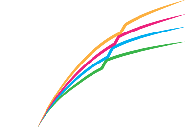

<!-- _class: title -->
<!-- _paginate: false -->

<p class="title-eyebrow">SCE Working Group 1 &middot; Project A &middot; October 2026</p>

# <span class="bn">Semantic ontologies</span>

## Formal descriptions

<p class="title-authors"><u>Akshay Shanker</u></p>



---
<style scoped>
.stack > div { padding: 0 0 0.9em 0; font-size: 19px; line-height: 1.45; }
.stack > div:last-child { padding-bottom: 0; }
.stack p { margin: 0; }
.stack code { font-size: 15px; }
.lbl { color: var(--ark-blue); font-weight: 500; }
</style>

## AI and Semantic Ontologies

<div class="stack">
<div>

<span class="lbl">Premise.</span> AI can now write code, translate papers to code and modify our models (Wu et al. 2022).

</div>
<div>

<span class="lbl">What remains for us.</span> Two questions remain: 
- Do we and AI agree on the meaning of a paper or a model description?
- Can we inspect and verify what AI understands?

</div>
<div>

<span class="lbl">Both are questions about <span class="c-red">**semantics**</span>.</span> 
- Meaning is a relation between a piece of text and <span class="c-red"> some thing </span> outside language.
- A system trained on text alone cannot learn that relation (Bender and Koller 2020). 
- A large language model approximates the map from text to meaning statistically rather than structurally. 

</div>
<div>

<span class="lbl">We can write meaning down in a form a machine reads, as a <span class="c-red">semantic ontology</span>.</span> 
- A semantic ontology is a machine-readable account of objects, their types and the valid relations between them. 
- It is a structural model of the model, in the economist's sense that its objects and relations are those of the mathematics itself. 
- AI can be trained on a semantic ontology, or can answer from what the ontology's programs compute, as when it writes a model in Lean and answers from the kernel's verdict. Seven such uses are listed in the <a href="#how-an-ai-works-with-a-semantic-ontology" class="c-red">appendix</a>.

</div>
</div>

<div class="footnote">The premise: Project A proposal, abstract &middot; Bender and Koller (2020), "Climbing towards NLU: on meaning, form, and understanding in the age of data", <em>ACL 2020</em>, 5185–5198 &middot; Wu et al. (2022), "Autoformalization with large language models", <em>NeurIPS 2022</em> &middot; Hubert, Mehta, Sartran et al. (2025), "Olympiad-level formal mathematical reasoning with reinforcement learning", <em>Nature</em>, 12 November 2025.</div>

---

<!-- _class: divider -->

# The problem

---

<!-- _class: divider sub -->

<p class="eyebrow">The problem</p>

# Example 1: Buffer-stock saving

---


## Is a semantic ontology just the mathematics of the model?

<div class="sub">Consider a written statement of the buffer-stock saving model.</div>

> Each period the household arrives with assets $k_t$, receives income $y_t$ and earns the gross return $R\,k_t$ on those assets, where $R$ is the gross interest factor. Market resources are then $m_t=R\,k_t+y_t$. Income is i.i.d. with $\log y_t\sim N(\mu_y,\sigma_y^2)$. The household chooses consumption $c_t\in(0,m_t]$, leaving $k_{t+1}=m_t-c_t$, to solve the Bellman equation
> $$v_t(m_t)=\max_{0<c_t\le m_t}\;\Big\{u(c_t)+\beta\,\mathbb{E}_t\,v_{t+1}\big(R\,(m_t-c_t)+y_{t+1}\big)\Big\}.$$
> The right-hand side defines an operator $\mathbb{T}$ with $v_t=\mathbb{T}\,v_{t+1}$, which sends the function $v_{t+1}$ to the function $v_t$, backward from a given terminal value over a finite horizon.

<div class="sp-s"></div>

- The statement alone does not give a machine enough information to build $\mathbb{T}$.
- An economist can nonetheless write code for $\mathbb{T}$ from the statement alone, by using their implicit understanding of Dynamic Programming.
- A semantic ontology makes that implicit understanding explicit. 

---
<style scoped>
table { font-size: 16.5px; margin: 0.4em 0 0 0; width: 100% !important; }
th, td { padding: 0.5em 0.8em 0.5em 0; vertical-align: top; }
th:first-child, td:first-child { width: 24%; }
th:nth-child(2), td:nth-child(2) { width: 44%; }
td code { font-size: 14px; }
</style>

## Syntax omits meaning: binding, parameters, types and the operator

<div class="sub">A parser is how text is read on the computer. It splits an equation such as <code>v = u(c) + beta * w</code> into a tree by grammar rules alone, that is, by rules about the arrangement of its symbols. The parse produces a syntax tree before it is compiled into code, but parsing the text above describing the Buffer stock saving model misses the semantics. <a href="#the-parse-tree-of-a-written-statement" class="c-red">See Appendix for more detail on parse trees.</a></div>

| Missing meaning| In the buffer-stock statement | Supplied today by |
|---|---|---|
| Which variables are bound, and where | The maximization binds $c_t$, while the expectation binds $y_{t+1}$. The left-hand side binds $m_t$ by defining $v_t$ as a function of $m_t$, which leaves $m_t$ free inside the right-hand side. | The reader, who keeps the three binders apart. |
| Parameters | The paper defines $u$, $R$, $\beta$ and the law of $y_{t+1}$ elsewhere, in no fixed place. Of these, only $\beta$ and $R$ are numbers, since $u$ is a function and the law is a measure. | The paper's assumptions, in prose. |
| Symbol types | The value function $v_t$ maps $\mathbb{R}_{++}$ to $\mathbb{R}$, with $m_t$ a point of its domain. The tree records both as names with no type. | The paper's assumptions, in prose. |
| An equation between functions | For each $m_t$ the Bellman equation equates two numbers. Over all $m_t$ it is one equation between functions, $v_t=\mathbb{T}\,v_{t+1}$, in which $\mathbb{T}$ maps $v_{t+1}$ to $v_t$. | The reader, who knows that a Bellman equation defines an operator. |


---
<style scoped>
table { font-size: 16.5px; margin: 0.4em 0 0 0; width: 100% !important; }
th, td { padding: 0.5em 0.8em 0.5em 0; vertical-align: top; }
th:first-child, td:first-child { width: 24%; }
th:nth-child(2), td:nth-child(2) { width: 44%; }
td code { font-size: 14px; }
</style>

## Syntax omits meaning: variables versus functions, and the law of a shock

| Missing meaning | In the buffer-stock statement | Supplied today by |
|---|---|---|
| Whether a symbol is a variable or a function | The symbol $m_t$, defined by $m_t=R\,k_t+y_t$, is i) the path of one household's resources, ii) the function $(k,y)\mapsto Rk+y$ composed inside the operator, and iii) the random variable whose law is the cross-sectional distribution. A paper writes one symbol for all three readings, whereas code must represent them as three objects of different types. | The reader, who infers from each sentence which reading is meant. |
| The law behind a parameter | The statement fixes $\log y_t\sim N(\mu_y,\sigma_y^2)$. In the shorter form $y\sim\mathrm{LogNormal}(\mu_y,\sigma_y)$, $\mu_y$ denotes the mean of $\log y$ under one convention and the mean of $y$ under another, which makes two calibrations with the same numbers two different models. | The conventions of a subfield. |

<div class="footnote">The LogNormal convention: Project Bellman (the author's project, slide 19), reference page "Shock distributions".</div>

---

<style scoped>
table { font-size: 16.5px; margin: 0.4em 0 0 0; width: 100% !important; }
th, td { padding: 0.5em 0.8em 0.5em 0; vertical-align: top; }
th:first-child, td:first-child { width: 24%; }
th:nth-child(2), td:nth-child(2) { width: 44%; }
td code { font-size: 14px; }
</style>

## Syntax omits meaning: timing and information

| Missing meaning | In a written statement | Supplied today by |
|---|---|---|
| Timing stated in words | "A policy shock raises entrants at date $t$." If the entrants change $y_t$ in equilibrium, the sentence is consistent with a model in which prices respond at $t$ and with one in which they respond only at $t+1$. | The reader, from the surrounding prose. |
| What the household knows when it decides | If the return $R_t$ is random, persistent and drawn before the decision, the household's expectation of $R_{t+1}$ depends on whether it observes $R_t$ or only $m_t=R_t\,k_t+y_t$ when it decides. | The reader, from the paper's account of timing. |

<div class="footnote">The timing example: Project A proposal, footnote 1.</div>

---
<style scoped>
.answer { font-size: 26px; line-height: 1.5; margin: 0.6em 0 0 0; }
.answer li { margin: 0 0 0.8em 0; }
</style>

## Multiple possible parsed meanings

<div class="answer">

- Because of the omissions on slides 6 to 8, one well-formed statement could admit two or more different readings on the computer, as [slides 37 to 39](#what-the-expectation-integrates) in the appendix show.
- Most of those readings do not arise in practice, because an economist sees at once which one is meant.
- The timing of events, and what the household knows at each decision, nevertheless confuse economists themselves in many papers.

</div>

---

<!-- _class: divider sub -->

<p class="eyebrow">The problem</p>

# Example 2: the pig in the library

---


<style scoped>
section { padding-top: 48px; }
h2 { margin-bottom: 0.5em; }
</style>

## What the pig learned in the library

<div class="center">


</div>

<div class="footnote">&copy; Tom Gauld, reproduced in Guizzardi and Guarino (2024), "Explanation, semantics, and ontology", <em>Data &amp; Knowledge Engineering</em> 153, 102325, Figure 1; shown here for discussion within the working group.</div>

---
<style scoped>
table { font-size: 16px; margin: 0.3em 0 0 0; width: 100% !important; }
th, td { padding: 0.4em 0.8em 0.4em 0; vertical-align: top; }
th:first-child, td:first-child { width: 22%; }
</style>

## The pigs and the model

<div class="sub">What would it take to understand the joke? Semantics is not enough. Semantics is a function from symbols to a domain, whereas the ontology is the system of kinds and relations that the symbols are about (Guizzardi and Guarino 2024, §2.1) -- the joke here is about the system.</div>

| | The pigs | The model |
|---|---|---|
| The written form | $\mathit{ham},\ \mathit{bacon},\ \mathit{sausages}$ | $m,\ y,\ \mathbb{E},\ v,\ \mathbb{T}$ in the paper's Bellman equation |
| The formal semantics, the function $\llbracket\cdot\rrbracket$ from symbols to the domain | $\llbracket\mathit{ham}\rrbracket,\ \llbracket\mathit{bacon}\rrbracket,\ \llbracket\mathit{sausages}\rrbracket\in\mathsf{Food}$, the dictionary's reading | $\llbracket\text{Bellman equation}\rrbracket=\mathbb{T}$, some operator, with the space it acts on, the scope of each binder and the law of $y$ unstated |
| What that semantics leaves open | whether the three words name foods for pigs or foods from pigs | the six readings of slides 37 to 39 |
| The ontology, the kinds and relations, written as typed symbols, each with a signature, what it takes and what it returns | $\mathit{Maurice}:\mathsf{Pig}$<br>$\mathit{madeOf}:\mathsf{Ham}\to\mathsf{Pork}$<br>$\mathit{from}:\mathsf{Pork}\to\mathsf{Pig}$ | $v:\mathbb{R}_{++}\to\mathbb{R}$, $\ y:\mathbb{R}_{++}$ with law $\nu_y$<br>$\mathbb{T}:(\mathbb{R}_{++}\to\mathbb{R})\to(\mathbb{R}_{++}\to\mathbb{R})$<br>$\mathbb{T}=\max_{c}\circ\,\mathbb{E}_{y}$, the expectation taken first |
| False agreement | two pigs who agree that the words name foods, one meaning foods for pigs and the other foods from pigs, and never go to the library | two readers who accept the Bellman equation and compute different objects |

<div class="footnote">Guizzardi and Guarino (2024), "Explanation, semantics, and ontology", <em>Data &amp; Knowledge Engineering</em> 153, 102325, &sect;2.1 for the cartoon and semantics as a function, &sect;3.4 for false agreement.</div>

---
<style scoped>
.stack > div { padding: 0 0 1.1em 0; font-size: 22px; line-height: 1.5; }
.stack > div:last-child { padding-bottom: 0; }
.stack p { margin: 0; }
.lbl { color: var(--ark-blue); font-weight: 500; }
</style>

## Two readings of one paper

<div class="stack">
<div>

<span class="lbl">Economists today.</span> An economist fills what a paper leaves out from <span class="c-red">implicit context</span>, which is sometimes hard to find. Two economists who fill it differently disagree about what the paper's results mean.

</div>
<div>

<span class="lbl">A machine that writes or translates code.</span> The machine reads the paper's text, which admits more than one reading. The model must therefore be <span class="c-red">written down as one object</span>, because a reading hidden in generated code can be checked only line by line.

</div>
</div>

<div class="footnote">Two readers who accept one text and compute different objects: Guizzardi and Guarino (2024), "Explanation, semantics, and ontology", <em>Data &amp; Knowledge Engineering</em> 153, 102325, &sect;3.4.</div>

---


<style scoped>
.answer { font-size: 26px; line-height: 1.5; margin: 0.6em 0 0 0; }
</style>

## The answer

<div class="answer">

A semantic ontology is the mathematics of the model, with the types, binders and laws that the paper's Bellman equation leaves to the reader, stated in a machine-readable file.

</div>

- An economist supplies the missing meaning from implicit context, the conventions of a subfield and the paper's surrounding prose (slides 6 to 8).
- An AI may *seem* to supply the same meaning, although it draws on the statistics of its training data rather than on a deterministic set of rules.
  - The reading it returns is stochastic, and producing it is expensive, since the AI must search the paper and similar papers for context.

<div class="footnote">Project A proposal, the paragraph that defines a semantic ontology: a statement, independent of the code, of which economic objects are computed and which relations among them are enforced.</div>

---
<style scoped>
.center img { margin: 0 auto; display: block; }
.stack > div { padding: 0 0 0.6em 0; font-size: 18px; line-height: 1.42; }
.stack > div:last-child { padding-bottom: 0; }
.stack p { margin: 0; }
.stack code { font-size: 14px; }
.lbl { color: var(--ark-blue); font-weight: 500; }
</style>

## How Dynare reads a model file

<div class="sub">A semantic ontology takes the upper path: Υ (upsilon) sends the file to its meaning ⟦file⟧, the model as a typed object, and Ρ (rho) attaches a numerical method to that object. Dynare takes the lower path in one program, so no ⟦file⟧ exists for a checker to read.</div>

<div class="center">


</div>

<div class="stack">
<div>

<span class="lbl">The meaning of a <code>.mod</code> file.</span> It is <span class="c-red">what the program does with the file</span>, as the README of Dynare's preprocessor, the program that reads the file, says: "The Dynare Preprocessor defines the Dynare model language."

</div>
<div>

<span class="lbl">Why it works.</span> Because Dynare solves one model class with one solver, its users learn the manual's conventions <span class="c-red">once</span>.

</div>
<div>

<span class="lbl">The conventions.</span> The manual, not the file, states that every equation holds in expectation at $t$, that a variable's date is the period in which it is decided, and that the solver approximates $\mathbb{E}_t\, f(y_{t+1},y_t,y_{t-1},u_t)=0$ by a Taylor expansion about the deterministic steady state, in the manual's notation, where $f$ stacks the model's equations, $y_t$ is the vector of endogenous variables and $u_t$ the vector of shocks.

</div>
</div>

<div class="footnote">Υ and Ρ: Bellman calculus, Introduction §1 &middot; Dynare preprocessor README (13 October 2026); Adjemian et al. (2026), <em>Dynare: Reference Manual, Version 7</em>, §4.2, §4.3.1.1, §4.13.1; the model class: Villemot (2011), Dynare Working Paper 2, §2.1.</div>

---
<style scoped>
.stack > div { padding: 0 0 0.9em 0; font-size: 19px; line-height: 1.45; }
.stack > div:last-child { padding-bottom: 0; }
.stack p { margin: 0; }
.stack code { font-size: 15px; }
.lbl { color: var(--ark-blue); font-weight: 500; }
</style>

## What Dynare's fused reading costs

<div class="sub">A meaning that exists only inside one program has four consequences.</div>

<div class="stack">
<div>

<span class="lbl">No object to compare across toolkits.</span> A language written directly as a program has one semantics only, in Oliveira and Löh's words "in this case, evaluation". A model moved to HARK or to the sequence-space Jacobian toolkit has its meaning re-derived from the manual, so that the two readings can be compared <span class="c-red">only through their outputs</span>.

</div>
<div>

<span class="lbl">Two models, one spelling.</span> `k` in a production function is capital decided this period unless `predetermined_variables k` is declared elsewhere in the file, in which case it is last period's capital. The equation alone <span class="c-red">does not say which model was meant</span>, the case that the row "Timing stated in words" of slide 8 describes.

</div>
<div>

<span class="lbl">A fixed vocabulary.</span> The file declares for each symbol only a role (endogenous, exogenous or parameter), with every expression a scalar. Because value functions, distributions and policy operators are not symbols of the language, the objects of a heterogeneous-agent model <span class="c-red">have no name</span> in it.

</div>
<div>

<span class="lbl">No check of meaning.</span> An AI-written file is checked for syntax, for as many equations as endogenous variables, for a steady state and for the Blanchard and Kahn conditions, <span class="c-red">not for what it means</span>. Under a semantic ontology a model file denotes the problem it poses, not the solver's output.

</div>
</div>

<div class="footnote">Adjemian et al. (2026), <em>Dynare: Reference Manual, Version 7</em>, version 7.2: §4.2 (declarations and <code>predetermined_variables</code>), §4.3 (scalar expressions), §4.5 (the model block, one equation per endogenous variable), §4.10 (<code>steady</code>) and §4.11 (<code>check</code>) &middot; Oliveira and Löh (2012), "Abstract syntax graphs for domain specific languages", §2.1, as quoted in the bellman-ddsl wiki, declarative language &middot; a model file denotes the problem it poses: Elliott (2009), "Denotational design with type class morphisms" &middot; the toolkits: Project A proposal, the paragraph on toolkits; Auclert, Bardóczy, Rognlie and Straub (2021), <em>Econometrica</em> 89(5), 2375–2408.</div>

---

<!-- _class: divider -->

# Examples of semantic ontologies

---
<style scoped>
.stack > div { padding: 0 0 1em 0; font-size: 21px; line-height: 1.5; }
.stack > div:last-child { padding-bottom: 0; }
.stack p { margin: 0; }
.lbl { color: var(--ark-blue); font-weight: 500; }
.katex-display { margin: 0.2em 0 1em 0 !important; font-size: 1.05em; }
</style>

## Three parts to a semantic ontology

$$
\text{written form}\ \xrightarrow{\quad\Upsilon\quad}\ \text{domain of meaning}
$$

<div class="stack">
<div>

<span class="lbl">The written form.</span> Machine-readable symbols, each with a <span class="c-red">type</span> and a signature, what it takes and what it returns, as in $v : X \to \mathbb{R}$.

</div>
<div>

<span class="lbl">The domain of meaning.</span> The objects we model, sorted into <span class="c-red">kinds</span> with relations between them: state spaces, laws, value functions and operators, as the kinds of slide 12 are Pig, Ham and Pork.

</div>
<div>

<span class="lbl">The map Υ (upsilon).</span> It sends a symbol of a given type to an object of the matching kind, and a program <span class="c-red">checks</span> that it does. Economists already have the domain, since their models are well described. Project A supplies the written form and the map.

</div>
</div>

<div class="footnote">Harel and Rumpe (2004), "Meaningful modeling: what's the semantics of 'semantics'?", <em>Computer</em> 37(10), 64–72, for the three parts &middot; Bellman calculus, Introduction §1 (bellman-ddsl/docs) &middot; in this deck a type belongs to the written form and a kind to the domain; Guizzardi and Guarino (2024) write "type" for what the deck calls a kind.</div>

---
<style scoped>
.center img { margin: 0 auto; display: block; }
.stack > div { padding: 0 0 0.6em 0; font-size: 19px; line-height: 1.45; }
.stack > div:last-child { padding-bottom: 0; }
.stack p { margin: 0; }
.stack code { font-size: 15px; }
.lbl { color: var(--ark-blue); font-weight: 500; }
</style>

## Economics: one stage of the buffer-stock problem as a stage file

<div class="sub">Project Bellman writes one period of the problem as a stage file in the language Bellman-SYM.</div>

<div class="center">


</div>

<div class="stack">
<div>

<span class="lbl">Perches.</span> The three information sets of the period: <span class="c-red">arrival</span> `!arvl`, <span class="c-red">decision</span> `!dcsn` and <span class="c-red">continuation</span> `!cntn`.

</div>
<div>

<span class="lbl">Fields.</span> A state or a value declared at a perch with its set, as in `m : ℝ₊₊ @ !dcsn`.

</div>
<div>

<span class="lbl">Blocks.</span> The equations between two perches: the transition with the shock, the choice, and the expectation.

</div>
</div>

<div class="footnote">Bellman-SYM, Stages §§1–4 (the documentation example, in the letters k, m, a of the calculus); Bellman calculus, Stages and perches §1 (bellman-ddsl/docs) &middot; the law line fixes the convention that slide 7 left to a subfield.</div>

---
<style scoped>
.stack > div { padding: 0 0 0.85em 0; font-size: 19px; line-height: 1.45; }
.stack > div:last-child { padding-bottom: 0; }
.stack p { margin: 0; }
.stack code { font-size: 15px; }
.lbl { color: var(--ark-blue); font-weight: 500; }
.katex-display { margin: 0.3em 0 0.1em 0 !important; font-size: 0.92em; }
.link { font-size: 19px; line-height: 1.45; margin: 1em 0 0 0; }
</style>

## Economics: what the stage file refuses or makes visible

<div class="stack">
<div>

<span class="lbl">Under Υ (upsilon), a value field denotes a function and a block denotes an operator.</span>
$$\texttt{V[>]}\ \mapsto\ v_\succ:\mathbb{R}_+\to\mathbb{R},\qquad \text{the choice block}\ \mapsto\ \mathbb{T}_\succ:\mathsf{V}_\succ\to\mathsf{V},\qquad \text{the expectation block}\ \mapsto\ \mathbb{T}_\prec:\mathsf{V}\to\mathsf{V}_\prec$$

</div>
<div>

<span class="lbl"><span class="c-red">Refused</span>, with the rule named.</span> A shock beside its expectation, `V[<] = E_{y}(V) + y`, since $y$ is not yet known at arrival. A continuation value listed at the decision perch, since it is a function of savings.

</div>
<div>

<span class="lbl"><span class="c-green">Visible</span>, as a line of the file.</span> The mean of the shock in the transition. A second `β` in the expectation block. A stationary closure $v_{t+1}=v_t$, which no file writes, since `V[>]` comes from the next period or the terminal boundary.

</div>
</div>

<div class="link"><a href="#the-bellman-calculus-in-full" class="c-red">The appendix (slides 40 to 50) gives the file in full, what it denotes, each refusal with its rule and the run behind it, and the period and trellis files.</a></div>

<div class="footnote">The reference on refusals, rules shock-reintroduced and field-perch; Bellman-SYM, Field equations §5, Perch tagging rules §3, Periods §§2–3, Trellises §2; the runs of <code>elaborate_text</code> of 13 October 2026 listed on the appendix slides.</div>

---
<style scoped>
.center img { margin: 0 auto; display: block; }
.stack > div { padding: 0 0 0.8em 0; font-size: 19px; line-height: 1.45; }
.stack > div:last-child { padding-bottom: 0; }
.stack p { margin: 0; }
.stack code { font-size: 15px; }
.lbl { color: var(--ark-blue); font-weight: 500; }
</style>

## Biology: the Gene Ontology

<div class="center">


</div>

<div class="stack">
<div>

<span class="lbl">Excludes.</span> A missing annotation read as the absence of a function (the open-world assumption), a NOT read as an inconclusive result, and a term read by its name rather than by its definition and relations, since a label must be unique and a definition must always denote the same referents (OBO Foundry principles 12 and 19).

</div>
<div>

<span class="lbl">For economics.</span> A model's object is named by a <span class="c-red">term with a definition and relations</span>, not by a variable name. The role tags `!ctrl` and `!vlu` and the law line of a stage file play that part, as the `sboTerm` of the Systems Biology Ontology does for a rate law in SBML.

</div>
</div>

<div class="footnote">Ashburner et al. (2000), "Gene Ontology: tool for the unification of biology", <em>Nature Genetics</em> 25(1), 25–29 &middot; The Gene Ontology Consortium (2026), "The Gene Ontology knowledgebase in 2026", <em>Nucleic Acids Research</em> 54(D1), D1779–D1792, Table 3 (the release of 22 July 2025) &middot; GAF 2.2 documentation and the human annotation file of 21 May 2026 (geneontology.org); the go-ontology build file, which runs the ELK reasoner &middot; SBO: Courtot et al. (2011), <em>Molecular Systems Biology</em> 7, 543.</div>

---
<style scoped>
.center img { margin: 0 auto; display: block; }
.stack > div { padding: 0 0 0.8em 0; font-size: 19px; line-height: 1.45; }
.stack > div:last-child { padding-bottom: 0; }
.stack p { margin: 0; }
.stack code { font-size: 15px; }
.lbl { color: var(--ark-blue); font-weight: 500; }
</style>

## Engineering: OntoCAPE, the ontology for chemical process engineering

<div class="center">


</div>

<div class="stack">
<div>

<span class="lbl">Excludes.</span> A model confused with the system it models, and a model variable confused with the physical quantity it stands for: the relation `models` joins a model to its system, and `correspondsToQuantity` pairs a variable with a quantity, as a declared domain excludes the deck's <span class="c-red">function on the wrong space</span>.

</div>
<div>

<span class="lbl">For economics.</span> OntoCAPE is the nearest case to Project A, an ontology of models themselves: model variables, equation systems and solution strategies are kinds in its modules, so that a process model and its solver are distinct typed objects, as Υ and Ρ keep a model apart from its numerical method.

</div>
</div>

<div class="footnote">Morbach, Yang and Marquardt (2007), "OntoCAPE—A large-scale ontology for chemical process engineering", <em>Engineering Applications of Artificial Intelligence</em> 20(2), 147–161 &middot; Morbach, Wiesner and Marquardt (2009), <em>Computers &amp; Chemical Engineering</em> 33(10), 1546–1556 &middot; Marquardt, Morbach, Wiesner and Yang (2010), <em>OntoCAPE: A Re-Usable Ontology for Chemical Process Engineering</em>, Springer &middot; the OntoCAPE 2.0 distribution (AVT, RWTH Aachen, GPL): system.owl and mathematical_model.owl; technical reports LPT-2008-25 and LPT-2008-28; Morbach (2009), dissertation, RWTH Aachen, on the RacerPro checks.</div>

---
<style scoped>
.center img { margin: 0 auto; display: block; }
.stack > div { padding: 0 0 0.8em 0; font-size: 19px; line-height: 1.45; }
.stack > div:last-child { padding-bottom: 0; }
.stack p { margin: 0; }
.stack code { font-size: 15px; }
.lbl { color: var(--ark-blue); font-weight: 500; }
</style>

## Earth science: the SWEET ontologies

<div class="center">


</div>

<div class="stack">
<div>

<span class="lbl">Excludes.</span> A quantity name read as any of several kinds: a SWEET class fixes the kind by its definition and by its place among realms, quantities and phenomena. The CF standard names, published as SKOS concepts with their canonical units on the NERC vocabulary server, settle the same question for a netCDF variable such as `temp`, which is <span class="c-red">the law behind a parameter</span> and <span class="c-red">timing stated in words</span> in the deck's terms.

</div>
<div>

<span class="lbl">For economics.</span> The comparison paper of the special issue that Project A proposes needs a vocabulary of this kind: which object each team reports, a value or a marginal value function, on which state and under which timing (den Haan, Judd and Juillard 2010, 2011).

</div>
</div>

<div class="footnote">Raskin and Pan (2005), "Knowledge representation in the semantic web for Earth and environmental terminology (SWEET)", <em>Computers &amp; Geosciences</em> 31(9), 1119–1125 &middot; ESIPFed/sweet, release 3.5.0 (14 July 2022), the header of sweetAll.ttl; the class count from the 3.5.0 source &middot; CF standard names: NERC Vocabulary Server, collection P07, version 95 (16 September 2026), publisher Natural Environment Research Council, owner the CF Standard Names Committee &middot; den Haan, Judd and Juillard (2010, 2011), <em>Journal of Economic Dynamics and Control</em> 34(1), 1–3 and 35(2), 175–177.</div>

---
<style scoped>
.center img { margin: 0 auto; display: block; }
.stack > div { padding: 0 0 0.8em 0; font-size: 19px; line-height: 1.45; }
.stack > div:last-child { padding-bottom: 0; }
.stack p { margin: 0; }
.stack code { font-size: 15px; }
.lbl { color: var(--ark-blue); font-weight: 500; }
</style>

## Finance: FIBO, the Financial Industry Business Ontology

<div class="center">


</div>

<div class="stack">
<div>

<span class="lbl">Excludes.</span> An issuer read as the obligor of a bond, and a notional amount read as a principal: each is a defined class or property, and the 2023 revision of the Swaps ontology separated the nominal from the notional amount, which its change note says "were confused". In the deck's terms, <span class="c-red">a function on the wrong space</span> and <span class="c-red">the law behind a parameter</span>.

</div>
<div>

<span class="lbl">For economics.</span> FIBO is finance's own ontology, with the Bureau of Economic Analysis, the Bureau of Labor Statistics, the CFTC and the Office of Financial Research among its contributors, and the 2026 rule under the Financial Data Transparency Act records it among the standards that commenters proposed. Project A's ontology names the objects of a model as FIBO names the parties and terms of a contract.

</div>
</div>

<div class="footnote">EDM Council, FIBO (spec.edmcouncil.org/fibo), release Q2 2026 (14 July 2026), MIT licence; the development-process page on consistency; onto-viewer's consistency checker (Openllet and HermiT) &middot; OMG specifications EDMC-FIBO/FND 1.2, BE 1.1, FBC 1.0 and IND 1.0 (2017–2018) &middot; Bennett (2013), "The financial industry business ontology: best practice for big data", <em>Journal of Banking Regulation</em> 14(3–4), 255–268 &middot; Allemang, Garbacz, Grądzki, Kendall and Trypuz (2021), <em>FOIS 2021</em>, 112–126 &middot; Financial Data Transparency Act Joint Data Standards, 91 FR 38246 (25 June 2026) &middot; GoodRelations, the ontology schema.org absorbed in 2012: Hepp (2008), <em>EKAW 2008</em>, LNCS 5268, 329–346.</div>

---
<style scoped>
.center img { margin: 0 auto; display: block; }
.stack > div { padding: 0 0 0.8em 0; font-size: 19px; line-height: 1.45; }
.stack > div:last-child { padding-bottom: 0; }
.stack p { margin: 0; }
.stack code { font-size: 15px; }
.lbl { color: var(--ark-blue); font-weight: 500; }
</style>

## Knowledge representation: OWL 2, the language ontologies are written in

<div class="center">


</div>

<div class="stack">
<div>

<span class="lbl">Excludes.</span> Any reading of the axioms other than the one the Direct Semantics fixes: "the correct answer to any such question is predetermined by the formal semantics", whatever reasoner computes it (Primer §2). Nor is a missing statement read as false, or two names as two individuals.

</div>
<div>

<span class="lbl">For economics.</span> This is the three-part definition <span class="c-red">in full</span>: classes, properties and individuals as typed symbols, an interpretation as the domain, and a map whose consistency and entailments a reasoner decides. A stage file's Υ plays the part of the Direct Semantics, and the elaborator the part of the reasoner.

</div>
</div>

<div class="footnote">W3C (2012), <em>OWL 2 Web Ontology Language</em>, Recommendations of 11 December 2012: Document Overview §2.3; Direct Semantics §§2.2–2.5; Profiles §§1 and 5; Primer §§2, 4 and 9 &middot; Baader, Calvanese, McGuinness, Nardi and Patel-Schneider (eds.) (2007), <em>The Description Logic Handbook</em>, 2nd ed., Cambridge University Press &middot; HermiT: Glimm, Horrocks, Motik, Stoilos and Wang (2014), <em>Journal of Automated Reasoning</em> 53(3), 245–269; ELK: Kazakov, Krötzsch and Simančík (2014), <em>Journal of Automated Reasoning</em> 53(1), 1–61.</div>

---
<style scoped>
table { font-size: 16px; margin: 0.3em 0 0 0; width: 100% !important; }
th, td { padding: 0.45em 0.7em 0.45em 0; vertical-align: top; }
th:first-child, td:first-child { width: 15%; }
td code { font-size: 13.5px; }
</style>

## The five cases against the three parts of a semantic ontology

<div class="sub">Each row places one case against the three parts of slide 18, the typed symbols of the written form, the domain of meaning and the map between them, and names in the last column the program that checks the map.</div>

| Case | Typed symbols | Domain | Map | Checker |
|---|---|---|---|---|
| Gene Ontology | the GO terms, each by ID | kinds of molecular function, biological process and cellular component | the term in a GAF annotation | the ELK reasoner on the ontology at every commit |
| OntoCAPE | OWL classes and relations in 62 modules | models, systems, materials and quantities | the axioms, `models` and `hasModelVariable` | the RacerPro reasoner |
| SWEET and the CF names | OWL classes, and SKOS concepts for the CF names | Earth-science quantities, realms and phenomena | the class, or the standard name on a variable | any OWL tool; the CF checker against the NVS table |
| FIBO | OWL classes and properties | contracts, instruments and parties | the class asserted of a record | two OWL 2 reasoners on every release |
| OWL 2 | classes, properties and individuals | an interpretation: a set with relations on it | the Direct Semantics | a reasoner: consistency and entailment |

<div class="footnote">Harel and Rumpe (2004), <em>Computer</em> 37(10), 64–72, for the three parts &middot; the sources of each case are on its slide: Ashburner et al. (2000) and the Gene Ontology Consortium (2026); Morbach, Yang and Marquardt (2007); Raskin and Pan (2005) and the NERC Vocabulary Server; the EDM Council and Bennett (2013); W3C (2012).</div>

---
<style scoped>
table { font-size: 17px; margin: 0.3em 0 0 0; width: 100% !important; }
th, td { padding: 0.5em 0.8em 0.5em 0; vertical-align: top; }
th:first-child, td:first-child { width: 22%; }
td code { font-size: 14px; }
</style>

## The stage file against the same three parts

<div class="sub">The stage file of slide 42, the deck's own written form, is read here against the columns of the table on slide 26.</div>

| Part | In the Bellman-SYM stage file |
|---|---|
| Typed symbols | the fields and the blocks, each with a type and a perch, and the declared law of the shock (slide 42) |
| Domain | state spaces, laws, value functions and the operators between them (slide 18) |
| Map | the perch tags `@ !arvl`, `@ !dcsn` and `@ !cntn`, the role tags `!ctrl` and `!vlu` and the law line (slide 42), interpreted by Υ (upsilon), the checked interpretation of slide 36, as the objects of slide 18 |
| Checker | the elaborator (slide 45), which constructs the typed object or refuses the file, naming the rule the file breaks and the line; and the comparator, a program that compares two elaborated files up to renaming and reports, for each kind of item, agreement, difference or an undecided residue, the items it can neither match nor reject (slide 30) |
| Run on the file of slide 42 | The elaborator constructed the object from the file and refused the line `E_{y}(V) + y`, with `y` listed among the block's inputs, under `shock-reintroduced`.<br>The comparator read the file and the documentation example, with b and w for k and m, as one object under that renaming. |

<div class="footnote">Bellman-SYM, Stages §5 (checked interpretation) &middot; bellman-ddsl wiki, Υ §1 (the elaborator) and judge §4 (the comparator) &middot; the runs: <code>elaborate_text</code> of <code>bellman.factory.elaboration</code> and <code>compare</code> of <code>meaning_map_training.compare</code>, 13 October 2026, on the stage file of slide 42 and on Bellman-SYM's documentation example (Stages §4).</div>

---

<!-- _class: divider -->

# Kinds, individuals and the community library

---
<style scoped>
.stack > div { padding: 0 0 0.9em 0; font-size: 19px; line-height: 1.45; }
.stack > div:last-child { padding-bottom: 0; }
.stack p { margin: 0; }
.stack code { font-size: 15px; }
.lbl { color: var(--ark-blue); font-weight: 500; }
</style>

## Kind and individual

$$\text{written form}\ \xrightarrow{\ \ \Upsilon\ \ }\ \underbrace{\mathbb{T}_\prec\circ\mathbb{T}_\succ:\mathsf{V}_\succ\to\mathsf{V}_\prec}_{\text{the kind: the model as a mathematical object}}\ \xrightarrow{\ \ \text{Ρ}\ \ }\ \underbrace{(\hat{\mathbb{T}}_\prec\circ\hat{\mathbb{T}}_\succ)_{\text{HARK}},\ (\hat{\mathbb{T}}_\prec\circ\hat{\mathbb{T}}_\succ)_{\text{SSJ}}}_{\text{individuals: the operator with grids, quadrature and interpolation attached}}$$

<div class="stack">
<div>

<span class="lbl">In the cartoon's terms.</span> The taxonomy's entry $\mathsf{Pig}$ is a kind, of which Maurice is an individual, although the taxonomy itself contains no pig.

</div>
<div>

<span class="lbl">The paper's model as kind and an implementation as individual.</span> Ρ (rho) attaches grids, quadrature and interpolation to the operators that the kind names, as the display shows for HARK and for the sequence-space Jacobian toolkit, SSJ. A grid, the finite list of points at which the computer evaluates a function, is not the declared set and belongs with the method and settings files. A change of interpolation likewise changes the approximation and not the operation.

</div>
</div>

<div class="footnote">Guizzardi and Guarino (2024), &sect;2.1, types, individuals and instantiation &middot; Bellman calculus, Introduction §1 (Υ and Ρ); Bellman-SYM, Stages §2 (a grid is not a set). &middot; SSJ: the sequence-space Jacobian toolkit of Auclert, Bardóczy, Rognlie and Straub (2021).</div>

---
<style scoped>
.stack > div { padding: 0 0 0.9em 0; font-size: 19px; line-height: 1.45; }
.stack > div:last-child { padding-bottom: 0; }
.stack p { margin: 0; }
.stack code { font-size: 15px; }
.lbl { color: var(--ark-blue); font-weight: 500; }
</style>

## One kind, several individuals

<div class="stack">
<div>

<span class="lbl">Two files, one object.</span> Two files that differ in spelling denote one object under Υ (upsilon), so that the comparator compares them as objects up to renaming, whereas two implementations of one object differ in approximation.

</div>
<div>

<span class="lbl">What the comparator does not read.</span> The settings of Ρ (rho), the grid, the quadrature and the interpolation, are declared in the method and settings files beside the stage file. The comparator's profile, the list of the kinds of item it compares, names the fields, parameters, functions, laws, blocks and stochastic kernels, the conditional distributions of the transitions, and none of those settings. Two implementations that differ only in grid, quadrature or interpolation are therefore one object to the comparator, with the difference visible only in their numbers.

</div>
<div>

<span class="lbl">The question of slide 2.</span> When our reading of the paper is the stage file we write from it and the AI's reading is the file it writes, the comparator reports the first item on which the two files differ.

</div>
<div>

<span class="lbl">A different law of the shock.</span> Two files that differ in the law of $y$ denote, under Υ, two objects that differ in $\nu_y$ and agree elsewhere. The comparator's report then lists, for each kind of item, agreement, difference or an undecided residue, as slide 27 says.

</div>
</div>

<div class="footnote">bellman-ddsl wiki, elaborated stage (files that differ in spelling elaborate to one stage) and judge §4 (the comparator's profile and its items) &middot; Bellman calculus, Introduction §3, and Bellman-SYM, Methodization (the method and settings files) &middot; Project A proposal, the paragraph on language models.</div>

---
<style scoped>
.stack > div { padding: 0 0 0.9em 0; font-size: 19px; line-height: 1.45; }
.stack > div:last-child { padding-bottom: 0; }
.stack p { margin: 0; }
.stack code { font-size: 15px; }
.lbl { color: var(--ark-blue); font-weight: 500; }
</style>

## What ties an individual to its kind

<div class="stack">
<div>

<span class="lbl">What the comparator reads.</span> The comparator reads two declarations, that is, two stage files. The code an AI writes from a declaration is tested only by the comparison of numbers on the next slide, because no program checks an implementation against its stage file.

</div>
<div>

<span class="lbl">In the five cases the individual's record names its kind.</span> A GO annotation names a GO term, an OntoCAPE or FIBO record asserts its class, a variable carries a SWEET class or a CF standard name, and an OWL individual is asserted into a class, so that in each case a reasoner or a checker reads the kind from the record itself.

</div>
<div>

<span class="lbl">In the community library the name is a link.</span> In the community library of Project B, the Community Library of Baseline Models (slide 32) an implementation names its model by a link to the shared model description and an optional metadata entry, `model: "BST"`, the library's short name for the buffer-stock model, and only the numbers of slide 32 test the implementation.

</div>
</div>

<div class="footnote">Community Library, buffer-stock submission guide, the optional metadata file &middot; the cases: Ashburner et al. (2000), Morbach, Yang and Marquardt (2007), Raskin and Pan (2005), the EDM Council's FIBO and W3C (2012), on their slides &middot; bellman-ddsl wiki, judge §4 (the comparator compares elaborated declarations).</div>

---

<style scoped>
.stack > div { padding: 0 0 0.9em 0; font-size: 19px; line-height: 1.45; }
.stack > div:last-child { padding-bottom: 0; }
.stack p { margin: 0; }
.stack code { font-size: 15px; }
.lbl { color: var(--ark-blue); font-weight: 500; }
</style>

## The community library holds the individuals

<div class="stack">
<div>

<span class="lbl">Project B's library.</span> The library, which QuantEcon hosts, holds one model statement and one calibration per baseline model, implementations across toolkits, and results that readers can compare.

</div>
<div>

<span class="lbl">The precedent, BioModels.</span> BioModels holds about 2,000 models in SBML. For the 800 curated models, the BioModels curators have checked the computational representation against the biology, checked that simulations reproduce the reference publication's results, and attached ontology terms (Malik-Sheriff et al. 2020).

</div>
<div>

<span class="lbl">What a comparison of numbers tests.</span> Because parsing, interpretation, method assignment, calibration and execution must all agree for a result to approximate the declared problem, agreement between two implementations is evidence about Ρ (rho). Reproducing a published number, by contrast, tests one implementation. A misreading of the model is caught by the comparator of slide 30, whereas an error in the code is caught only here, by the numbers.

</div>
<div>

<span class="lbl">What makes the test well posed.</span> The stated kind says which object both implementations claim to approximate. Without it, a library can be compared only number by number, a comparison in which the agreement of two numbers does not exclude the false agreement of slide 13.

</div>
</div>

<div class="footnote">Malik-Sheriff et al. (2020), "BioModels: 15 years of sharing computational models in life science", <em>Nucleic Acids Research</em> 48, D407–D415 &middot; The Community Library of Baseline Models, README, QuantEcon, 2026 &middot; Bellman calculus, Introduction §3.</div>

---

<style scoped>
.answer { font-size: 26px; line-height: 1.5; margin: 0.6em 0 0 0; }
</style>

## What a semantic ontology is

<div class="answer">

A semantic ontology is the mathematics of the model, with the types, binders and laws that the Bellman equation leaves to the reader, stated in a machine-readable file. The Bellman equation of slide 5 admits, beside its intended reading, the readings of slides 37 to 39, whereas the typed file of slide 42 states exactly one object. A different reading would be a different line of the file, which under Υ (upsilon) denotes a different object and which the comparator therefore reports as a difference.

</div>

<div class="footnote">Slides 5, 30, 37 to 39 and 42 of this deck &middot; Project A proposal, the paragraph that defines a semantic ontology.</div>

---

<!-- _class: divider -->

# Appendix

---
<!-- _header: 'Appendix &middot; [return to slide 6](#syntax-omits-meaning-binding-parameters-types-and-the-operator)' -->
<style scoped>
.cols { grid-template-columns: 1fr 1fr; gap: 1.6em; align-items: center; }
.stack > div { padding: 0 0 0.9em 0; font-size: 19px; line-height: 1.45; }
.stack > div:last-child { padding-bottom: 0; }
.stack p { margin: 0; }
.lbl { color: var(--ark-blue); font-weight: 500; }
</style>

## The parse tree of a written statement

Parsing a written statement into a tree, as every compiler first does, shows what the statement leaves to context.

<div class="cols">
<div>


</div>
<div>

<div class="stack">
<div>

<span class="lbl">What the parser does.</span> It splits `v = u(c) + beta * w` into a tree by grammar rules alone.

</div>
<div>

<span class="lbl">What the tree records.</span> The tree records only which symbol is applied to which, node by node.

</div>
<div>

<span class="lbl">What the tree omits.</span> The tree records nothing about what `v`, `c` or `w` are, which variable is bound where, or whether `v` is a function.

</div>
</div>

</div>
</div>

<div class="footnote">The tree is Python's abstract syntax tree, <code>ast.parse("v = u(c) + beta * w")</code>.</div>

---
<!-- _header: 'Appendix &middot; [return to slide 6](#syntax-omits-meaning-binding-parameters-types-and-the-operator)' -->
<style scoped>
.cols { grid-template-columns: 1.05fr 1fr; gap: 1.4em; align-items: center; }
.cols .katex-display { margin: 0.2em 0 0.2em 0 !important; font-size: 0.9em; }
.cap { font-size: 18px; line-height: 1.45; margin: 0.4em 0 0 0; }
</style>

## From the syntax tree to the semantic graph

In the model, $v$ is not a number obtained by adding $\beta w$ to $u(c)$. That $v_t=\mathbb{T}\,v_{t+1}$ sends a function to a function appears only once the binders, types and declarations on the right are attached to the tree, the dotted lines in the figure.

<div class="cols">
<div>


</div>
<div>

$$\begin{aligned}
&\textsf{binders:}&& \max_{c_t}\ \text{binds } c_t,\quad \mathbb{E}_t\ \text{binds } y_{t+1},\\
&&& v_t(m_t)=\cdots\ \ \forall m_t\in\mathbb{R}_{++}\ \text{ binds } m_t\\[4pt]
&\textsf{fixed from outside:}&& u:\mathbb{R}_{++}\to\mathbb{R},\quad \beta,\,R\in\mathbb{R},\\
&&& \nu_y\ \text{the law of } y_{t+1},\ \text{on } \mathbb{R}_{++}\\[4pt]
&\textsf{obtained:}&& v_{t+1}\big(R(m_t-c_t)+y_{t+1}\big):\mathbb{R},\\
&&& \mathbb{T}:(\mathbb{R}_{++}\to\mathbb{R})\to(\mathbb{R}_{++}\to\mathbb{R})
\end{aligned}$$

<div class="cap">The law <em>ν</em><sub><em>y</em></sub> is the probability distribution of the income shock. A semantic ontology states the quantifier over <em>m</em><sub><em>t</em></sub> on the left-hand side, the binder conventions, the types and the declarations of <em>u</em> and <em>ν</em><sub><em>y</em></sub>, none of which the tree records.</div>

</div>
</div>

<div class="footnote">Bellman-SYM, Project Bellman's model language, parses a file into such a tree, builds the semantic graph from it by a checked interpretation, which the calculus calls Υ (upsilon), and discards the tree (Bellman calculus, Introduction §2; Bellman-SYM, Stages §5).</div>


---
<!-- _header: 'Appendix &middot; [return to slide 9](#multiple-possible-parsed-meanings)' -->
<style scoped>
.box { border: 1px solid var(--ark-line-2); border-left: 4px solid var(--ark-blue); border-radius: 4px; background: #ffffff; padding: 0.65em 1.1em 0.6em 1.1em; margin: 0 0 1.1em 0; font-size: 19px; line-height: 1.45; }
.box:last-child { margin-bottom: 0; }
.box .katex-display { margin: 0.35em 0 0.4em 0 !important; }
.box p { margin: 0; }
.lbl { color: var(--ark-blue); font-weight: 500; font-size: 20px; }
.sub p { margin: 0; }
</style>

## What the expectation integrates

<div class="sub">

The paper's Bellman equation gives $\mathbb{E}$ the date $t$ as its subscript rather than the variable it integrates. Because the tree specifies neither that variable nor the type of $\mathbb{E}_t$, each box below puts the paper's expression to the left of "read as" and a reading that the tree does not exclude to the right.

</div>

<div class="box">

<span class="lbl">The shock leaves the expectation.</span>
$$\mathbb{E}_t\,v\big(R(m-c)+y'\big)\qquad\text{read as}\qquad v\big(R(m-c)+\mathbb{E}_t\,y'\big)\quad\text{or}\quad \mathbb{E}_t\big[v\big(R(m-c)\big)\big]+y'.$$
Since Jensen's inequality gives $\mathbb{E}_t\,v(R(m-c)+y')\le v(R(m-c)+\mathbb{E}_t\,y')$ for concave $v$, the first reading overstates the continuation value. Because it replaces the income risk by its mean, it also removes the precautionary motive, the saving held against that risk (Kimball 1990). The second reading treats $y'$ as known before it is drawn.

</div>
<div class="box">

<span class="lbl">The expectation moved through the maximization.</span>
$$\max_c\big\{u(c)+\beta\,\mathbb{E}_t\,v_{t+1}(\cdot)\big\}\qquad\text{read as}\qquad \mathbb{E}_t\max_c\big\{u(c)+\beta\,v_{t+1}(\cdot)\big\}.$$
Since $\mathbb{E}\max\ge\max\mathbb{E}$, the reading on the right overstates the value and lets consumption respond to income that has not yet been drawn.

</div>

<div class="footnote">Jensen's inequality and the precautionary motive: Kimball (1990), "Precautionary saving in the small and in the large", <em>Econometrica</em> 58(1), 53–73.</div>

---
<!-- _header: 'Appendix &middot; [return to slide 9](#multiple-possible-parsed-meanings)' -->
<style scoped>
.box { border: 1px solid var(--ark-line-2); border-left: 4px solid var(--ark-blue); border-radius: 4px; background: #ffffff; padding: 0.65em 1.1em 0.6em 1.1em; margin: 0 0 1.1em 0; font-size: 19px; line-height: 1.45; }
.box:last-child { margin-bottom: 0; }
.box .katex-display { margin: 0.35em 0 0.4em 0 !important; }
.box p { margin: 0; }
.lbl { color: var(--ark-blue); font-weight: 500; font-size: 20px; }
</style>

## A number for a function, and a function on the wrong space

<div class="box">

<span class="lbl">A number where a function belongs.</span>
$$v_t=\mathbb{T}\,v_{t+1},\quad v_t:\mathbb{R}_{++}\to\mathbb{R}\qquad\text{read as}\qquad v_t(\hat m_t)\ \text{ alone, at }\ \hat m_t=R\,\hat k_t+\hat y_t,\ \text{ one simulated household's resources.}$$
The backward step then returns one number and one consumption $c_t(\hat m_t)$, although $\mathbb{T}$ needs $v_{t+1}$ at every $R(\hat m_t-c)+y'$. Under this reading the reader has simulated a path where the model asked for a function.

</div>
<div class="box">

<span class="lbl">A function on the wrong space.</span>
$$\mathbb{E}_t\,v_{t+1}(Ra+y')\ \text{ on savings } a=m-c,\ \text{the paper's } k_{t+1},\ a\in[0,\infty)\qquad\text{read as}\qquad v_{t+1}\ \text{ itself, on resources } m\in(0,\infty).$$
The borrowing limit acts at $a=0$, a point at which a function of resources is not defined, so that the two functions have different domains. A reading that confuses them puts the boundary at a point where the constraint does not act.

</div>

---
<!-- _header: 'Appendix &middot; [return to slide 9](#multiple-possible-parsed-meanings)' -->
<style scoped>
.box { border: 1px solid var(--ark-line-2); border-left: 4px solid var(--ark-blue); border-radius: 4px; background: #ffffff; padding: 0.65em 1.1em 0.6em 1.1em; margin: 0 0 1.1em 0; font-size: 19px; line-height: 1.45; }
.box:last-child { margin-bottom: 0; }
.box .katex-display { margin: 0.35em 0 0.4em 0 !important; }
.box p { margin: 0; }
.lbl { color: var(--ark-blue); font-weight: 500; font-size: 20px; }
</style>

## The discount and the expectation applied twice, and the recursion as a fixed point

<div class="box">

<span class="lbl">The discount and the expectation applied by both steps once $\mathbb{T}$ is split.</span>
$$v_t=\max_c\big\{u(c)+\beta\,\mathbb{E}_t\,v_{t+1}(\cdot)\big\}\qquad\text{read as}\qquad v_t=\max_c\big\{u(c)+\beta^2\,\mathbb{E}_{y'}\mathbb{E}_{y''}\,v_{t+1}(\cdot)\big\}.$$
Since the Bellman equation writes $\beta$ and $\mathbb{E}_t$ once each, an implementation that splits $\mathbb{T}$ into the choice and the expectation, as slide 44 does, must decide which step applies $\beta$ and which applies $\mathbb{E}_t$. An implementation that applies $\beta$ and $\mathbb{E}_t$ in each of the two steps makes the household discount at $\beta^2$ and draw income twice.

</div>
<div class="box">

<span class="lbl">Dated value functions read as one stationary function.</span>
$$v_t=\mathbb{T}\,v_{t+1},\ \ v_{t+1}\ \text{an input}\qquad\text{read as}\qquad v=\mathbb{T}\,v,\ \ \text{a fixed point.}$$
A stationarity condition that the statement never makes replaces the backward recursion from a terminal value. Once the terminal value has disappeared from the problem, the last period's consumption is chosen as if another period followed.

</div>

---

<!-- _class: divider sub -->

<p class="eyebrow">Appendix</p>

# The Bellman calculus in full

---
<!-- _header: 'Appendix &middot; [return to slide 20](#economics-what-the-stage-file-refuses-or-makes-visible)' -->
<style scoped>
.stack > div { padding: 0 0 0.9em 0; font-size: 19px; line-height: 1.45; }
.stack > div:last-child { padding-bottom: 0; }
.stack p { margin: 0; }
.lbl { color: var(--ark-blue); font-weight: 500; }
</style>

## Stage, perch, field, block and builder

<div class="stack">
<div>

<span class="lbl">Stage.</span> A stage is one unit of a dynamic programming problem, with three information sets: arrival, before the shock is drawn; decision, after it, where the choice is made; continuation, after the choice. One period of the buffer-stock problem is one stage. A period may list several stages, joined by connectors of the kind that slide 47 defines and slide 49 writes between periods.

</div>
<div>

<span class="lbl">Perch.</span> A perch is one of the three information sets of a stage.

</div>
<div>

<span class="lbl">Field.</span> A field is a state or a value declared at a perch.

</div>
<div>

<span class="lbl">Block.</span> The equations between declared inputs and outputs form a block.

</div>
<div>

<span class="lbl">Builder.</span> Under Υ (upsilon), a block denotes one operator, a builder.

</div>
</div>

<div class="footnote">Bellman-SYM, Stages §§1–4, Field equations §1 and Period syntax §1; Bellman calculus, Stages and perches §1 (bellman-ddsl/docs).</div>

---
<!-- _header: 'Appendix &middot; [return to slide 20](#economics-what-the-stage-file-refuses-or-makes-visible)' -->
<style scoped>
section { padding-top: 40px; }
h2 { margin-bottom: 0.3em; }
.gloss { font-size: 19px; line-height: 1.5; margin: 0.7em 0 0 0; }
.gloss code { font-size: 15px; }
.gloss p { margin: 0; }
</style>

## The stage file of the buffer-stock problem

<div class="sub">The figure shows the stage file, the written form of slide 18, in the language Bellman-SYM.</div>

<div class="center">


</div>

<div class="gloss">

Three kinds of mark appear in the figure: `!arvl`, `!dcsn` and `!cntn` for the perches, `!ctrl` and `!vlu` for a control and a value, and `[id=…]` for the name of a block. The line `y ~ LogNormal(μ_y, σ_y)` declares the law of the shock. The language's reference on shock distributions defines `LogNormal(μ_y, σ_y)` as the law under which $\log y\sim N(\mu_y,\sigma_y^2)$, which fixes for every file the convention that slide 7 left to a subfield. `V[>]` at the continuation perch is the stage's input, supplied from outside the stage.

</div>

<div class="footnote">Bellman-SYM's documentation example (bellman-ddsl docs, Stages §4) in the letters k, m, a of the calculus, the perch marks written inside the type declarations, as The Bellman-SYM language §1.1 writes them &middot; LogNormal: the reference on shock distributions.</div>

---
<!-- _header: 'Appendix &middot; [return to slide 20](#economics-what-the-stage-file-refuses-or-makes-visible)' -->
<style scoped>
.cols { grid-template-columns: 1fr 1.35fr; gap: 1.6em; align-items: start; }
.cols pre { font-size: 15px; line-height: 1.5; margin: 0.3em 0 0 0; }
.small { font-size: 19px; line-height: 1.5; }
.small p { margin: 0 0 0.7em 0; }
.small code { font-size: 15px; }
</style>

## The preamble and one block of the stage file

<div class="sub">The stage file of slide 42 opens with these lines, of which the figure shows only the law of the shock. The last three lines are one block, whose header lists its inputs and then its outputs.</div>

<div class="cols">
<div>

```
β : (0,1)
ρ : (1, inf)
R : ℝ₊₊
μ_y : ℝ
σ_y : ℝ₊
y : ℝ₊₊
y ~ LogNormal(μ_y, σ_y)

𝑢(c : ℝ₊₊) := c^(1-ρ)/(1-ρ)

[id=dcsn_to_arvl, (V) : !dcsn -> (V[<] : ℝ @ !vlu) : !arvl] {
    V[<] = E_{y}(V)              :: [id=value]
}
```

</div>
<div class="small">

The file declares each parameter with its set. The lowercase ρ of the utility function is the curvature of utility, not Ρ (rho), the map of slide 15 that attaches a numerical method.

A calibration file beside the stage file supplies the values of the parameters.

The declarations `c : ℝ₊₊` and `a : ℝ₊` together with the line `a = m - c` impose the bound $0<c\le m$ on the choice, over which the binder `argmax_{c}`, written without a set, then ranges.

</div>
</div>

<div class="footnote">The file: Bellman-SYM's documentation example (bellman-ddsl docs, Stages §4) in the letters k, m, a of the calculus &middot; the preamble: Stages §§2, 4 and 5 and the wiki entry calibration &middot; the feasible set: Stages §3, From syntax to a mathematical problem §3.</div>

---
<!-- _header: 'Appendix &middot; [return to slide 20](#economics-what-the-stage-file-refuses-or-makes-visible)' -->
<style scoped>
section { padding-top: 40px; }
h2 { margin-bottom: 0.3em; }
.gloss { font-size: 18px; line-height: 1.45; margin: 0.7em 0 0 0; }
.gloss p { margin: 0; }
</style>

## What the stage file denotes, backward on value functions and forward on laws

<div class="sub">Under Υ (upsilon), each value field <code>V</code> of the file denotes a function <em>v</em> on the state space of its perch, an element of the set 𝖵 of such functions, subscripted by the perch. The figure shows the three value functions with the two operators between them, and the laws on the three state spaces, elements of the sets 𝒫<sub>≺</sub>, 𝒫 and 𝒫<sub>≻</sub> of probability measures, which two forward operators map from one space to the next under the policy π, the rule <em>m</em> ↦ <em>c</em>(<em>m</em>) that the block <code>policy</code> defines.</div>

<div class="center">


</div>

<div class="gloss">The arrival block, where <em>y</em> is drawn before the decision, fixes the date at which the shock enters the law of <em>m</em>. The file fixes the household's own shock only. An aggregate policy shock of the kind on slide 8 is no part of this stage.</div>

<div class="footnote">The operators follow the Bellman calculus, Illustrative example §2 and Fields, functions and types §4 (bellman-ddsl/docs). The calculus writes 𝖬<sub>p</sub> for the probability measures on the state space X<sub>p</sub> (Fields, functions and types §4), whereas the deck writes 𝒫 so that the letter M names only the forward operators. The dating of the shock: Bellman-SYM, Perch tagging rules §3.</div>

---
<!-- _header: 'Appendix &middot; [return to slide 20](#economics-what-the-stage-file-refuses-or-makes-visible)' -->
<style scoped>
.stack > div { padding: 0.45em 0 0.5em 0; border-top: 1px solid var(--ark-line); font-size: 19px; line-height: 1.45; }
.stack > div:first-child { border-top: none; padding-top: 0.1em; }
.stack .katex-display { margin: 0.3em 0 0.35em 0 !important; }
.stack p { margin: 0; }
.stack code { font-size: 15px; }
.lbl { color: var(--ark-blue); font-weight: 500; font-size: 20px; }
</style>

## How the stage file refuses or makes visible the two readings of the expectation

<div class="sub">Each reading of slide 37 is set beside the construct that refuses it or the line that shows it.</div>

<div class="stack">
<div>

<span class="lbl">The elaborator refuses a shock read beside its own expectation, whereas a shock replaced by its mean stands as a visible line.</span> Υ (upsilon) interprets `y ~ LogNormal(μ_y, σ_y)`, `m = R*k + y` and `V[<] = E_{y}(V)` as
$$(\mathbb{T}_\prec v)(k)=\int v(Rk+y)\,\nu_y(\mathrm{d}y),\qquad y \text{ bound by the block, } \nu_y \text{ the declared law.}$$
Since an arrival value may depend only on what is known at arrival, where $y$ is not yet drawn, the line `V[<] = E_{y}(V) + y` cannot define one. The elaborator, the program that constructs the typed object from a file or refuses the file, refuses that line under the rule `shock-reintroduced`, since a shock that an expectation has integrated cannot appear again beside that expectation in a backward function. The other version of this reading, $y'$ replaced by its mean, cannot be written in this block either, since the elaborator refuses an expectation inside a transition under the rule `transition-without-expectation`. The mean enters only as a different transition line, $m=Rk+\exp(\mu_y+\sigma_y^2/2)$, which elaborates, that is, which the elaborator accepts, and stands visible.

</div>
<div>

<span class="lbl">Since no block holds both the draw and the choice, the expectation cannot move through the maximization.</span> Next period's income is drawn in the next stage, after this stage's choice, which therefore cannot respond to it. The choice block `policy` lists `V[>]`, a function of savings, and no shock, which leaves $\mathbb{E}\max$ no block to be written in. A model in which a choice follows a draw declares the draw before the choice, an order the file then shows.

</div>
</div>

<div class="footnote">Bellman-SYM, Field equations §5, Perch tagging rules §3; the reference on refusals, rules shock-reintroduced (the line refused on 13 October 2026 with <em>y</em> listed among the block's inputs, whereas with <em>y</em> unlisted the rule signature-complete refuses it first) and transition-without-expectation (the mean inside the transition); the mean as a parameter in the transition elaborated the same day; Periods §3.1; bellman-ddsl wiki, Υ §1 (the elaborator).</div>

---
<!-- _header: 'Appendix &middot; [return to slide 20](#economics-what-the-stage-file-refuses-or-makes-visible)' -->
<style scoped>
.stack > div { padding: 0.45em 0 0.5em 0; border-top: 1px solid var(--ark-line); font-size: 19px; line-height: 1.45; }
.stack > div:first-child { border-top: none; padding-top: 0.1em; }
.stack .katex-display { margin: 0.3em 0 0.35em 0 !important; }
.stack p { margin: 0; }
.stack code { font-size: 15px; }
.lbl { color: var(--ark-blue); font-weight: 500; font-size: 20px; }
</style>

## How the Bellman calculus refuses a number for a function and a function on the wrong space

<div class="sub">Each reading of slide 38 is set beside the construct that refuses it.</div>

<div class="stack">
<div>

<span class="lbl">A field is a function on its declared space, never a number.</span> Given the declaration `m : ℝ₊₊ @ !dcsn` of a set and an information set, Υ (upsilon) interprets `V = 𝑢(c) + β*V[>]` as
$$v(m)=u\big(c(m)\big)+\beta\,v_\succ\big(m-c(m)\big)\qquad\text{for every } m\in\mathbb{R}_{++},\ \ v_\succ \text{ on savings.}$$
A realized $\hat m_t$, having no form in the file, never enters the backward operators of slide 44, those on value functions. The laws of $k$ and $m$ enter only the forward operators, those on probability measures, which leaves the solver a single input, $v_\succ\in\mathsf{V}_\succ$, a function on the space the file declares.

</div>
<div>

<span class="lbl">The elaborator refuses a continuation value listed at the decision perch.</span> Since `V[>] : ℝ @ !vlu` is listed at the continuation perch, whose state is `a : ℝ₊`, under Υ it denotes $v_\succ:\mathbb{R}_+\to\mathbb{R}$, a function of savings. A file that lists `V[>]` in a block header's list marked `!dcsn`, one of the two lists slide 43 shows, is refused under the rule `field-perch`, which requires that every listed field have one perch and that its mark, its side of the header and its role agree. A continuation value on resources therefore cannot be written.

</div>
</div>

<div class="footnote">Bellman-SYM, Stages §§2–4 and Appendix C (a field denotes a function of the state of its perch); the reference on refusals, rule field-perch, with its example of <code>V[&gt;]</code> listed on a side marked <code>!dcsn</code>; Bellman calculus, Introduction §§1–2 and Illustrative example §1 (bellman-ddsl/docs).</div>

---
<!-- _header: 'Appendix &middot; [return to slide 20](#economics-what-the-stage-file-refuses-or-makes-visible)' -->
<style scoped>
.stack > div { padding: 0.45em 0 0.5em 0; border-top: 1px solid var(--ark-line); font-size: 19px; line-height: 1.45; }
.stack > div:first-child { border-top: none; padding-top: 0.1em; }
.stack .katex-display { margin: 0.3em 0 0.35em 0 !important; }
.stack p { margin: 0; }
.stack code { font-size: 15px; }
.lbl { color: var(--ark-blue); font-weight: 500; font-size: 20px; }
</style>

## Composition, and the discount once

<div class="sub">The readings of slide 39 are set beside the construct that admits one composition only and the lines that show a second discount.</div>

<div class="stack">
<div>

<span class="lbl">Builders, the operators the blocks denote, are typed and compose in one order only.</span> Υ (upsilon) interprets the block `cntn_to_dcsn`, together with `policy`, as the choice operator, the block `dcsn_to_arvl` of slide 43 as the expectation operator, and the stage as their composition,
$$\mathbb{T}_\succ:\mathsf{V}_\succ\to\mathsf{V},\qquad \mathbb{T}_\prec:\mathsf{V}\to\mathsf{V}_\prec,\qquad \mathbb{T}_\prec\circ\mathbb{T}_\succ:\mathsf{V}_\succ\to\mathsf{V}_\prec,$$
the only composition the types admit within the stage.

</div>
<div>

<span class="lbl">The discount and the expectation each appear once, with any second copy visible on its own line.</span> `β` appears in the objective of the choice step, $u(c)+\beta\,v_\succ$, and not in the expectation block `V[<] = E_{y}(V)`. Because a connector, the entry `{a: k}` of the trellis file (slide 49, where that file lists the model's periods), identifies the continuation state of one stage with the arrival state of the next and performs no calculation, a join cannot produce $\beta^2$ or a second $\mathbb{E}_y$. A file that also writes `β` in the expectation block elaborates, with the second `β` standing on its own line. The objective is written twice, in the value equation and in the block `policy`. The elaborator lets the two differ, since the quasi-hyperbolic household of Laibson (1997) chooses under $\beta\delta$ and values under $\delta$, which leaves the modeler, not the elaborator, to keep them in agreement.

</div>
</div>

<div class="footnote">Bellman-SYM, Stages §§2–4, Field equations §§1 and 5, Periods §§2–3, the wiki entry connector; Bellman calculus, Introduction §§1–2; a file with β in the expectation block and one with the policy objective <code>𝑢(c) + V[&gt;]</code> both elaborated on 13 October 2026; the closure: Stages §4; Laibson (1997), "Golden eggs and hyperbolic discounting", <em>Quarterly Journal of Economics</em> 112(2), 443–477.</div>

---
<!-- _header: 'Appendix &middot; [return to slide 20](#economics-what-the-stage-file-refuses-or-makes-visible)' -->
<style scoped>
.stack > div { padding: 0.45em 0 0.5em 0; border-top: 1px solid var(--ark-line); font-size: 19px; line-height: 1.45; }
.stack > div:first-child { border-top: none; padding-top: 0.1em; }
.stack .katex-display { margin: 0.3em 0 0.35em 0 !important; }
.stack p { margin: 0; }
.stack code { font-size: 15px; }
.lbl { color: var(--ark-blue); font-weight: 500; font-size: 20px; }
</style>

## The stationary closure

<div class="sub">The last reading of slide 39, beside the lines that show it.</div>

<div class="stack">
<div>

<span class="lbl">Since the continuation input comes from outside the stage, a stationary closure, the condition $v_{t+1}=v_t$, is visible.</span> The next period or the terminal boundary data supplies `V[>]`, which leaves $v_{t+1}=v_t$ a condition the modeler adds and the stage does not impose. The trellis file of slide 49 sets the horizon at fifty periods, with a stationary closure written in none of the files.

</div>
</div>

<div class="footnote">Bellman-SYM, Stages §4 (the closure) and Trellises §2 (the terminal value as boundary data); Bellman calculus, Introduction §§1–2.</div>

---
<!-- _header: 'Appendix &middot; [return to slide 20](#economics-what-the-stage-file-refuses-or-makes-visible)' -->
<style scoped>
.cols { grid-template-columns: 1fr 1.25fr; gap: 1.6em; align-items: start; }
.cols pre { font-size: 14px; line-height: 1.4; margin: 0.4em 0 0.8em 0; }
.small { font-size: 18px; line-height: 1.5; }
.small p { margin: 0 0 0.6em 0; }
.small code { font-size: 14px; }
</style>

## The period file and the trellis file

<div class="sub">The period file places the stage file of slide 42 in a period, which the trellis file repeats and joins. The two files and the boundary data, not the stage, supply <code>V[&gt;]</code>.</div>

<div class="cols">
<div>

```yaml
# period.yml
!period
name: buffer_stock_period
stages:
  - buffer_stock
connectors: []
```

```yaml
# trellis.yml
!trellis
name: buffer_stock_life_cycle
periods:
  - {template: period.yml, repeat: 50}
inter_connectors:
  - {a: k}
```

</div>
<div class="small">

The period lists one stage and no within-period connector. The trellis, the sequence of a model's periods counted backward from the terminal one, repeats the period fifty times. The inter-period connector `{a: k}` states that the savings `a` that leave one period are the assets `k` that enter the next, with no calculation. Since a stage file has no time index and is listed by name, one file serves every period that lists it.

The terminal period's `V[>]` is boundary data that neither file states and that Ρ (rho) receives when it constructs the numerical problem. A bequest motive is a stage of the terminal period, as the durables model of the language's documentation writes it, which the comparator of slide 30 therefore reads. Only the continuation value after the last decision, zero for that model, stays outside the files, which makes two trellises that differ only in that constant one object to the comparator. A stationary closure has no entry in either file, since the horizon is the number of periods the trellis lists.

</div>
</div>

<div class="footnote">Bellman-SYM, Periods §§1–2, Trellises §§1.1, 2 and 4 (the backward count, a stage file carries no index, the inter-period connector, the terminal value as boundary data), The Bellman factory §3.5 (the bequest is a stage); a two-period trellis of the file of slide 42 joined by <code>{a: k}</code> elaborated on 13 October 2026; bellman-ddsl wiki, judge §4 (the comparator's items); Bellman calculus, Periods and the trellis §4.</div>

---
<!-- _header: 'Appendix &middot; [return to slide 20](#economics-what-the-stage-file-refuses-or-makes-visible)' -->
## The Bellman calculus and the Bellman operator

The paper's operator and the stage operator compose the same two parts, the expectation $\mathbb{T}_\prec$ and the choice $\mathbb{T}_\succ$:
$$\begin{aligned}
&\text{the paper:}&& \mathbb{T}=\mathbb{T}_\succ\circ\mathbb{T}_\prec:\mathsf{V}\to\mathsf{V}, && \text{the expectation, then the choice, across the period boundary;}\\
&\text{the stage operator:}&& \mathbb{T}_\prec\circ\mathbb{T}_\succ:\mathsf{V}_\succ\to\mathsf{V}_\prec, && \text{the choice, then the expectation, within the stage;}\\
&\text{the identification:}&& v_\prec\ \text{of period } t+1 \ \text{is}\ v_\succ\ \text{of period } t, && \text{since } k_{t+1}=a_t.
\end{aligned}$$
The two compositions differ only in where the period boundary falls. Υ (upsilon) interprets the typed file as the stage composition $\mathbb{T}_\prec\circ\mathbb{T}_\succ$, to each part of which Ρ (rho) attaches a numerical method. The continuation input comes from outside the stage, from the next period or a terminal boundary.

<div class="sp-s"></div>

The elaborator refuses the readings that the file's types and blocks do not admit. The others, the mean of the shock in the transition and the second discount and stationary closure of slide 47, stand visible as lines the modeler must write, as explicit binding leaves them in a proof assistant such as Lean. The file proves nothing about the analysis. That the states suffice, that the integrals are finite, that a maximizer is measurable and that $\mathbb{T}$ has a unique fixed point remain theorems, stated and proved by the economist.

<div class="footnote">Bellman calculus, Introduction §§1–2, Illustrative example §2 (the boundary identity <em>k</em><sub><em>t</em>+1</sub> = <em>a</em><sub><em>t</em></sub> and the supply of the continuation input) and Stages and perches §1 (bellman-ddsl/docs/bellman-calculus).</div>

---

<!-- _class: divider sub -->

<p class="eyebrow">Appendix</p>

# How an AI works with a semantic ontology

---
<!-- _header: 'Appendix &middot; [return to slide 2](#ai-and-semantic-ontologies)' -->

<style scoped>
.center img { margin: 0 auto; display: block; }
.stack > div { padding: 0 0 0.6em 0; font-size: 17.5px; line-height: 1.42; }
.stack > div:last-child { padding-bottom: 0; }
.stack p { margin: 0; }
.stack code { font-size: 14px; }
.lbl { color: var(--ark-blue); font-weight: 500; }
</style>

## The AI writes against the ontology

<div class="center">


</div>

<div class="stack">
<div>

<span class="lbl">Autoformalization.</span> The AI translates the paper into the written form, and the checker accepts or refuses the result (Wu et al. 2022; AlphaProof, Hubert et al. 2025, which learned by reinforcement with Lean's kernel as the verifier).

</div>
<div>

<span class="lbl">Refuse and repair.</span> The checker's refusal, with its rule named, is the AI's next prompt, as a proof assistant's error message is in Baldur (First et al. 2023). The elaborator's rules `shock-reintroduced` and `field-perch` are messages of this kind.

</div>
<div>

<span class="lbl">Constrained generation.</span> The AI's output is restricted at decoding time to the grammar of the written form, so that only its meaning remains to be checked (Poesia et al. 2022; Geng et al. 2023).

</div>
<div>

<span class="lbl">Compute, then answer.</span> From the accepted file the ontology's programs compute, Υ the object and Ρ the numbers, or the kernel the proof, and the AI's answer to the user is built from that output rather than from its own guess.

</div>
<div>

<span class="lbl">Round trip.</span> A second program writes the accepted object back into prose, and a judge compares that prose with the paper (Li et al. 2024; Allamanis et al. 2024). Matsya's architect mode runs this loop with the elaborator and two judges.

</div>
</div>

<div class="footnote">Wu, Jiang, Li, Rabe, Staats, Jamnik and Szegedy (2022), "Autoformalization with large language models", <em>NeurIPS 2022</em>, 32353–32368 &middot; Hubert, Mehta, Sartran et al. (2025), <em>Nature</em> 651, 607–613 &middot; First, Rabe, Ringer and Brun (2023), "Baldur: whole-proof generation and repair with large language models", <em>ESEC/FSE 2023</em>, 1229–1241 &middot; Poesia et al. (2022), "Synchromesh", <em>ICLR 2022</em>; Geng, Josifoski, Peyrard and West (2023), "Grammar-constrained decoding for structured NLP tasks without finetuning", <em>EMNLP 2023</em>, 10932–10952 &middot; Li, Wu, Li, Wei, Yang, Zhang and Ma (2024), "Autoformalize mathematical statements by symbolic equivalence and semantic consistency", <em>NeurIPS 2024</em>, 53598–53625; Allamanis, Panthaplackel and Yin (2024), "Unsupervised evaluation of code LLMs with round-trip correctness", <em>ICML 2024</em>, PMLR 235, 1050–1066 &middot; Matsya's architect mode: bellman-ddsl, terminology, 9 October 2026.</div>

---
<!-- _header: 'Appendix &middot; [return to slide 2](#ai-and-semantic-ontologies)' -->

<style scoped>
.center img { margin: 0 auto; display: block; }
.stack > div { padding: 0 0 0.6em 0; font-size: 19px; line-height: 1.42; }
.stack > div:last-child { padding-bottom: 0; }
.stack p { margin: 0; }
.stack code { font-size: 14px; }
.lbl { color: var(--ark-blue); font-weight: 500; }
</style>

## The AI reads from the ontology

<div class="stack">
<div>

<span class="lbl">Retrieval over typed objects.</span> The AI answers from terms, definitions and relations retrieved from the ontology, each with a stated meaning, rather than from passages of text (Pan et al. 2024; Edge et al. 2024). Matsya's retrieval over the project's typed documents is this.

</div>
<div>

<span class="lbl">Training on generated pairs.</span> The ontology generates pairs of a file and its prose, or the comparator labels two files as one object or as two, and the AI is trained on the pairs. AlphaProof's roughly one million natural-language problems, auto-formalized into about 80 million formal statements, are the largest instance, and the project's comparator module, <code>meaning_map_training</code>, is named for this use.

</div>
<div>

<span class="lbl">What separates the two groups.</span> In the five uses of the previous slide the checker, not the AI, decides what the file means, so the AI's reading can be inspected. In these two the AI's reading improves but stays statistical, which is why they do not replace the checker.

</div>
</div>

<div class="footnote">Pan, Luo, Wang, Chen, Wang and Wu (2024), "Unifying large language models and knowledge graphs: a roadmap", <em>IEEE Transactions on Knowledge and Data Engineering</em> 36(7), 3580–3599 &middot; Edge et al. (2024), "From local to global: a graph RAG approach to query-focused summarization", arXiv:2404.16130 &middot; Hubert, Mehta, Sartran et al. (2025), <em>Nature</em> 651, 607–613, on the auto-formalized training problems &middot; <code>meaning_map_training.compare</code>: bellman-ddsl.</div>
