<!-- slide 1 · Semantic ontologies -->

<!-- _class: title -->
<!-- _paginate: false -->

<p class="title-eyebrow">SCE Working Group 1 &middot; Project A &middot; October 2026</p>

# <span class="bn">Semantic ontologies</span>

## Primer: meaning of semantic ontology 

<p class="title-authors"><u> Matt Mackay & Akshay Shanker</u></p>


---

<!-- slide 2 · Understanding AI -->

<style scoped>
.stack > div { padding: 0 0 0.9em 0; font-size: 19px; line-height: 1.45; }
.stack > div:last-child { padding-bottom: 0; }
.stack p { margin: 0; }
.stack code { font-size: 15px; }
</style>

## Understanding AI 

<div>

</br> 

<span class="lbl">Premise.</span> AI can now write code, solve hard math problems and translate papers to code. 

</div>
<div>

<span class="lbl">Semantics.</span> We need a common structure to understand *what* AI "understands":
1. Ensure we and AI agree on the *meaning* of a paper, a model or a model description.
2. Automatically inspect and verify AI outputs.
3. Efficiently scale and expand the set of problems AI can solve. 
</div>
<div>


---

<!-- slide 3 · Semantics and Text -->

## Semantics and Text

<div>

</br> 

<span class="lbl">Semantic domain.</span> Meaning is a relation between a piece of text and <span class="c-red"> some thing </span> (domain) outside language.
 
<span class="lbl">Missing meaning.</span> A system trained only on text cannot contain the relationship of the text to meaning (Bender and Koller 2020). 

</br> 

A large language model fills in the meaning statistically rather than structurally. 

<style scoped>
.callout.ai-example {
  max-width: 900px;
  font-size: 18px;
  line-height: 1.4;
  padding: 0.55em 0.8em;
  margin: 0.7em 0 0;
}
</style>

<div class="callout ai-example"><strong>Example from AI training.</strong> With NVIDIA’s TensorFloat-32 (TF32) mode, multiplying a matrix by the identity can change its entries because inputs are rounded first. Inputs and outputs still use 32-bit floating-point numbers (<code>float32</code>). AI-generated code must specify the arithmetic mode as well as the data type.</div>

</div>
<div>


<div class="footnote"><a href="https://docs.pytorch.org/docs/2.14/notes/numerical_accuracy.html">PyTorch, “Numerical accuracy”, TF32 section</a> &middot; Stosic and Micikevicius (NVIDIA, 2021), <a href="https://developer.nvidia.com/blog/accelerating-ai-training-with-tf32-tensor-cores/">“Accelerating AI Training with NVIDIA TF32 Tensor Cores”</a>.</div>

---

<!-- slide 4 · Semantic Ontology -->

## Semantic Ontology 

Meaning of objects is not enough. 

<span class="lbl">Ontology.</span> To "understand", we need a structure of relations between objects of different *types* 

<span class="lbl">Semantic Ontology.</span> **Machine-readable account of objects, their types and the valid relations between them.**

 </br> 

--- 

How AI can use a semantic ontology:
- AI can be trained on a semantic ontology, or can answer from the ontology's program outputs
- For example: AI writes model in Lean and answers from the Lean kernel's output. 
- Other ways AI can work with sematnic ontologies are listed in the <a href="#how-an-ai-works-with-a-semantic-ontology" class="c-red">appendix</a>.

</div>
</div>

<div class="footnote">The premise: Project A proposal, abstract &middot; Bender and Koller (2020), "Climbing towards NLU: on meaning, form, and understanding in the age of data", <em>ACL 2020</em>, 5185–5198 &middot; Wu et al. (2022), "Autoformalization with large language models", <em>NeurIPS 2022</em> &middot; Hubert, Mehta, Sartran et al. (2025), "Olympiad-level formal mathematical reasoning with reinforcement learning", <em>Nature</em>, 12 November 2025.</div>

--- 
<!-- Evidence · Shared state and actions -->

## Motivating example from robotics

<p class="small">Nam et al. (2026), accepted at NeurIPS 2026.</p>

OntoPlan combines a language model with planning software for simulated indoor robot tasks. Both use the same ontology of objects, locations and action rules.

<span class="lbl">Illustrative task.</span> Move a toothbrush from a cabinet to another room.

<style scoped>
th:first-child { width: 25%; }
</style>

| Step | Shared record |
|:---|:---|
| Initial state | The toothbrush is in the cabinet. |
| Pick up | The robot holds the toothbrush; the cabinet no longer contains it. |
| Move to another room | The toothbrush's recorded location changes with the robot. |

<div class="callout">The ontology keeps the AI and planning software working from the same updated state.</div>

<div class="footnote">Nam et al. (2026), <a href="https://arxiv.org/html/2610.07649v1">OntoPlan</a>, Appendix A, Table 7. The task illustrates the paper’s state updates.</div>

---

<!-- Evidence · AI planning with the same information -->

## Ontology-based planning achieved 89% task success

The same study compared three AI planning systems on 150 simulated robot tasks. All received the same scene facts and action rules and used GPT-4o.

| System | Success rate |
|:---|:---|
| OntoPlan | **88.7% (133/150)** |
| SayPlan | 27% |
| DELTA | 13% |

OntoPlan retrieves relevant facts, constructs plans and records the consequences of actions. DELTA already had formal action rules and software that constructs plans.

<div class="footnote">Nam et al. (2026), <a href="https://arxiv.org/html/2610.07649v1">OntoPlan</a>, §§4–5 and Appendix E. Results evaluate the ontology together with fact retrieval and planning software.</div>

---

<!-- Evidence · Scale and manufacturing reuse -->

## Shared descriptions reduce repeated work

<span class="lbl">Scale.</span> From small to large scenes, OntoPlan's largest AI input per task grew **1.06×** when retrieving relevant facts, versus **8.13×** with all facts supplied as text, without a statistically significant difference in task success.

<span class="lbl">Reuse.</span> From an existing factory ontology and descriptions of machine operations, a converter produced **267 planning actions in about 15 seconds**; generated recovery plans were executed on factory equipment.

<div class="footnote">Nam et al. (2026), <a href="https://arxiv.org/html/2610.07649v1">OntoPlan</a>, Table 6; input size counts tokens, the text units read by the language model. Malburg, Klein and Bergmann (2023), <a href="https://doi.org/10.1016/j.engappai.2023.106727"><em>Engineering Applications of Artificial Intelligence</em> 126, 106727</a>, §5; conversion reuses a previously constructed ontology and machine-operation descriptions.</div>


---

<!-- slide 5 · Examples (divider) -->

<!-- _class: divider -->

# Examples of Missing Meaning


---

<!-- slide 6 · Buffer-stock saving (divider) -->

<!-- _class: divider sub -->

<p class="eyebrow">Example of Missing Meaning</p>

# Buffer-stock saving


---

<!-- slide 7 · Mathematical Description of a Model -->

## Mathematical Description of a Model

We want to show that machine reading a mathematical description of a model misses meaning. Consider an excerpt of a written statement of the buffer-stock saving model:

> Each period the household arrives with assets $k_t$, receives income $y_t$ and earns the gross return $R\,k_t$ on those assets, where $R$ is the gross interest factor. Market resources are then $m_t=R\,k_t+y_t$. Income is i.i.d. with $\log y_t\sim N(\mu_y,\sigma_y^2)$. The household chooses consumption $c_t\in(0,m_t]$, leaving $k_{t+1}=m_t-c_t$, to solve the Bellman equation
> $$v_t(m_t)=\max_{0<c_t\le m_t}\;\Big\{u(c_t)+\beta\,\mathbb{E}_t\,v_{t+1}\big(R\,(m_t-c_t)+y_{t+1}\big)\Big\}.$$
> The right-hand side defines an operator $\mathbb{T}$ with $v_t=\mathbb{T}\,v_{t+1}$, which sends the function $v_{t+1}$ to the function $v_t$, backward from a given terminal value over a finite horizon.

<div class="sp-s"></div>


---

<!-- slide 8 · Context -->

## Context 

</br>

<span class="lbl">Implicit context</span> Economist write code to implement $\mathbb{T}$ by using their implicit understanding of Dynamic Programming. 

</br>

By itself, machine reading the statement does not give enough information to build $\mathbb{T}$.
- The challenge is fundamental, since a machine parses text into a syntax tree by explicit rules, whereas the tree, without added structure on its symbols, does not capture the meaning of the model. <a href="#the-parse-tree-of-a-written-statement" class="c-red">See the appendix on parse trees.</a>

- A semantic ontology makes that <span class="c-red">implicit understanding explicit</span>.


---

<!-- slide 9 · Missing Meaning Problem -->

<style scoped>
table { font-size: 16.5px; margin: 0.4em 0 0 0; width: 100% !important; }
th, td { padding: 0.5em 0.8em 0.5em 0; vertical-align: top; }
th:first-child, td:first-child { width: 24%; }
th:nth-child(2), td:nth-child(2) { width: 76%; }
td code { font-size: 14px; }
</style>

## Missing Meaning Problem

A non-exhaustive list of meanings that are missed in parsing the text describing the buffer-stock saving model.

</br>

| Missing meaning| In the buffer-stock statement |
|---|---|
| Variable bindings | The maximization binds $c_t$, while the expectation binds $y_{t+1}$. The left-hand side binds $m_t$ by defining $v_t$ as a function of $m_t$, which leaves $m_t$ free inside the right-hand side. |
| Parameters | The paper defines $u$, $R$, $\beta$ and the law of $y_{t+1}$ elsewhere, in no fixed place. Only $\beta$ and $R$ are numbers, $u$ is a function and the law is a measure - this is not immediately apparent from the statement. |
| Symbol types | The value function $v_t$ maps $\mathbb{R}_{++}$ to $\mathbb{R}$, and $m_t$ a point of in its domain. The tree records both symbols but not the fact that $v_{t}(m_{t})$ is a function evaluation at a variable of a particular type. |
| An equation between functions | For each $m_t$ the Bellman equation equates two numbers. Over all $m_t$ it is one equation between functions, $v_t=\mathbb{T}\,v_{t+1}$, in which $\mathbb{T}$ maps $v_{t+1}$ to $v_t$. |


---

<!-- slide 10 · Missing Meaning Problem -->

<style scoped>
table { font-size: 16.5px; margin: 0.4em 0 0 0; width: 100% !important; }
th, td { padding: 0.5em 0.8em 0.5em 0; vertical-align: top; }
th:first-child, td:first-child { width: 24%; }
th:nth-child(2), td:nth-child(2) { width: 76%; }
td code { font-size: 14px; }
</style>

## Missing Meaning Problem

| Missing meaning | In the buffer-stock statement |
|---|---|
| Whether a symbol is a variable, a function, or a random variable | The symbol $m_t$, defined by $m_t=R\,k_t+y_t$, is i) the path of one household's resources, ii) the function $(k,y)\mapsto Rk+y$ composed inside the operator, and iii) the random variable whose law is the cross-sectional distribution. A paper writes one symbol for all three meanings, whereas code must represent them as three objects of different types "doing" different things. |
| Shock law | The statement fixes $\log y_t\sim N(\mu_y,\sigma_y^2)$. In the shorter form $y\sim\mathrm{LogNormal}(\mu_y,\sigma_y)$, $\mu_y$ denotes the mean of $\log y$ under one convention and the mean of $y$ under another. |

<div class="footnote">The LogNormal convention: Project Bellman (the author's project, slide 23), reference page "Shock distributions".</div>


---

<!-- slide 11 · Missing Meaning Problem -->

<style scoped>
table { font-size: 16.5px; margin: 0.4em 0 0 0; width: 100% !important; }
th, td { padding: 0.5em 0.8em 0.5em 0; vertical-align: top; }
th:first-child, td:first-child { width: 24%; }
th:nth-child(2), td:nth-child(2) { width: 76%; }
td code { font-size: 14px; }
</style>

## Missing Meaning Problem

| Missing meaning |In the buffer-stock statement  |
|---|---|
| Implications of timing stated in words | "A policy shock raises entrants at date $t$." If the entrants change $y_t$ in equilibrium, the sentence is consistent with a model in which prices respond at $t$ and with one in which they respond only at $t+1$. |
| What the household knows when it decides | If the return $R_t$ is random, persistent and drawn before the decision, the household's expectation of $R_{t+1}$ depends on whether it observes $R_t$ or only $m_t=R_t\,k_t+y_t$ when it decides. |

<div class="footnote">The timing example: Project A proposal, footnote 1.</div>


---

<!-- slide 12 · Multiple possible parsed meanings -->

<style scoped>
.stack > div { padding: 0 0 1em 0; font-size: 21px; line-height: 1.5; }
.stack > div:last-child { padding-bottom: 0; }
.stack p { margin: 0; }
</style>

## Multiple possible parsed meanings

<div class="stack">
<div>

<span class="lbl">Several readings.</span> One well-formed statement admits two or more readings of its parse tree. <a href="#what-the-expectation-integrates" class="c-red">The appendix</a> gives examples of false agreement.

</div>
<div>

<span class="lbl">Human readers.</span> False agreement rarely arises when an economist reads the model. An economist has been taught that $m_t$ in $v(m_t)$ is the point at which $v$ is evaluated, not a path of assets across a population.

</div>
<div>

<span class="lbl">Timing and information.</span> Even so, the timing of events, and what the individual knows at each decision, confuse economists themselves.

</div>
<div>

<span class="lbl">AI readers.</span> When we rely on an AI's statistical reading of the text, we can <span class="c-red">never be sure</span> that it understands the model correctly, even if it appears to most of the time.

</div>
</div>


---

<!-- slide 13 · The pig in the library (divider) -->

<!-- _class: divider sub -->

<p class="eyebrow">Example</p>

# Pig goes to the library


---

<!-- slide 14 · What the pig learned in the library -->

<style scoped>
section { padding-top: 48px; }
h2 { margin-bottom: 0.5em; }
</style>

## What the pig learned in the library

<div class="center">

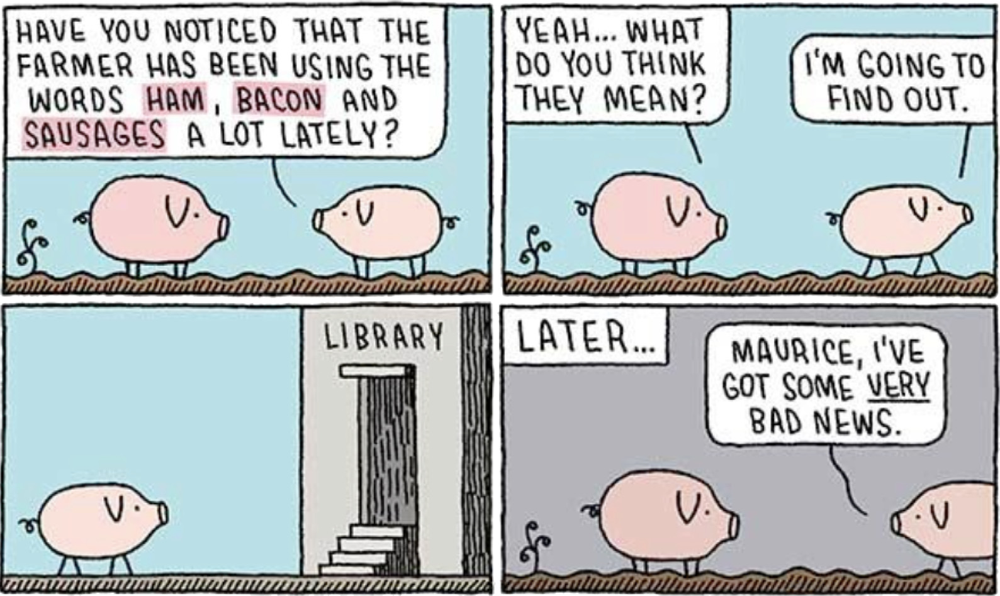

</div>

<div class="footnote">&copy; Tom Gauld, reproduced in Guizzardi and Guarino (2024), "Explanation, semantics, and ontology", <em>Data &amp; Knowledge Engineering</em> 153, 102325, Figure 1; shown here for discussion within the working group.</div>


---

<!-- slide 15 · The semantics is not enough -->

## The set-theoretic semantics is not enough

What must a reader know to understand the joke?

</br>

<span class="lbl">Set-theoretic semantics.</span> A function from each word to a subset of a domain $D$ of individuals gives $\llbracket\mathit{ham}\rrbracket,\ \llbracket\mathit{bacon}\rrbracket,\ \llbracket\mathit{sausages}\rrbracket\subseteq D$. Such a mapping, the paper says, "would not do Maurice here any good".

<span class="lbl">Ontology.</span> The kinds and relations the words are about form a separate system, which the paper states as three facts. Ham, bacon and sausage are food products constituted by pork. Pork comes from a pig. Maurice is a pig.
- In the deck's notation: $\mathit{Maurice}:\mathsf{Pig}$, $\ \mathsf{Ham}\sqsubseteq\exists\mathit{constitutedBy}.\mathsf{Pork}$ (every ham is constituted by some pork), $\ \mathsf{Pork}\sqsubseteq\exists\mathit{dependsOn}.\mathsf{Pig}$ (every quantity of pork comes from some pig).
- The library holds this. The dictionary does not.

</br>

The joke here arises from the system of kinds and relations, <span class="c-red">not from the set-theoretic semantics</span>.

<div class="footnote">Guizzardi and Guarino (2024), "Explanation, semantics, and ontology", <em>Data &amp; Knowledge Engineering</em> 153, 102325, &sect;2.1: the quotation, and the three facts (1)–(3) that understanding the cartoon needs, stated there in words; the symbols are the deck's.</div>


---

<!-- slide 16 · When Maurice learns the ontology -->

<style scoped>
.fig { margin: 0.2em 0 0.4em 0; }
.fig img { width: 100%; display: block; }
p { font-size: 19px; margin: 0 0 0.35em 0; }
</style>

## When Maurice learns the ontology

<div class="fig">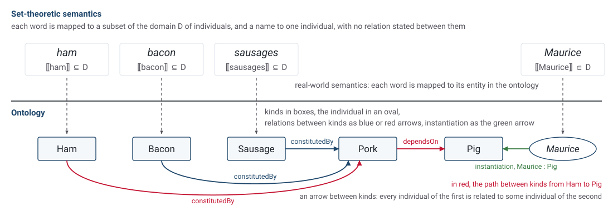</div>

<span class="lbl">The inference.</span> Every ham is constituted by some pork. Every quantity of pork comes from some pig. Maurice is a pig. No fact says that the pork in any ham comes from Maurice.

<div class="footnote">Guizzardi and Guarino (2024), &sect;2.1: "Mapping the words 'ham', 'bacon' and 'sausages' to subsets of a semantic domain would not do Maurice here any good"; the three facts (1)&ndash;(3); real-world semantics "maps symbols to the entities (types, relations, objects, events, aspects) that are part of this ontology".</div>

---

<!-- slide 17 · Semantics and Ontology -->

<style scoped>
table { font-size: 14px; margin: 0.3em 0 0 0; width: 100% !important; }
th, td { padding: 0.24em 0.8em 0.24em 0; vertical-align: top; }
th:first-child, td:first-child { width: 22%; }
p, li { font-size: 18.5px; }
.katex { white-space: nowrap; }
p { margin: 0 0 0.4em 0; }
ul { margin: 0 0 0.3em 0; }
li { margin: 0 0 0.05em 0; }
</style>

## Semantics and Ontology

<span class="lbl">Set.</span> A set-theoretic semantics maps each word to a subset of a domain $D$ of individuals, $\llbracket\mathit{ham}\rrbracket\subseteq D$, and nothing more.

<span class="lbl">Type.</span> The ontology is a separate system of kinds, individuals and relations, written as typed symbols.
- Kinds: $\mathsf{Pig},\ \mathsf{Pork},\ \mathsf{Ham},\ \mathsf{Bacon},\ \mathsf{Sausage}$. The word $\mathit{ham}$ names the kind $\mathsf{Ham}$, whose instances are the individual hams.
- Individual: $\mathit{Maurice}:\mathsf{Pig}$. A typed symbol pairs a symbol with the kind of what it names. Here the colon is the instantiation relation, which holds between the individual Maurice and the kind $\mathsf{Pig}$.
- Relations: $\mathit{constitutedBy}$, a relation from $\mathsf{Ham}$ to $\mathsf{Pork}$, and $\mathit{dependsOn}$, a relation from $\mathsf{Pork}$ to $\mathsf{Pig}$. Each holds between individuals of its two kinds and is not a function from one kind to the other. The kind-level facts $\mathsf{Ham}\sqsubseteq\exists\mathit{constitutedBy}.\mathsf{Pork}$ and $\mathsf{Pork}\sqsubseteq\exists\mathit{dependsOn}.\mathsf{Pig}$ say that every ham is constituted by some pork and that every quantity of pork comes from some pig.

| | The pigs | The buffer-stock model |
|---|---|---|
| Written form | $\mathit{ham},\ \mathit{bacon},\ \mathit{sausages}$ | $m,\ y,\ \mathbb{E},\ v,\ \mathbb{T}$ in the Bellman equation |
| Semantics, $\llbracket\cdot\rrbracket$ into a set | $\llbracket\mathit{ham}\rrbracket,\ \llbracket\mathit{bacon}\rrbracket,\ \llbracket\mathit{sausages}\rrbracket\subseteq D$ | $\llbracket\text{Bellman equation}\rrbracket=\mathbb{T}$, some operator |
| Left open | foods for pigs, or foods from pigs | which variable $\max$ chooses and which $\mathbb{E}$ averages over, the space of $v$, the law and timing of $y$ |
| Ontology, typed statements | $\mathit{Maurice}:\mathsf{Pig}$, $\mathsf{Ham}\sqsubseteq\exists\mathit{constitutedBy}.\mathsf{Pork}$, $\mathsf{Pork}\sqsubseteq\exists\mathit{dependsOn}.\mathsf{Pig}$ | $v:\mathbb{R}_{++}\to\mathbb{R}$, $\ y:\mathbb{R}_{++}$ with law $\nu_y$, $\ \mathbb{T}:(\mathbb{R}_{++}\to\mathbb{R})\to(\mathbb{R}_{++}\to\mathbb{R})$ |
| False agreement | two pigs agree that the words name foods, one meaning foods for pigs and the other foods from pigs | two readers accept the Bellman equation and disagree on the timing of the price response to a shock |

<div class="footnote">Guizzardi and Guarino (2024), "Explanation, semantics, and ontology", <em>Data &amp; Knowledge Engineering</em> 153, 102325, &sect;2.1 (semantics as a function; an ontology as "a specific theory about the kinds of entity and their ties"; types, individuals and instantiation, where the paper's word for a kind is "type"; the facts (1) and (2) are stated there in words and written above in the deck's notation), &sect;3.4 (false agreement).</div>


---

<!-- slide 18 · The answer -->

<style scoped>
.stack > div { padding: 0 0 1.1em 0; font-size: 22px; line-height: 1.5; }
.stack > div:last-child { padding-bottom: 0; }
.stack p { margin: 0; }
</style>

<style scoped>
.answer { font-size: 26px; line-height: 1.5; margin: 0.6em 0 0 0; }
</style>

## The answer

<div class="answer">

A semantic ontology is the mathematics of the model, with the types, binders and laws that the paper's Bellman equation leaves to the reader, stated in a machine-readable file.

</div>

- An economist supplies the missing meaning from implicit context, the conventions of a subfield and the paper's surrounding prose (slides 9 to 11).
- An AI may *seem* to supply the same meaning, although it draws on the statistics of its training data rather than on a deterministic set of rules.
  - The reading it returns is stochastic, and producing it is expensive, since the AI must search the paper and similar papers for context.

<div class="footnote">Project A proposal, the paragraph that defines a semantic ontology: a statement, independent of the code, of which economic objects are computed and which relations among them are enforced.</div>


---

<!-- slide 19 · What does DYNARE do? -->

<style scoped>
.center img { margin: 0 auto; display: block; }
.stack > div { padding: 0 0 0.6em 0; font-size: 18px; line-height: 1.42; }
.stack > div:last-child { padding-bottom: 0; }
.stack p { margin: 0; }
.stack code { font-size: 14px; }
</style>

## What does DYNARE do?

Without semantic ontologies, how does DYNARE work?

<div class="sub">Both routes parse the file into a tree that holds syntax only, and both end in solver code. An ideal declarative language first builds ⟦file⟧, the model as a typed object, by Υ (upsilon), and then attaches a numerical method to it by Ρ (rho). Dynare applies Ρ to the tree directly, so its Υ is never written and the interpretation is attached implicitly, inside the numerical implementation.</div>

<div class="center">

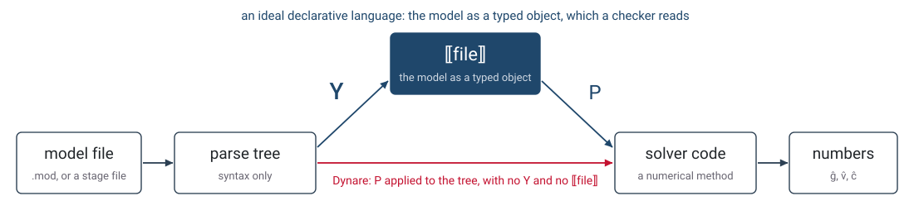

</div>

<div class="stack">
<div>

<span class="lbl">The meaning of a <code>.mod</code> file.</span> It is <span class="c-red">what the program does with the file</span>: "The Dynare Preprocessor defines the Dynare model language" (the preprocessor's README).

</div>
</div>

<div class="footnote">Υ and Ρ: Bellman calculus, Introduction §1 &middot; Dynare preprocessor README (13 October 2026); Adjemian et al. (2026), <em>Dynare: Reference Manual, Version 7</em>, §4.2, §4.3.1.1, §4.13.1; the model class: Villemot (2011), Dynare Working Paper 2, §2.1.</div>


---

<!-- slide 20 · What an AI needs beyond Dynare -->

<style scoped>
.stack > div { padding: 0 0 1em 0; font-size: 21px; line-height: 1.5; }
.stack > div:last-child { padding-bottom: 0; }
.stack p { margin: 0; }
</style>

## What an AI needs beyond Dynare

<div class="stack">
<div>

<span class="lbl">Dynare does what it was built for.</span> One program, one solver and one set of conventions, learned once, have given economists the right numbers from a short file since Juillard (1996).

</div>
<div>

<span class="lbl">Its meaning is tied to its numerics.</span> The model has no statement apart from the perturbation solver, so a model moved to HARK or to the sequence-space Jacobian toolkit can be compared with it <span class="c-red">only through the numbers</span>.

</div>
<div>

<span class="lbl">An AI writing new code needs more.</span> Its file is checked for syntax, for one equation per variable and for a steady state, <span class="c-red">not for what it means</span>. New code, for a new model or another toolkit, needs the model stated apart from any solver, where a checker can read and refuse it.

</div>
</div>

<div class="footnote">Juillard (1996), CEPREMAP Working Paper 9602 &middot; Adjemian et al. (2026), <em>Dynare: Reference Manual, Version 7</em>, 7.2: §4.5 (the model block), §4.10 (<code>steady</code>), §4.11 (<code>check</code>) &middot; Auclert, Bardóczy, Rognlie and Straub (2021), <em>Econometrica</em> 89(5), 2375–2408.</div>


---

<!-- slide 21 · Examples of semantic ontologies (divider) -->

<!-- _class: divider -->

# Examples of semantic ontologies


---

<!-- slide 22 · Three parts to a semantic ontology -->

<style scoped>
.stack > div { padding: 0 0 1em 0; font-size: 21px; line-height: 1.5; }
.stack > div:last-child { padding-bottom: 0; }
.stack p { margin: 0; }
.katex-display { margin: 0.2em 0 1em 0 !important; font-size: 1.05em; }
</style>

## Three parts to a semantic ontology

$$
\text{written form}\ \xrightarrow{\quad\Upsilon\quad}\ \text{domain of meaning}
$$

<div class="stack">
<div>

<span class="lbl">The written form.</span> Machine-readable symbols, each with a <span class="c-red">type</span> and a signature, what it takes and what it returns, as in $v : X \to \mathbb{R}$.

</div>
<div>

<span class="lbl">The domain of meaning.</span> The objects we model, sorted into <span class="c-red">kinds</span> with relations between them: state spaces, laws, value functions and operators, as the kinds of slide 17 are Pig, Ham and Pork.

</div>
<div>

<span class="lbl">The map Υ (upsilon).</span> It sends a symbol of a given type to an object of the matching kind, and a program <span class="c-red">checks</span> that it does. Economists already have the domain, since their models are well described. Project A supplies the written form and the map.

</div>
</div>

<div class="footnote">Harel and Rumpe (2004), "Meaningful modeling: what's the semantics of 'semantics'?", <em>Computer</em> 37(10), 64–72, for the three parts &middot; Bellman calculus, Introduction §1 (bellman-ddsl/docs) &middot; in this deck a type belongs to the written form and a kind to the domain; Guizzardi and Guarino (2024) write "type" for what the deck calls a kind.</div>


---

<!-- slide 23 · Economics – one stage of the buffer-stock problem as a stage file -->

<style scoped>
.center img { margin: 0 auto; display: block; }
.terms { display: grid; grid-template-columns: 1fr 1fr 1fr; gap: 1.6em; margin: 0.9em 0 0 0; font-size: 18px; line-height: 1.42; }
.terms p { margin: 0; }
.terms code { font-size: 14.5px; }
</style>

## Economics: one stage of the buffer-stock problem as a stage file

<div class="sub">Project Bellman writes one period of the problem as a stage file in the language Bellman-SYM.</div>

<div class="center">

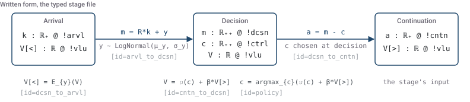

</div>

<div class="terms">
<div>

<span class="lbl">Perches.</span> The three information sets of the period: <span class="c-red">arrival</span> `!arvl`, <span class="c-red">decision</span> `!dcsn` and <span class="c-red">continuation</span> `!cntn`.

</div>
<div>

<span class="lbl">Fields.</span> A state or a value declared at a perch with its set, as in `m : ℝ₊₊ @ !dcsn`.

</div>
<div>

<span class="lbl">Blocks.</span> The equations between two perches: the transition with the shock, the choice, and the expectation.

</div>
</div>

<div class="footnote">Bellman-SYM, Stages §§1–4 (the documentation example, in the letters k, m, a of the calculus); Bellman calculus, Stages and perches §1 (bellman-ddsl/docs) &middot; the law line fixes the convention that slide 10 left to a subfield.</div>


---

<!-- slide 24 · Economics – what the stage file refuses or makes visible -->

<style scoped>
table { font-size: 16.5px; margin: 0.3em 0 0.9em 0; width: 100% !important; }
th, td { padding: 0.38em 0.8em 0.38em 0; vertical-align: top; }
th:first-child, td:first-child { width: 52%; }
td code { font-size: 13.5px; }
.link { font-size: 18px; line-height: 1.42; margin: 0.6em 0 0 0; }
</style>

## Economics: what the stage file refuses or makes visible

<div class="sub">Υ (upsilon) reads each field and block of the file as a typed object. The elaborator, the program that constructs those objects, refuses a line that the types do not admit and names the rule.</div>

| The file writes | Under Υ it denotes |
|---|---|
| `V[>] : ℝ @ !vlu` at the continuation perch | $v_\succ:\mathbb{R}_+\to\mathbb{R}$, a function of savings, never a number |
| the choice block `[id=cntn_to_dcsn]` with `policy` | $\mathbb{T}_\succ:\mathsf{V}_\succ\to\mathsf{V}$, the choice operator |
| the expectation block `[id=dcsn_to_arvl]` | $\mathbb{T}_\prec:\mathsf{V}\to\mathsf{V}_\prec$, the expectation operator |

| A line that | The elaborator |
|---|---|
| reads the shock beside its expectation, `V[<] = E_{y}(V) + y` | <span class="c-red">refuses</span> it under `shock-reintroduced`, since $y$ is not known at arrival |
| lists a continuation value at the decision perch | <span class="c-red">refuses</span> it under `field-perch`, since the value is a function of savings |
| puts the mean of the shock in the transition, `m = R*k + exp(μ_y + σ_y^2/2)` | <span class="c-green">accepts</span> it, and the different model stands visible on that line |
| writes a second `β` in the expectation block | <span class="c-green">accepts</span> it, and the second `β` stands visible on its own line |
| would impose a stationary closure $v_{t+1}=v_t$ | has no line for it, since `V[>]` comes from the next period or the terminal boundary |

<div class="link"><a href="#the-bellman-calculus-in-full" class="c-red">The appendix, slides 43 to 53, gives the full file, each refusal with its rule, and the period and trellis files.</a></div>

<div class="footnote">The reference on refusals, rules shock-reintroduced and field-perch; Bellman-SYM, Field equations §5, Perch tagging rules §3, Periods §§2–3, Trellises §2; the runs of <code>elaborate_text</code> of 13 October 2026 listed on the appendix slides.</div>


---

<!-- slide 25 · Biology – the Gene Ontology -->

<style scoped>
.center img { margin: 0 auto; display: block; }
.stack > div { padding: 0 0 0.8em 0; font-size: 19px; line-height: 1.45; }
.stack > div:last-child { padding-bottom: 0; }
.stack p { margin: 0; }
.stack code { font-size: 15px; }
</style>

## Biology: the Gene Ontology

<div class="center">

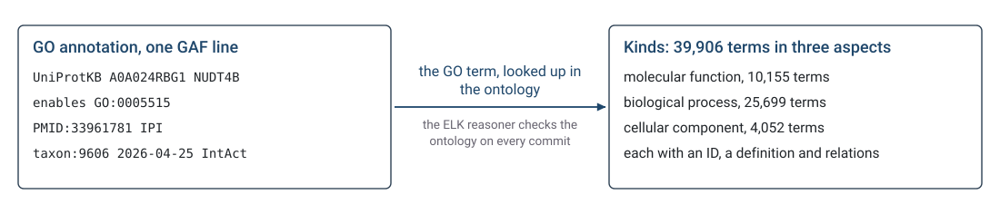

</div>

<div class="stack">
<div>

<span class="lbl">Excludes.</span> A missing annotation read as the absence of a function (the open-world assumption), a NOT read as an inconclusive result, and a term read by its name rather than by its definition and relations, since a label must be unique and a definition must always denote the same referents (OBO Foundry principles 12 and 19).

</div>
<div>

<span class="lbl">For economics.</span> A model's object is named by a <span class="c-red">term with a definition and relations</span>, not by a variable name. The role tags `!ctrl` and `!vlu` and the law line of a stage file play that part, as the `sboTerm` of the Systems Biology Ontology does for a rate law in SBML.

</div>
</div>

<div class="footnote">Ashburner et al. (2000), "Gene Ontology: tool for the unification of biology", <em>Nature Genetics</em> 25(1), 25–29 &middot; The Gene Ontology Consortium (2026), "The Gene Ontology knowledgebase in 2026", <em>Nucleic Acids Research</em> 54(D1), D1779–D1792, Table 3 (the release of 22 July 2025) &middot; GAF 2.2 documentation and the human annotation file of 21 May 2026 (geneontology.org); the go-ontology build file, which runs the ELK reasoner &middot; SBO: Courtot et al. (2011), <em>Molecular Systems Biology</em> 7, 543.</div>


---

<!-- slide 26 · Engineering – OntoCAPE, the ontology for chemical process engineering -->

<style scoped>
.center img { margin: 0 auto; display: block; }
.stack > div { padding: 0 0 0.8em 0; font-size: 19px; line-height: 1.45; }
.stack > div:last-child { padding-bottom: 0; }
.stack p { margin: 0; }
.stack code { font-size: 15px; }
</style>

## Engineering: OntoCAPE, the ontology for chemical process engineering

<div class="center">

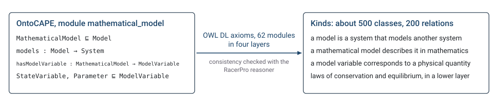

</div>

<div class="stack">
<div>

<span class="lbl">Excludes.</span> A model confused with the system it models, and a model variable confused with the physical quantity it stands for: the relation `models` joins a model to its system, and `correspondsToQuantity` pairs a variable with a quantity, as a declared domain excludes the deck's <span class="c-red">function on the wrong space</span>.

</div>
<div>

<span class="lbl">For economics.</span> OntoCAPE is the nearest case to Project A, an ontology of models themselves: model variables, equation systems and solution strategies are kinds in its modules, so that a process model and its solver are distinct typed objects, as Υ and Ρ keep a model apart from its numerical method.

</div>
</div>

<div class="footnote">Morbach, Yang and Marquardt (2007), "OntoCAPE—A large-scale ontology for chemical process engineering", <em>Engineering Applications of Artificial Intelligence</em> 20(2), 147–161 &middot; Morbach, Wiesner and Marquardt (2009), <em>Computers &amp; Chemical Engineering</em> 33(10), 1546–1556 &middot; Marquardt, Morbach, Wiesner and Yang (2010), <em>OntoCAPE: A Re-Usable Ontology for Chemical Process Engineering</em>, Springer &middot; the OntoCAPE 2.0 distribution (AVT, RWTH Aachen, GPL): system.owl and mathematical_model.owl; technical reports LPT-2008-25 and LPT-2008-28; Morbach (2009), dissertation, RWTH Aachen, on the RacerPro checks.</div>


---

<!-- slide 27 · Earth science – the SWEET ontologies -->

<style scoped>
.center img { margin: 0 auto; display: block; }
.stack > div { padding: 0 0 0.8em 0; font-size: 19px; line-height: 1.45; }
.stack > div:last-child { padding-bottom: 0; }
.stack p { margin: 0; }
.stack code { font-size: 15px; }
</style>

## Earth science: the SWEET ontologies

<div class="center">

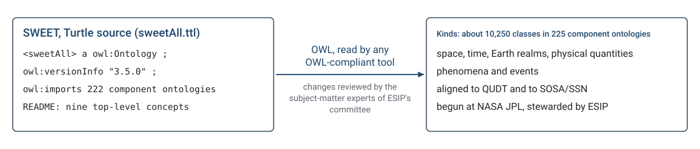

</div>

<div class="stack">
<div>

<span class="lbl">Excludes.</span> A quantity name read as any of several kinds: a SWEET class fixes the kind by its definition and by its place among realms, quantities and phenomena. The CF standard names, published as SKOS concepts with their canonical units on the NERC vocabulary server, settle the same question for a netCDF variable such as `temp`, which is <span class="c-red">the law behind a parameter</span> and <span class="c-red">timing stated in words</span> in the deck's terms.

</div>
<div>

<span class="lbl">For economics.</span> The comparison paper of the special issue that Project A proposes needs a vocabulary of this kind: which object each team reports, a value or a marginal value function, on which state and under which timing (den Haan, Judd and Juillard 2010, 2011).

</div>
</div>

<div class="footnote">Raskin and Pan (2005), "Knowledge representation in the semantic web for Earth and environmental terminology (SWEET)", <em>Computers &amp; Geosciences</em> 31(9), 1119–1125 &middot; ESIPFed/sweet, release 3.5.0 (14 July 2022), the header of sweetAll.ttl; the class count from the 3.5.0 source &middot; CF standard names: NERC Vocabulary Server, collection P07, version 95 (16 September 2026), publisher Natural Environment Research Council, owner the CF Standard Names Committee &middot; den Haan, Judd and Juillard (2010, 2011), <em>Journal of Economic Dynamics and Control</em> 34(1), 1–3 and 35(2), 175–177.</div>


---

<!-- slide 28 · Finance – FIBO, the Financial Industry Business Ontology -->

<style scoped>
.center img { margin: 0 auto; display: block; }
.stack > div { padding: 0 0 0.8em 0; font-size: 19px; line-height: 1.45; }
.stack > div:last-child { padding-bottom: 0; }
.stack p { margin: 0; }
.stack code { font-size: 15px; }
</style>

## Finance: FIBO, the Financial Industry Business Ontology

<div class="center">

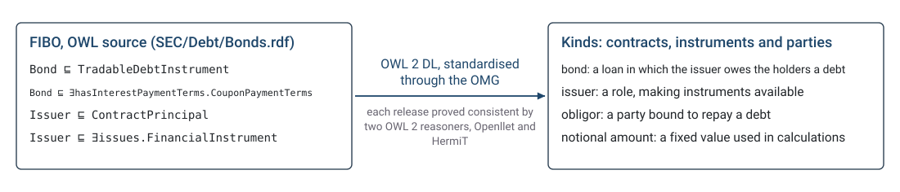

</div>

<div class="stack">
<div>

<span class="lbl">Excludes.</span> An issuer read as the obligor of a bond, and a notional amount read as a principal: each is a defined class or property, and the 2023 revision of the Swaps ontology separated the nominal from the notional amount, which its change note says "were confused". In the deck's terms, <span class="c-red">a function on the wrong space</span> and <span class="c-red">the law behind a parameter</span>.

</div>
<div>

<span class="lbl">For economics.</span> FIBO is finance's own ontology, with the Bureau of Economic Analysis, the Bureau of Labor Statistics, the CFTC and the Office of Financial Research among its contributors, and the 2026 rule under the Financial Data Transparency Act records it among the standards that commenters proposed. Project A's ontology names the objects of a model as FIBO names the parties and terms of a contract.

</div>
</div>

<div class="footnote">EDM Council, FIBO (spec.edmcouncil.org/fibo), release Q2 2026 (14 July 2026), MIT licence; the development-process page on consistency; onto-viewer's consistency checker (Openllet and HermiT) &middot; OMG specifications EDMC-FIBO/FND 1.2, BE 1.1, FBC 1.0 and IND 1.0 (2017–2018) &middot; Bennett (2013), "The financial industry business ontology: best practice for big data", <em>Journal of Banking Regulation</em> 14(3–4), 255–268 &middot; Allemang, Garbacz, Grądzki, Kendall and Trypuz (2021), <em>FOIS 2021</em>, 112–126 &middot; Financial Data Transparency Act Joint Data Standards, 91 FR 38246 (25 June 2026) &middot; GoodRelations, the ontology schema.org absorbed in 2012: Hepp (2008), <em>EKAW 2008</em>, LNCS 5268, 329–346.</div>


---

<!-- slide 29 · Knowledge representation – OWL 2, the language ontologies are written in -->

<style scoped>
.center img { margin: 0 auto; display: block; }
.stack > div { padding: 0 0 0.8em 0; font-size: 19px; line-height: 1.45; }
.stack > div:last-child { padding-bottom: 0; }
.stack p { margin: 0; }
.stack code { font-size: 15px; }
</style>

## Knowledge representation: OWL 2, the language ontologies are written in

<div class="center">

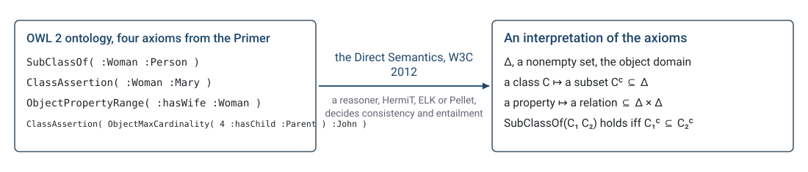

</div>

<div class="stack">
<div>

<span class="lbl">Excludes.</span> Any reading of the axioms other than the one the Direct Semantics fixes: "the correct answer to any such question is predetermined by the formal semantics", whatever reasoner computes it (Primer §2). Nor is a missing statement read as false, or two names as two individuals.

</div>
<div>

<span class="lbl">For economics.</span> This is the three-part definition <span class="c-red">in full</span>: classes, properties and individuals as typed symbols, an interpretation as the domain, and a map whose consistency and entailments a reasoner decides. A stage file's Υ plays the part of the Direct Semantics, and the elaborator the part of the reasoner.

</div>
</div>

<div class="footnote">W3C (2012), <em>OWL 2 Web Ontology Language</em>, Recommendations of 11 December 2012: Document Overview §2.3; Direct Semantics §§2.2–2.5; Profiles §§1 and 5; Primer §§2, 4 and 9 &middot; Baader, Calvanese, McGuinness, Nardi and Patel-Schneider (eds.) (2007), <em>The Description Logic Handbook</em>, 2nd ed., Cambridge University Press &middot; HermiT: Glimm, Horrocks, Motik, Stoilos and Wang (2014), <em>Journal of Automated Reasoning</em> 53(3), 245–269; ELK: Kazakov, Krötzsch and Simančík (2014), <em>Journal of Automated Reasoning</em> 53(1), 1–61.</div>


---

<!-- slide 30 · The five cases against the three parts of a semantic ontology -->

<style scoped>
table { font-size: 16px; margin: 0.3em 0 0 0; width: 100% !important; }
th, td { padding: 0.45em 0.7em 0.45em 0; vertical-align: top; }
th:first-child, td:first-child { width: 15%; }
td code { font-size: 13.5px; }
</style>

## The five cases against the three parts of a semantic ontology

<div class="sub">Each row places one case against the three parts of slide 22, the typed symbols of the written form, the domain of meaning and the map between them, and names in the last column the program that checks the map.</div>

| Case | Typed symbols | Domain | Map | Checker |
|---|---|---|---|---|
| Gene Ontology | the GO terms, each by ID | kinds of molecular function, biological process and cellular component | the term in a GAF annotation | the ELK reasoner on the ontology at every commit |
| OntoCAPE | OWL classes and relations in 62 modules | models, systems, materials and quantities | the axioms, `models` and `hasModelVariable` | the RacerPro reasoner |
| SWEET and the CF names | OWL classes, and SKOS concepts for the CF names | Earth-science quantities, realms and phenomena | the class, or the standard name on a variable | any OWL tool; the CF checker against the NVS table |
| FIBO | OWL classes and properties | contracts, instruments and parties | the class asserted of a record | two OWL 2 reasoners on every release |
| OWL 2 | classes, properties and individuals | an interpretation: a set with relations on it | the Direct Semantics | a reasoner: consistency and entailment |

<div class="footnote">Harel and Rumpe (2004), <em>Computer</em> 37(10), 64–72, for the three parts &middot; the sources of each case are on its slide: Ashburner et al. (2000) and the Gene Ontology Consortium (2026); Morbach, Yang and Marquardt (2007); Raskin and Pan (2005) and the NERC Vocabulary Server; the EDM Council and Bennett (2013); W3C (2012).</div>


---

<!-- slide 31 · The stage file against the same three parts -->

<style scoped>
table { font-size: 17px; margin: 0.3em 0 0 0; width: 100% !important; }
th, td { padding: 0.5em 0.8em 0.5em 0; vertical-align: top; }
th:first-child, td:first-child { width: 22%; }
td code { font-size: 14px; }
</style>

## The stage file against the same three parts

<div class="sub">The stage file of slide 45, the deck's own written form, is read here against the columns of the table on slide 30.</div>

| Part | In the Bellman-SYM stage file |
|---|---|
| Typed symbols | the fields and the blocks, each with a type and a perch, and the declared law of the shock (slide 45) |
| Domain | state spaces, laws, value functions and the operators between them (slide 22) |
| Map | the perch tags `@ !arvl`, `@ !dcsn` and `@ !cntn`, the role tags `!ctrl` and `!vlu` and the law line (slide 45), interpreted by Υ (upsilon), the checked interpretation of slide 39, as the objects of slide 22 |
| Checker | the elaborator (slide 48), which constructs the typed object or refuses the file, naming the rule the file breaks and the line; and the comparator, a program that compares two elaborated files up to renaming and reports, for each kind of item, agreement, difference or an undecided residue, the items it can neither match nor reject (slide 34) |
| Run on the file of slide 45 | The elaborator constructed the object from the file and refused the line `E_{y}(V) + y`, with `y` listed among the block's inputs, under `shock-reintroduced`.<br>The comparator read the file and the documentation example, with b and w for k and m, as one object under that renaming. |

<div class="footnote">Bellman-SYM, Stages §5 (checked interpretation) &middot; bellman-ddsl wiki, Υ §1 (the elaborator) and judge §4 (the comparator) &middot; the runs: <code>elaborate_text</code> of <code>bellman.factory.elaboration</code> and <code>compare</code> of <code>meaning_map_training.compare</code>, 13 October 2026, on the stage file of slide 45 and on Bellman-SYM's documentation example (Stages §4).</div>


---

<!-- slide 32 · Kinds, individuals and the community library (divider) -->

<!-- _class: divider -->

# Kinds, individuals and the community library


---

<!-- slide 33 · Kind and individual -->

<style scoped>
.stack > div { padding: 0 0 1em 0; font-size: 20px; line-height: 1.48; }
.stack > div:last-child { padding-bottom: 0; }
.stack p { margin: 0; }
.stack code { font-size: 15.5px; }
.katex-display { margin: 0.2em 0 1em 0 !important; font-size: 0.92em; }
.rule { font-family: 'Newsreader', Georgia, serif; font-size: 27px; line-height: 1.3; color: var(--ark-head); margin: 0.2em 0 1em 0; }
</style>

## Kind and individual

$$\text{written form}\ \xrightarrow{\ \ \Upsilon\ \ }\ \underbrace{\mathbb{T}_\prec\circ\mathbb{T}_\succ:\mathsf{V}_\succ\to\mathsf{V}_\prec}_{\text{the kind: the model as a mathematical object}}\ \xrightarrow{\ \ \text{Ρ}\ \ }\ \underbrace{(\hat{\mathbb{T}}_\prec\circ\hat{\mathbb{T}}_\succ)_{\text{HARK}},\ (\hat{\mathbb{T}}_\prec\circ\hat{\mathbb{T}}_\succ)_{\text{SSJ}}}_{\text{individuals: the operator with grids, quadrature and interpolation attached}}$$

<div class="stack">
<div>

<span class="lbl">In the cartoon.</span> $\mathsf{Pig}$ is a kind and Maurice an individual of it, although the taxonomy holds no pig.

</div>
<div>

<span class="lbl">In a library of models.</span> The shared model statement with its calibration is the <span class="c-red">kind</span>. Each toolkit's implementation, with its own shock approximation, grids and interpolation, is an <span class="c-red">individual</span>, and a change of interpolation changes the approximation, not the operation.

</div>
</div>

<div class="footnote">Guizzardi and Guarino (2024), &sect;2.1, types, individuals and instantiation &middot; Bellman calculus, Introduction §1 (Υ and Ρ; "changing an interpolation method produces a different numerical approximation to a specified mathematical operation") &middot; SSJ: the sequence-space Jacobian toolkit of Auclert, Bardóczy, Rognlie and Straub (2021).</div>


---

<!-- slide 34 · What the library asks of an implementation -->

<style scoped>
.stack > div { padding: 0 0 1em 0; font-size: 20px; line-height: 1.48; }
.stack > div:last-child { padding-bottom: 0; }
.stack p { margin: 0; }
.stack code { font-size: 15.5px; }
.katex-display { margin: 0.2em 0 1em 0 !important; font-size: 0.92em; }
.rule { font-family: 'Newsreader', Georgia, serif; font-size: 27px; line-height: 1.3; color: var(--ark-head); margin: 0.2em 0 1em 0; }
</style>

## What the library asks of an implementation

<div class="rule">"Keep the model and calibration fixed, and choose your own prose, solution method and runnable format."</div>

<div class="stack">
<div>

<span class="lbl">Fixed.</span> The model statement and its calibration, one per baseline model: the kind.

</div>
<div>

<span class="lbl">Free.</span> The solution method, the finite approximation of the shocks, the grids and the toolkit: Ρ (rho), the numerical construction, which each project chooses.

</div>
<div>

<span class="lbl">Compared.</span> The results, against reference values and draft tolerances, with the timing convention stated once because it is "the single most common source of results that fail to line up".

</div>
</div>

<div class="footnote">The Community Library of Baseline Models, README and the buffer-stock submission guide (QuantEcon, 2026); the template brief of 11 September 2026 (reference values and tolerances) &middot; SCE WG1, model specification template, draft v0.1: "pin the economics, leave the method free"; §2 on the timing convention.</div>


---

<!-- slide 35 · Why the kind has to be stated -->

<style scoped>
.stack > div { padding: 0 0 1em 0; font-size: 20px; line-height: 1.48; }
.stack > div:last-child { padding-bottom: 0; }
.stack p { margin: 0; }
.stack code { font-size: 15.5px; }
.katex-display { margin: 0.2em 0 1em 0 !important; font-size: 0.92em; }
.rule { font-family: 'Newsreader', Georgia, serif; font-size: 27px; line-height: 1.3; color: var(--ark-head); margin: 0.2em 0 1em 0; }
</style>

## Why the kind has to be stated

<div class="stack">
<div>

<span class="lbl">Numbers can agree while the problems differ.</span> "Krusell–Smith" denotes different models across toolkits, and two solvers can print close values for two problems. Agreement of numbers is evidence only once both implementations claim the <span class="c-red">same object</span>.

</div>
<div>

<span class="lbl">A stated kind makes the test well posed.</span> The comparator reads two declarations as one object up to renaming. The numbers then test only Ρ: a <span class="c-red">misreading</span> of the model is caught by the comparator, an <span class="c-red">error in the code</span> only by the numbers.

</div>
<div>

<span class="lbl">Today the link is a name.</span> An implementation names its model by a link to the shared description and the entry `model: "BST"`, which only the numbers test. In the five cases of slides 25 to 29 the record carries a term that a checker reads. A stage file would give the library the same.

</div>
</div>

<div class="footnote">bellman-ddsl, model-class relations, literature note of 1 October 2026 ("'Krusell-Smith' denotes different models across toolkits") &middot; Bellman calculus, Introduction §1: parsing, interpretation, method assignment, calibration and execution must all agree for a result to approximate the declared problem &middot; bellman-ddsl wiki, judge §4 (the comparator) &middot; the buffer-stock submission guide, the optional metadata entry.</div>


---

<!-- slide 36 · The community library holds the individuals -->

<style scoped>
.stack > div { padding: 0 0 1em 0; font-size: 20px; line-height: 1.48; }
.stack > div:last-child { padding-bottom: 0; }
.stack p { margin: 0; }
.stack code { font-size: 15.5px; }
.katex-display { margin: 0.2em 0 1em 0 !important; font-size: 0.92em; }
.rule { font-family: 'Newsreader', Georgia, serif; font-size: 27px; line-height: 1.3; color: var(--ark-head); margin: 0.2em 0 1em 0; }
</style>

## The community library holds the individuals

<div class="stack">
<div>

<span class="lbl">Project B.</span> The library, hosted by QuantEcon, publishes tutorials that solve the same baseline models in different toolkits from one model statement and one calibration, so that readers can <span class="c-red">compare the results</span>. Five baseline models are proposed.

</div>
<div>

<span class="lbl">The precedent.</span> BioModels holds about 2,000 models in SBML. For the 800 curated ones the curators have checked the representation against the biology, checked that simulations reproduce the publication, and attached ontology terms (Malik-Sheriff et al. 2020).

</div>
<div>

<span class="lbl">The corpus is the interface.</span> Every semantics paper of Project A treats the same baseline models, and its verification experiments run on the library's implementations. The library supplies the individuals on which the ontology's checks run, and receives in return a kind that a program can check.

</div>
</div>

<div class="footnote">The Community Library of Baseline Models, README (QuantEcon, 2026) &middot; Malik-Sheriff et al. (2020), "BioModels: 15 years of sharing computational models in life science", <em>Nucleic Acids Research</em> 48, D407–D415 &middot; Project A brief, "Relation to Project B".</div>


---

<!-- slide 37 · Appendix (divider) -->

<!-- _class: divider -->

# Appendix


---

<!-- slide 38 · The parse tree of a written statement -->

<!-- _header: 'Appendix &middot; [return to slide 8](#context)' -->
<style scoped>
.cols { grid-template-columns: 1fr 1fr; gap: 1.6em; align-items: center; }
.stack > div { padding: 0 0 0.9em 0; font-size: 19px; line-height: 1.45; }
.stack > div:last-child { padding-bottom: 0; }
.stack p { margin: 0; }
</style>

## The parse tree of a written statement

Parsing a written statement into a tree, as every compiler first does, shows what the statement leaves to context.

<div class="cols">
<div>


</div>
<div>

<div class="stack">
<div>

<span class="lbl">What the parser does.</span> It splits `v = u(c) + beta * w` into a tree by grammar rules alone.

</div>
<div>

<span class="lbl">What the tree records.</span> The tree records only which symbol is applied to which, node by node.

</div>
<div>

<span class="lbl">What the tree omits.</span> The tree records nothing about what `v`, `c` or `w` are, which variable is bound where, or whether `v` is a function.

</div>
</div>

</div>
</div>

<div class="footnote">The tree is Python's abstract syntax tree, <code>ast.parse("v = u(c) + beta * w")</code>.</div>


---

<!-- slide 39 · From the syntax tree to the semantic graph -->

<!-- _header: 'Appendix &middot; [return to slide 8](#context)' -->
<style scoped>
.cols { grid-template-columns: 1.05fr 1fr; gap: 1.4em; align-items: center; }
.cols .katex-display { margin: 0.2em 0 0.2em 0 !important; font-size: 0.9em; }
.cap { font-size: 18px; line-height: 1.45; margin: 0.4em 0 0 0; }
</style>

## From the syntax tree to the semantic graph

In the model, $v$ is not a number obtained by adding $\beta w$ to $u(c)$. That $v_t=\mathbb{T}\,v_{t+1}$ sends a function to a function appears only once the binders, types and declarations on the right are attached to the tree, the dotted lines in the figure.

<div class="cols">
<div>

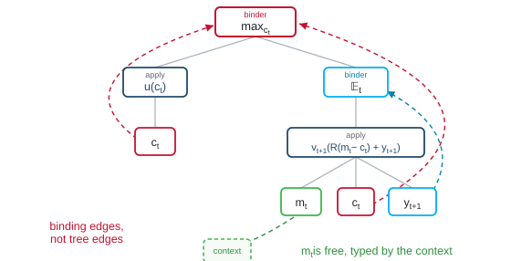

</div>
<div>

$$\begin{aligned}
&\textsf{binders:}&& \max_{c_t}\ \text{binds } c_t,\quad \mathbb{E}_t\ \text{binds } y_{t+1},\\
&&& v_t(m_t)=\cdots\ \ \forall m_t\in\mathbb{R}_{++}\ \text{ binds } m_t\\[4pt]
&\textsf{fixed from outside:}&& u:\mathbb{R}_{++}\to\mathbb{R},\quad \beta,\,R\in\mathbb{R},\\
&&& \nu_y\ \text{the law of } y_{t+1},\ \text{on } \mathbb{R}_{++}\\[4pt]
&\textsf{obtained:}&& v_{t+1}\big(R(m_t-c_t)+y_{t+1}\big):\mathbb{R},\\
&&& \mathbb{T}:(\mathbb{R}_{++}\to\mathbb{R})\to(\mathbb{R}_{++}\to\mathbb{R})
\end{aligned}$$

<div class="cap">The law <em>ν</em><sub><em>y</em></sub> is the probability distribution of the income shock. A semantic ontology states the quantifier over <em>m</em><sub><em>t</em></sub> on the left-hand side, the binder conventions, the types and the declarations of <em>u</em> and <em>ν</em><sub><em>y</em></sub>, none of which the tree records.</div>

</div>
</div>

<div class="footnote">Bellman-SYM, Project Bellman's model language, parses a file into such a tree, builds the semantic graph from it by a checked interpretation, which the calculus calls Υ (upsilon), and discards the tree (Bellman calculus, Introduction §2; Bellman-SYM, Stages §5).</div>


---

<!-- slide 40 · What the expectation integrates -->

<!-- _header: 'Appendix &middot; [return to slide 12](#multiple-possible-parsed-meanings)' -->
<style scoped>
.box { border: 1px solid var(--ark-line-2); border-left: 4px solid var(--ark-blue); border-radius: 4px; background: #ffffff; padding: 0.65em 1.1em 0.6em 1.1em; margin: 0 0 1.1em 0; font-size: 19px; line-height: 1.45; }
.box:last-child { margin-bottom: 0; }
.box .katex-display { margin: 0.35em 0 0.4em 0 !important; }
.box p { margin: 0; }
.sub p { margin: 0; }
</style>

## What the expectation integrates

<div class="sub">

The paper's Bellman equation gives $\mathbb{E}$ the date $t$ as its subscript rather than the variable it integrates. Because the tree specifies neither that variable nor the type of $\mathbb{E}_t$, each box below puts the paper's expression to the left of "read as" and a reading that the tree does not exclude to the right.

</div>

<div class="box">

<span class="lbl">The shock leaves the expectation.</span>
$$\mathbb{E}_t\,v\big(R(m-c)+y'\big)\qquad\text{read as}\qquad v\big(R(m-c)+\mathbb{E}_t\,y'\big)\quad\text{or}\quad \mathbb{E}_t\big[v\big(R(m-c)\big)\big]+y'.$$
Since Jensen's inequality gives $\mathbb{E}_t\,v(R(m-c)+y')\le v(R(m-c)+\mathbb{E}_t\,y')$ for concave $v$, the first reading overstates the continuation value. Because it replaces the income risk by its mean, it also removes the precautionary motive, the saving held against that risk (Kimball 1990). The second reading treats $y'$ as known before it is drawn.

</div>
<div class="box">

<span class="lbl">The expectation moved through the maximization.</span>
$$\max_c\big\{u(c)+\beta\,\mathbb{E}_t\,v_{t+1}(\cdot)\big\}\qquad\text{read as}\qquad \mathbb{E}_t\max_c\big\{u(c)+\beta\,v_{t+1}(\cdot)\big\}.$$
Since $\mathbb{E}\max\ge\max\mathbb{E}$, the reading on the right overstates the value and lets consumption respond to income that has not yet been drawn.

</div>

<div class="footnote">Jensen's inequality and the precautionary motive: Kimball (1990), "Precautionary saving in the small and in the large", <em>Econometrica</em> 58(1), 53–73.</div>


---

<!-- slide 41 · A number for a function, and a function on the wrong space -->

<!-- _header: 'Appendix &middot; [return to slide 12](#multiple-possible-parsed-meanings)' -->
<style scoped>
.box { border: 1px solid var(--ark-line-2); border-left: 4px solid var(--ark-blue); border-radius: 4px; background: #ffffff; padding: 0.65em 1.1em 0.6em 1.1em; margin: 0 0 1.1em 0; font-size: 19px; line-height: 1.45; }
.box:last-child { margin-bottom: 0; }
.box .katex-display { margin: 0.35em 0 0.4em 0 !important; }
.box p { margin: 0; }
</style>

## A number for a function, and a function on the wrong space

<div class="box">

<span class="lbl">A number where a function belongs.</span>
$$v_t=\mathbb{T}\,v_{t+1},\quad v_t:\mathbb{R}_{++}\to\mathbb{R}\qquad\text{read as}\qquad v_t(\hat m_t)\ \text{ alone, at }\ \hat m_t=R\,\hat k_t+\hat y_t,\ \text{ one simulated household's resources.}$$
The backward step then returns one number and one consumption $c_t(\hat m_t)$, although $\mathbb{T}$ needs $v_{t+1}$ at every $R(\hat m_t-c)+y'$. Under this reading the reader has simulated a path where the model asked for a function.

</div>
<div class="box">

<span class="lbl">A function on the wrong space.</span>
$$\mathbb{E}_t\,v_{t+1}(Ra+y')\ \text{ on savings } a=m-c,\ \text{the paper's } k_{t+1},\ a\in[0,\infty)\qquad\text{read as}\qquad v_{t+1}\ \text{ itself, on resources } m\in(0,\infty).$$
The borrowing limit acts at $a=0$, a point at which a function of resources is not defined, so that the two functions have different domains. A reading that confuses them puts the boundary at a point where the constraint does not act.

</div>


---

<!-- slide 42 · The discount and the expectation applied twice, and the recursion as a fixed point -->

<!-- _header: 'Appendix &middot; [return to slide 12](#multiple-possible-parsed-meanings)' -->
<style scoped>
.box { border: 1px solid var(--ark-line-2); border-left: 4px solid var(--ark-blue); border-radius: 4px; background: #ffffff; padding: 0.65em 1.1em 0.6em 1.1em; margin: 0 0 1.1em 0; font-size: 19px; line-height: 1.45; }
.box:last-child { margin-bottom: 0; }
.box .katex-display { margin: 0.35em 0 0.4em 0 !important; }
.box p { margin: 0; }
</style>

## The discount and the expectation applied twice, and the recursion as a fixed point

<div class="box">

<span class="lbl">The discount and the expectation applied by both steps once $\mathbb{T}$ is split.</span>
$$v_t=\max_c\big\{u(c)+\beta\,\mathbb{E}_t\,v_{t+1}(\cdot)\big\}\qquad\text{read as}\qquad v_t=\max_c\big\{u(c)+\beta^2\,\mathbb{E}_{y'}\mathbb{E}_{y''}\,v_{t+1}(\cdot)\big\}.$$
Since the Bellman equation writes $\beta$ and $\mathbb{E}_t$ once each, an implementation that splits $\mathbb{T}$ into the choice and the expectation, as slide 47 does, must decide which step applies $\beta$ and which applies $\mathbb{E}_t$. An implementation that applies $\beta$ and $\mathbb{E}_t$ in each of the two steps makes the household discount at $\beta^2$ and draw income twice.

</div>
<div class="box">

<span class="lbl">Dated value functions read as one stationary function.</span>
$$v_t=\mathbb{T}\,v_{t+1},\ \ v_{t+1}\ \text{an input}\qquad\text{read as}\qquad v=\mathbb{T}\,v,\ \ \text{a fixed point.}$$
A stationarity condition that the statement never makes replaces the backward recursion from a terminal value. Once the terminal value has disappeared from the problem, the last period's consumption is chosen as if another period followed.

</div>


---

<!-- slide 43 · The Bellman calculus in full (divider) -->

<!-- _class: divider sub -->

<p class="eyebrow">Appendix</p>

# The Bellman calculus in full


---

<!-- slide 44 · Stage, perch, field, block and builder -->

<!-- _header: 'Appendix &middot; [return to slide 24](#economics-what-the-stage-file-refuses-or-makes-visible)' -->
<style scoped>
.stack > div { padding: 0 0 0.9em 0; font-size: 19px; line-height: 1.45; }
.stack > div:last-child { padding-bottom: 0; }
.stack p { margin: 0; }
</style>

## Stage, perch, field, block and builder

<div class="stack">
<div>

<span class="lbl">Stage.</span> A stage is one unit of a dynamic programming problem, with three information sets: arrival, before the shock is drawn; decision, after it, where the choice is made; continuation, after the choice. One period of the buffer-stock problem is one stage. A period may list several stages, joined by connectors of the kind that slide 50 defines and slide 52 writes between periods.

</div>
<div>

<span class="lbl">Perch.</span> A perch is one of the three information sets of a stage.

</div>
<div>

<span class="lbl">Field.</span> A field is a state or a value declared at a perch.

</div>
<div>

<span class="lbl">Block.</span> The equations between declared inputs and outputs form a block.

</div>
<div>

<span class="lbl">Builder.</span> Under Υ (upsilon), a block denotes one operator, a builder.

</div>
</div>

<div class="footnote">Bellman-SYM, Stages §§1–4, Field equations §1 and Period syntax §1; Bellman calculus, Stages and perches §1 (bellman-ddsl/docs).</div>


---

<!-- slide 45 · The stage file of the buffer-stock problem -->

<!-- _header: 'Appendix &middot; [return to slide 24](#economics-what-the-stage-file-refuses-or-makes-visible)' -->
<style scoped>
section { padding-top: 40px; }
h2 { margin-bottom: 0.3em; }
.gloss { font-size: 19px; line-height: 1.5; margin: 0.7em 0 0 0; }
.gloss code { font-size: 15px; }
.gloss p { margin: 0; }
</style>

## The stage file of the buffer-stock problem

<div class="sub">The figure shows the stage file, the written form of slide 22, in the language Bellman-SYM.</div>

<div class="center">


</div>

<div class="gloss">

Three kinds of mark appear in the figure: `!arvl`, `!dcsn` and `!cntn` for the perches, `!ctrl` and `!vlu` for a control and a value, and `[id=…]` for the name of a block. The line `y ~ LogNormal(μ_y, σ_y)` declares the law of the shock. The language's reference on shock distributions defines `LogNormal(μ_y, σ_y)` as the law under which $\log y\sim N(\mu_y,\sigma_y^2)$, which fixes for every file the convention that slide 10 left to a subfield. `V[>]` at the continuation perch is the stage's input, supplied from outside the stage.

</div>

<div class="footnote">Bellman-SYM's documentation example (bellman-ddsl docs, Stages §4) in the letters k, m, a of the calculus, the perch marks written inside the type declarations, as The Bellman-SYM language §1.1 writes them &middot; LogNormal: the reference on shock distributions.</div>


---

<!-- slide 46 · The preamble and one block of the stage file -->

<!-- _header: 'Appendix &middot; [return to slide 24](#economics-what-the-stage-file-refuses-or-makes-visible)' -->
<style scoped>
.cols { grid-template-columns: 1fr 1.35fr; gap: 1.6em; align-items: start; }
.cols pre { font-size: 15px; line-height: 1.5; margin: 0.3em 0 0 0; }
.small { font-size: 19px; line-height: 1.5; }
.small p { margin: 0 0 0.7em 0; }
.small code { font-size: 15px; }
</style>

## The preamble and one block of the stage file

<div class="sub">The stage file of slide 45 opens with these lines, of which the figure shows only the law of the shock. The last three lines are one block, whose header lists its inputs and then its outputs.</div>

<div class="cols">
<div>

```
β : (0,1)
ρ : (1, inf)
R : ℝ₊₊
μ_y : ℝ
σ_y : ℝ₊
y : ℝ₊₊
y ~ LogNormal(μ_y, σ_y)

𝑢(c : ℝ₊₊) := c^(1-ρ)/(1-ρ)

[id=dcsn_to_arvl, (V) : !dcsn -> (V[<] : ℝ @ !vlu) : !arvl] {
    V[<] = E_{y}(V)              :: [id=value]
}
```

</div>
<div class="small">

The file declares each parameter with its set. The lowercase ρ of the utility function is the curvature of utility, not Ρ (rho), the map of slide 19 that attaches a numerical method.

A calibration file beside the stage file supplies the values of the parameters.

The declarations `c : ℝ₊₊` and `a : ℝ₊` together with the line `a = m - c` impose the bound $0<c\le m$ on the choice, over which the binder `argmax_{c}`, written without a set, then ranges.

</div>
</div>

<div class="footnote">The file: Bellman-SYM's documentation example (bellman-ddsl docs, Stages §4) in the letters k, m, a of the calculus &middot; the preamble: Stages §§2, 4 and 5 and the wiki entry calibration &middot; the feasible set: Stages §3, From syntax to a mathematical problem §3.</div>


---

<!-- slide 47 · What the stage file denotes, backward on value functions and forward on laws -->

<!-- _header: 'Appendix &middot; [return to slide 24](#economics-what-the-stage-file-refuses-or-makes-visible)' -->
<style scoped>
section { padding-top: 40px; }
h2 { margin-bottom: 0.3em; }
.gloss { font-size: 18px; line-height: 1.45; margin: 0.7em 0 0 0; }
.gloss p { margin: 0; }
</style>

## What the stage file denotes, backward on value functions and forward on laws

<div class="sub">Under Υ (upsilon), each value field <code>V</code> of the file denotes a function <em>v</em> on the state space of its perch, an element of the set 𝖵 of such functions, subscripted by the perch. The figure shows the three value functions with the two operators between them, and the laws on the three state spaces, elements of the sets 𝒫<sub>≺</sub>, 𝒫 and 𝒫<sub>≻</sub> of probability measures, which two forward operators map from one space to the next under the policy π, the rule <em>m</em> ↦ <em>c</em>(<em>m</em>) that the block <code>policy</code> defines.</div>

<div class="center">

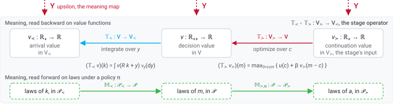

</div>

<div class="gloss">The arrival block, where <em>y</em> is drawn before the decision, fixes the date at which the shock enters the law of <em>m</em>. The file fixes the household's own shock only. An aggregate policy shock of the kind on slide 11 is no part of this stage.</div>

<div class="footnote">The operators follow the Bellman calculus, Illustrative example §2 and Fields, functions and types §4 (bellman-ddsl/docs). The calculus writes 𝖬<sub>p</sub> for the probability measures on the state space X<sub>p</sub> (Fields, functions and types §4), whereas the deck writes 𝒫 so that the letter M names only the forward operators. The dating of the shock: Bellman-SYM, Perch tagging rules §3.</div>


---

<!-- slide 48 · How the stage file refuses or makes visible the two readings of the expectation -->

<!-- _header: 'Appendix &middot; [return to slide 24](#economics-what-the-stage-file-refuses-or-makes-visible)' -->
<style scoped>
.stack > div { padding: 0.45em 0 0.5em 0; border-top: 1px solid var(--ark-line); font-size: 19px; line-height: 1.45; }
.stack > div:first-child { border-top: none; padding-top: 0.1em; }
.stack .katex-display { margin: 0.3em 0 0.35em 0 !important; }
.stack p { margin: 0; }
.stack code { font-size: 15px; }
</style>

## How the stage file refuses or makes visible the two readings of the expectation

<div class="sub">Each reading of slide 40 is set beside the construct that refuses it or the line that shows it.</div>

<div class="stack">
<div>

<span class="lbl">The elaborator refuses a shock read beside its own expectation, whereas a shock replaced by its mean stands as a visible line.</span> Υ (upsilon) interprets `y ~ LogNormal(μ_y, σ_y)`, `m = R*k + y` and `V[<] = E_{y}(V)` as
$$(\mathbb{T}_\prec v)(k)=\int v(Rk+y)\,\nu_y(\mathrm{d}y),\qquad y \text{ bound by the block, } \nu_y \text{ the declared law.}$$
Since an arrival value may depend only on what is known at arrival, where $y$ is not yet drawn, the line `V[<] = E_{y}(V) + y` cannot define one. The elaborator, the program that constructs the typed object from a file or refuses the file, refuses that line under the rule `shock-reintroduced`, since a shock that an expectation has integrated cannot appear again beside that expectation in a backward function. The other version of this reading, $y'$ replaced by its mean, cannot be written in this block either, since the elaborator refuses an expectation inside a transition under the rule `transition-without-expectation`. The mean enters only as a different transition line, $m=Rk+\exp(\mu_y+\sigma_y^2/2)$, which elaborates, that is, which the elaborator accepts, and stands visible.

</div>
<div>

<span class="lbl">Since no block holds both the draw and the choice, the expectation cannot move through the maximization.</span> Next period's income is drawn in the next stage, after this stage's choice, which therefore cannot respond to it. The choice block `policy` lists `V[>]`, a function of savings, and no shock, which leaves $\mathbb{E}\max$ no block to be written in. A model in which a choice follows a draw declares the draw before the choice, an order the file then shows.

</div>
</div>

<div class="footnote">Bellman-SYM, Field equations §5, Perch tagging rules §3; the reference on refusals, rules shock-reintroduced (the line refused on 13 October 2026 with <em>y</em> listed among the block's inputs, whereas with <em>y</em> unlisted the rule signature-complete refuses it first) and transition-without-expectation (the mean inside the transition); the mean as a parameter in the transition elaborated the same day; Periods §3.1; bellman-ddsl wiki, Υ §1 (the elaborator).</div>


---

<!-- slide 49 · How the Bellman calculus refuses a number for a function and a function on the wrong space -->

<!-- _header: 'Appendix &middot; [return to slide 24](#economics-what-the-stage-file-refuses-or-makes-visible)' -->
<style scoped>
.stack > div { padding: 0.45em 0 0.5em 0; border-top: 1px solid var(--ark-line); font-size: 19px; line-height: 1.45; }
.stack > div:first-child { border-top: none; padding-top: 0.1em; }
.stack .katex-display { margin: 0.3em 0 0.35em 0 !important; }
.stack p { margin: 0; }
.stack code { font-size: 15px; }
</style>

## How the Bellman calculus refuses a number for a function and a function on the wrong space

<div class="sub">Each reading of slide 41 is set beside the construct that refuses it.</div>

<div class="stack">
<div>

<span class="lbl">A field is a function on its declared space, never a number.</span> Given the declaration `m : ℝ₊₊ @ !dcsn` of a set and an information set, Υ (upsilon) interprets `V = 𝑢(c) + β*V[>]` as
$$v(m)=u\big(c(m)\big)+\beta\,v_\succ\big(m-c(m)\big)\qquad\text{for every } m\in\mathbb{R}_{++},\ \ v_\succ \text{ on savings.}$$
A realized $\hat m_t$, having no form in the file, never enters the backward operators of slide 47, those on value functions. The laws of $k$ and $m$ enter only the forward operators, those on probability measures, which leaves the solver a single input, $v_\succ\in\mathsf{V}_\succ$, a function on the space the file declares.

</div>
<div>

<span class="lbl">The elaborator refuses a continuation value listed at the decision perch.</span> Since `V[>] : ℝ @ !vlu` is listed at the continuation perch, whose state is `a : ℝ₊`, under Υ it denotes $v_\succ:\mathbb{R}_+\to\mathbb{R}$, a function of savings. A file that lists `V[>]` in a block header's list marked `!dcsn`, one of the two lists slide 46 shows, is refused under the rule `field-perch`, which requires that every listed field have one perch and that its mark, its side of the header and its role agree. A continuation value on resources therefore cannot be written.

</div>
</div>

<div class="footnote">Bellman-SYM, Stages §§2–4 and Appendix C (a field denotes a function of the state of its perch); the reference on refusals, rule field-perch, with its example of <code>V[&gt;]</code> listed on a side marked <code>!dcsn</code>; Bellman calculus, Introduction §§1–2 and Illustrative example §1 (bellman-ddsl/docs).</div>


---

<!-- slide 50 · Composition, and the discount once -->

<!-- _header: 'Appendix &middot; [return to slide 24](#economics-what-the-stage-file-refuses-or-makes-visible)' -->
<style scoped>
.stack > div { padding: 0.45em 0 0.5em 0; border-top: 1px solid var(--ark-line); font-size: 19px; line-height: 1.45; }
.stack > div:first-child { border-top: none; padding-top: 0.1em; }
.stack .katex-display { margin: 0.3em 0 0.35em 0 !important; }
.stack p { margin: 0; }
.stack code { font-size: 15px; }
</style>

## Composition, and the discount once

<div class="sub">The readings of slide 42 are set beside the construct that admits one composition only and the lines that show a second discount.</div>

<div class="stack">
<div>

<span class="lbl">Builders, the operators the blocks denote, are typed and compose in one order only.</span> Υ (upsilon) interprets the block `cntn_to_dcsn`, together with `policy`, as the choice operator, the block `dcsn_to_arvl` of slide 46 as the expectation operator, and the stage as their composition,
$$\mathbb{T}_\succ:\mathsf{V}_\succ\to\mathsf{V},\qquad \mathbb{T}_\prec:\mathsf{V}\to\mathsf{V}_\prec,\qquad \mathbb{T}_\prec\circ\mathbb{T}_\succ:\mathsf{V}_\succ\to\mathsf{V}_\prec,$$
the only composition the types admit within the stage.

</div>
<div>

<span class="lbl">The discount and the expectation each appear once, with any second copy visible on its own line.</span> `β` appears in the objective of the choice step, $u(c)+\beta\,v_\succ$, and not in the expectation block `V[<] = E_{y}(V)`. Because a connector, the entry `{a: k}` of the trellis file (slide 52, where that file lists the model's periods), identifies the continuation state of one stage with the arrival state of the next and performs no calculation, a join cannot produce $\beta^2$ or a second $\mathbb{E}_y$. A file that also writes `β` in the expectation block elaborates, with the second `β` standing on its own line. The objective is written twice, in the value equation and in the block `policy`. The elaborator lets the two differ, since the quasi-hyperbolic household of Laibson (1997) chooses under $\beta\delta$ and values under $\delta$, which leaves the modeler, not the elaborator, to keep them in agreement.

</div>
</div>

<div class="footnote">Bellman-SYM, Stages §§2–4, Field equations §§1 and 5, Periods §§2–3, the wiki entry connector; Bellman calculus, Introduction §§1–2; a file with β in the expectation block and one with the policy objective <code>𝑢(c) + V[&gt;]</code> both elaborated on 13 October 2026; the closure: Stages §4; Laibson (1997), "Golden eggs and hyperbolic discounting", <em>Quarterly Journal of Economics</em> 112(2), 443–477.</div>


---

<!-- slide 51 · The stationary closure -->

<!-- _header: 'Appendix &middot; [return to slide 24](#economics-what-the-stage-file-refuses-or-makes-visible)' -->
<style scoped>
.stack > div { padding: 0.45em 0 0.5em 0; border-top: 1px solid var(--ark-line); font-size: 19px; line-height: 1.45; }
.stack > div:first-child { border-top: none; padding-top: 0.1em; }
.stack .katex-display { margin: 0.3em 0 0.35em 0 !important; }
.stack p { margin: 0; }
.stack code { font-size: 15px; }
</style>

## The stationary closure

<div class="sub">The last reading of slide 42, beside the lines that show it.</div>

<div class="stack">
<div>

<span class="lbl">Since the continuation input comes from outside the stage, a stationary closure, the condition $v_{t+1}=v_t$, is visible.</span> The next period or the terminal boundary data supplies `V[>]`, which leaves $v_{t+1}=v_t$ a condition the modeler adds and the stage does not impose. The trellis file of slide 52 sets the horizon at fifty periods, with a stationary closure written in none of the files.

</div>
</div>

<div class="footnote">Bellman-SYM, Stages §4 (the closure) and Trellises §2 (the terminal value as boundary data); Bellman calculus, Introduction §§1–2.</div>


---

<!-- slide 52 · The period file and the trellis file -->

<!-- _header: 'Appendix &middot; [return to slide 24](#economics-what-the-stage-file-refuses-or-makes-visible)' -->
<style scoped>
.cols { grid-template-columns: 1fr 1.25fr; gap: 1.6em; align-items: start; }
.cols pre { font-size: 14px; line-height: 1.4; margin: 0.4em 0 0.8em 0; }
.small { font-size: 18px; line-height: 1.5; }
.small p { margin: 0 0 0.6em 0; }
.small code { font-size: 14px; }
</style>

## The period file and the trellis file

<div class="sub">The period file places the stage file of slide 45 in a period, which the trellis file repeats and joins. The two files and the boundary data, not the stage, supply <code>V[&gt;]</code>.</div>

<div class="cols">
<div>

```yaml
# period.yml
!period
name: buffer_stock_period
stages:
  - buffer_stock
connectors: []
```

```yaml
# trellis.yml
!trellis
name: buffer_stock_life_cycle
periods:
  - {template: period.yml, repeat: 50}
inter_connectors:
  - {a: k}
```

</div>
<div class="small">

The period lists one stage and no within-period connector. The trellis, the sequence of a model's periods counted backward from the terminal one, repeats the period fifty times. The inter-period connector `{a: k}` states that the savings `a` that leave one period are the assets `k` that enter the next, with no calculation. Since a stage file has no time index and is listed by name, one file serves every period that lists it.

The terminal period's `V[>]` is boundary data that neither file states and that Ρ (rho) receives when it constructs the numerical problem. A bequest motive is a stage of the terminal period, as the durables model of the language's documentation writes it, which the comparator of slide 34 therefore reads. Only the continuation value after the last decision, zero for that model, stays outside the files, which makes two trellises that differ only in that constant one object to the comparator. A stationary closure has no entry in either file, since the horizon is the number of periods the trellis lists.

</div>
</div>

<div class="footnote">Bellman-SYM, Periods §§1–2, Trellises §§1.1, 2 and 4 (the backward count, a stage file carries no index, the inter-period connector, the terminal value as boundary data), The Bellman factory §3.5 (the bequest is a stage); a two-period trellis of the file of slide 45 joined by <code>{a: k}</code> elaborated on 13 October 2026; bellman-ddsl wiki, judge §4 (the comparator's items); Bellman calculus, Periods and the trellis §4.</div>


---

<!-- slide 53 · The Bellman calculus and the Bellman operator -->

<!-- _header: 'Appendix &middot; [return to slide 24](#economics-what-the-stage-file-refuses-or-makes-visible)' -->
## The Bellman calculus and the Bellman operator

The paper's operator and the stage operator compose the same two parts, the expectation $\mathbb{T}_\prec$ and the choice $\mathbb{T}_\succ$:
$$\begin{aligned}
&\text{the paper:}&& \mathbb{T}=\mathbb{T}_\succ\circ\mathbb{T}_\prec:\mathsf{V}\to\mathsf{V}, && \text{the expectation, then the choice, across the period boundary;}\\
&\text{the stage operator:}&& \mathbb{T}_\prec\circ\mathbb{T}_\succ:\mathsf{V}_\succ\to\mathsf{V}_\prec, && \text{the choice, then the expectation, within the stage;}\\
&\text{the identification:}&& v_\prec\ \text{of period } t+1 \ \text{is}\ v_\succ\ \text{of period } t, && \text{since } k_{t+1}=a_t.
\end{aligned}$$
The two compositions differ only in where the period boundary falls. Υ (upsilon) interprets the typed file as the stage composition $\mathbb{T}_\prec\circ\mathbb{T}_\succ$, to each part of which Ρ (rho) attaches a numerical method. The continuation input comes from outside the stage, from the next period or a terminal boundary.

<div class="sp-s"></div>

The elaborator refuses the readings that the file's types and blocks do not admit. The others, the mean of the shock in the transition and the second discount and stationary closure of slide 50, stand visible as lines the modeler must write, as explicit binding leaves them in a proof assistant such as Lean. The file proves nothing about the analysis. That the states suffice, that the integrals are finite, that a maximizer is measurable and that $\mathbb{T}$ has a unique fixed point remain theorems, stated and proved by the economist.

<div class="footnote">Bellman calculus, Introduction §§1–2, Illustrative example §2 (the boundary identity <em>k</em><sub><em>t</em>+1</sub> = <em>a</em><sub><em>t</em></sub> and the supply of the continuation input) and Stages and perches §1 (bellman-ddsl/docs/bellman-calculus).</div>


---

<!-- slide 54 · How an AI works with a semantic ontology (divider) -->

<!-- _class: divider sub -->

<p class="eyebrow">Appendix</p>

# How an AI works with a semantic ontology


---

<!-- slide 55 · The AI writes against the ontology -->

<!-- _header: 'Appendix &middot; [return to slide 4](#semantic-ontology)' -->

<style scoped>
.center img { margin: 0 auto; display: block; }
.stack > div { padding: 0 0 0.6em 0; font-size: 17.5px; line-height: 1.42; }
.stack > div:last-child { padding-bottom: 0; }
.stack p { margin: 0; }
.stack code { font-size: 14px; }
</style>

## The AI writes against the ontology

<div class="center">

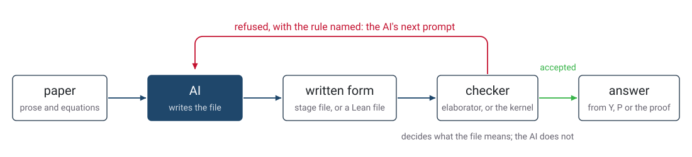

</div>

<div class="stack">
<div>

<span class="lbl">Autoformalization.</span> The AI translates the paper into the written form, and the checker accepts or refuses the result (Wu et al. 2022; AlphaProof, Hubert et al. 2025, which learned by reinforcement with Lean's kernel as the verifier).

</div>
<div>

<span class="lbl">Refuse and repair.</span> The checker's refusal, with its rule named, is the AI's next prompt, as a proof assistant's error message is in Baldur (First et al. 2023). The elaborator's rules `shock-reintroduced` and `field-perch` are messages of this kind.

</div>
<div>

<span class="lbl">Constrained generation.</span> The AI's output is restricted at decoding time to the grammar of the written form, so that only its meaning remains to be checked (Poesia et al. 2022; Geng et al. 2023).

</div>
<div>

<span class="lbl">Compute, then answer.</span> From the accepted file the ontology's programs compute, Υ the object and Ρ the numbers, or the kernel the proof, and the AI's answer to the user is built from that output rather than from its own guess.

</div>
<div>

<span class="lbl">Round trip.</span> A second program writes the accepted object back into prose, and a judge compares that prose with the paper (Li et al. 2024; Allamanis et al. 2024). Matsya's architect mode runs this loop with the elaborator and two judges.

</div>
</div>

<div class="footnote">Wu, Jiang, Li, Rabe, Staats, Jamnik and Szegedy (2022), "Autoformalization with large language models", <em>NeurIPS 2022</em>, 32353–32368 &middot; Hubert, Mehta, Sartran et al. (2025), <em>Nature</em> 651, 607–613 &middot; First, Rabe, Ringer and Brun (2023), "Baldur: whole-proof generation and repair with large language models", <em>ESEC/FSE 2023</em>, 1229–1241 &middot; Poesia et al. (2022), "Synchromesh", <em>ICLR 2022</em>; Geng, Josifoski, Peyrard and West (2023), "Grammar-constrained decoding for structured NLP tasks without finetuning", <em>EMNLP 2023</em>, 10932–10952 &middot; Li, Wu, Li, Wei, Yang, Zhang and Ma (2024), "Autoformalize mathematical statements by symbolic equivalence and semantic consistency", <em>NeurIPS 2024</em>, 53598–53625; Allamanis, Panthaplackel and Yin (2024), "Unsupervised evaluation of code LLMs with round-trip correctness", <em>ICML 2024</em>, PMLR 235, 1050–1066 &middot; Matsya's architect mode: bellman-ddsl, terminology, 9 October 2026.</div>


---

<!-- slide 56 · The AI reads from the ontology -->

<!-- _header: 'Appendix &middot; [return to slide 4](#semantic-ontology)' -->

<style scoped>
.center img { margin: 0 auto; display: block; }
.stack > div { padding: 0 0 0.6em 0; font-size: 19px; line-height: 1.42; }
.stack > div:last-child { padding-bottom: 0; }
.stack p { margin: 0; }
.stack code { font-size: 14px; }
</style>

## The AI reads from the ontology

<div class="stack">
<div>

<span class="lbl">Retrieval over typed objects.</span> The AI answers from terms, definitions and relations retrieved from the ontology, each with a stated meaning, rather than from passages of text (Pan et al. 2024; Edge et al. 2024). Matsya's retrieval over the project's typed documents is this.

</div>
<div>

<span class="lbl">Training on generated pairs.</span> The ontology generates pairs of a file and its prose, or the comparator labels two files as one object or as two, and the AI is trained on the pairs. AlphaProof's roughly one million natural-language problems, auto-formalized into about 80 million formal statements, are the largest instance, and the project's comparator module, <code>meaning_map_training</code>, is named for this use.

</div>
<div>

<span class="lbl">What separates the two groups.</span> In the five uses of the previous slide the checker, not the AI, decides what the file means, so the AI's reading can be inspected. In these two the AI's reading improves but stays statistical, which is why they do not replace the checker.

</div>
</div>

<div class="footnote">Pan, Luo, Wang, Chen, Wang and Wu (2024), "Unifying large language models and knowledge graphs: a roadmap", <em>IEEE Transactions on Knowledge and Data Engineering</em> 36(7), 3580–3599 &middot; Edge et al. (2024), "From local to global: a graph RAG approach to query-focused summarization", arXiv:2404.16130 &middot; Hubert, Mehta, Sartran et al. (2025), <em>Nature</em> 651, 607–613, on the auto-formalized training problems &middot; <code>meaning_map_training.compare</code>: bellman-ddsl.</div>
